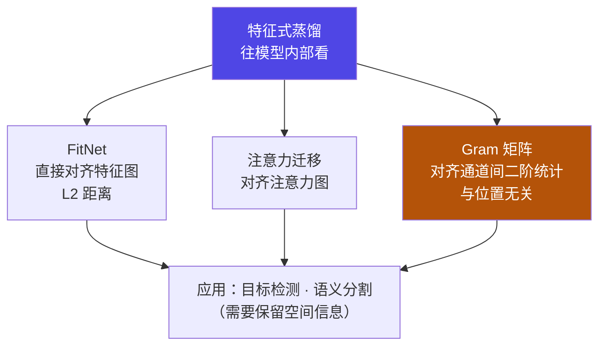
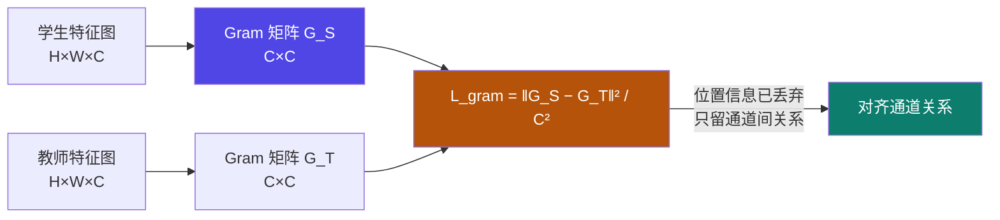

# 5-4 · 特征式蒸馏（Feature-Based）

::: info 难度分层 · 本页 = L2（机制层）
L2 能说出三种特征式方法的对齐对象（特征图 / 注意力图 / Gram 矩阵）与各自适用场景。
:::

## 定位

[5-3](/training/p5/03-response) 只看教师的**最终输出**——信息量最少。
特征式蒸馏往模型**内部**看：对齐**中间层特征图**，实现"更细粒度的知识迁移"。

本页解决：**往内部看，有哪三种看法？各自对齐什么？**

## (1) 特征式蒸馏的总思路

> 通过匹配**中间层特征图**实现**更细粒度**的知识迁移。

三种方法：

| 方法 | 原文说明 | 捕捉什么 |
|---|---|---|
| **特征图匹配（FitNet）** | 直接匹配特征图的 **L2 距离** | 特征值的**绝对位置与大小** |
| **注意力迁移**（attention_transfer）| 匹配教师与学生模型的**注意力图** | 模型"**看哪里**" |
| **Gram 矩阵匹配** | 捕捉特征间的**二阶统计信息** | 通道之间的**关系**（与位置无关）|

应用场景：

> 适用于需要**保留空间信息**的任务（如**目标检测、语义分割**）。

::: tip 为什么这三种都强调"空间信息"
图像类任务里，"**哪个位置有什么**"本身就是知识。
- FitNet 连位置带数值一起学；
- 注意力迁移学"该关注哪块区域"；
- Gram 矩阵**故意丢掉位置**，只学"纹理/风格层面的通道关系"（这也是风格迁移用 Gram 的原因）。
所以讲义把应用场景定在**目标检测 / 语义分割**——它们最吃空间信息。
:::

## (2) FitNet · 特征图匹配

页面标题为"a) 特征图匹配（FitNet）"，正文为两张图："**FitNet 算法原理**"与"**FitNet 损失函数**"。

::: danger ⚠ 源材料缺口提示（L4 P12）
L4 P12 的 FitNet 算法原理与损失函数**均为图片**，无可提取文字。
本站**不编造公式**。可确认的信息只有（来自 L4 P11）：**FitNet 直接匹配特征图的 L2 距离**。
有可运行/可引用内容的是 **Gram 矩阵（P14 有公式）** 与 [5-9](/training/p5/09-practice) 的实战代码。
:::

**能确定的部分**（L4 P11 + P12 交叉）：FitNet 的损失就是**学生特征图与教师特征图的 L2 距离**。若教师与学生特征图维度不一致，需要加一层映射（原文未展开）。

## (3) 注意力迁移（Attention Transfer）

页面标题为"b) 注意力迁移（attention_transfer）"，**该页无可提取文字内容**（应为示意图页）。

**能确定的部分**（来自 L4 P11）：注意力迁移匹配的是**教师与学生模型的注意力图**。

::: warning 注意讲义术语拼写
原文写作 `attention_trasnfer`（**系原文拼写**，标准拼写应为 `attention_transfer`）。
本站保留原文标注，此处提示以免读者检索时困惑。
:::

## (4) Gram 矩阵匹配

给出了本页唯一可提取的公式：

> Gram 矩阵用于度量**各个维度自己的特性**以及**各个维度之间的关系**。
> Gram 矩阵损失：
>
> > `L_gram = MSE(G_S, G_T) = ‖ G_S − G_T ‖² / (C²)`
>
> **不关心学生和老师的特征激活在哪个具体位置，只关心它们的通道间关系是否一致**。

| 符号 | 含义（按原文表述）|
|---|---|
| `G_S` / `G_T` | 学生 / 教师的 Gram 矩阵 |
| `‖ · ‖²` | L2 距离的平方 |
| `C²` | 归一化因子（**C = 通道数**，即 Gram 矩阵的维度）|

::: tip Gram 矩阵为什么"与位置无关"
Gram 矩阵是特征图在**通道维度**上做内积：`G[i][j] = Σ_{h,w} F[h,w,i] · F[h,w,j]`。
求和已经把 `(h, w)` 这个空间维度**加掉**了，所以结果只保留"**通道 i 和通道 j 有多相关**"。
这就是原文说的"不关心激活在哪个具体位置，只关心通道间关系"。
:::

## 三种特征式方法对照

| 维度 | FitNet | 注意力迁移 | Gram 矩阵 |
|---|---|---|---|
| 对齐对象 | 特征图本身 | 注意力图 | 通道间 Gram 矩阵 |
| 距离度量 | **L2 距离** | 原文未给 | `MSE / C²` |
| 保留位置信息 | **是** | 是（注意力即位置权重）| **否**（已求和掉）|
| 对大模型友好度 | 低（维度需匹配）| 低 | 中（可跨层/跨维度比较）|
| 原文完整度 | 仅图片 | 仅图片 | **有公式** ✅ |

::: warning 大模型场景下的硬约束
FitNet / 注意力迁移都要求教师与学生**存在可对齐的中间层、且特征维度可比**。
大模型与小模型的层数、隐藏维度通常**都不一致** —— 这正是 [5-7](/training/p5/07-challenges) 列为挑战二的"**无法对齐中间层**"。
**所以本课程实战（[5-9](/training/p5/09-practice)）走的是响应式（输出对齐），不是特征式。**
:::

## 坑与自检

> ✕ 在大模型蒸馏里默认用 FitNet / 注意力迁移。

> ✓ 特征式要求"层能对齐、维度可比"；大小模型不满足时做不了 → 改用响应式。

> ✕ 以为 Gram 矩阵和 FitNet 是一回事。

> ✓ FitNet 保留位置、比数值；Gram **丢位置**、比通道关系。

> ✕ 把 `L_gram` 的 `C²` 当成随便写的常数。

> ✓ `C` 是通道数，`C²` 是归一化因子（Gram 矩阵是 `C×C`，共 `C²` 个元素）。

**自检清单**：

- [ ] 我能说出特征式蒸馏"往内部看"的总思路
- [ ] 我能列出三种方法并对齐到各自对象
- [ ] 我知道特征式的应用场景是**需要保留空间信息**的任务
- [ ] 我能写出 Gram 矩阵损失公式并解释 `C²`
- [ ] 我能解释 Gram 为什么"与位置无关"
- [ ] 我知道 L4 P12 / P13 的内容是图片、无文字，本站未编造
- [ ] 我知道大模型场景下特征式难以落地（无法对齐中间层）

---

> 上一节：[5-3 响应式蒸馏](/training/p5/03-response) ｜ 下一节：[5-5 关系式蒸馏](/training/p5/05-relation)
