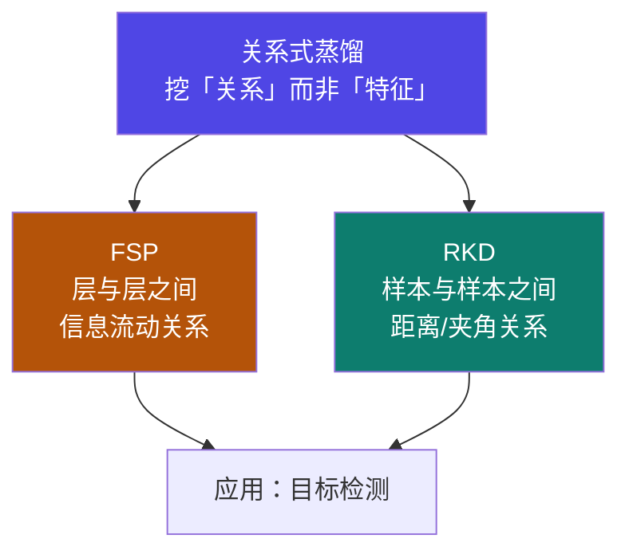
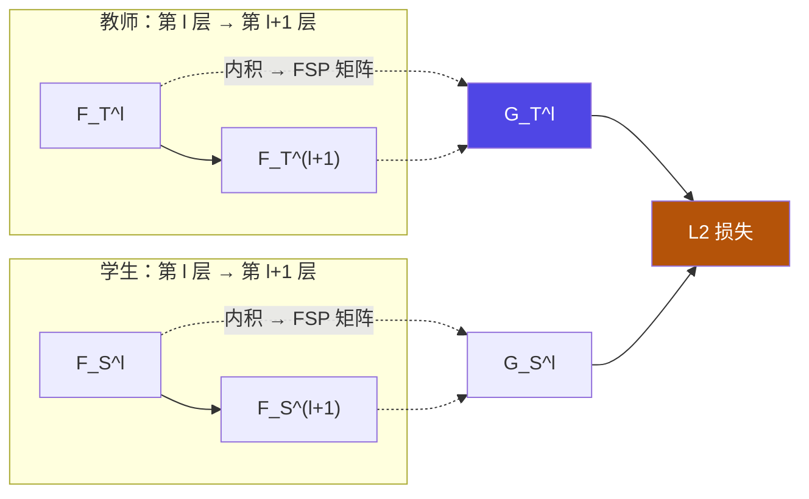
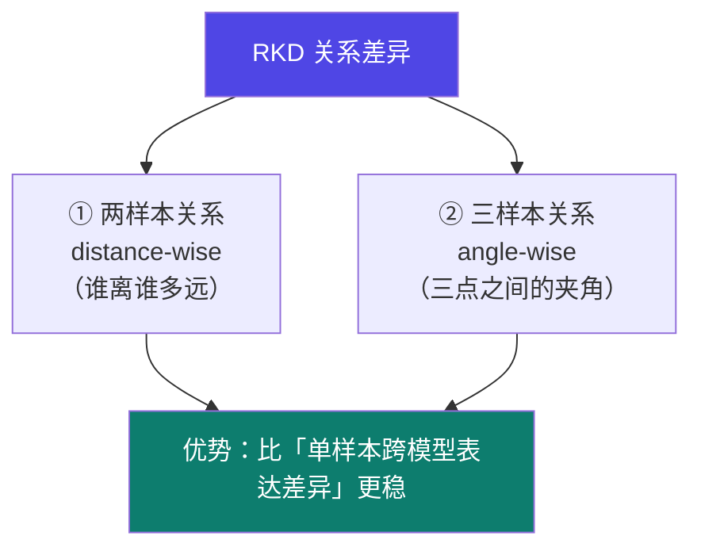

# 5-5 · 关系式蒸馏（Relation-Based）

::: info 难度分层 · 本页 = L2（机制层）
L2 能说出关系式蒸馏"挖关系"的思路，以及 FSP 与 RKD 各自构建什么关系矩阵。
:::

## 定位

[5-4](/training/p5/04-feature) 比的是"**单个特征**"；关系式蒸馏再进一步——比的是"**关系**"。
本页解决：**什么叫"关系"？FSP 和 RKD 各构建哪一种关系？**

## (1) 关系式蒸馏的总思路

> 通过**挖掘样本间的关系**进行蒸馏。
> 重点是捕捉**样本之间**或**特征层之间**关系，通过计算**关系矩阵的差异损失**来指导蒸馏过程。

给出的两个代表算法：

| 代表算法 | 构建什么关系矩阵 |
|---|---|
| **FSP** | **教师和学生特征层之间**关系矩阵（层 ↔ 层 的信息流动）|
| **RKD** | **教师和学生各样本特征**关系矩阵（样本 ↔ 样本）|

应用场景：

> **目标检测**。

::: tip 为什么"关系"比"特征"更值钱
同一个特征在不同模型里可能**数值完全对不上**（因为尺度、通道定义都不一样），直接比会失败。
但"**A 和 B 谁离谁更近**"这种**相对关系**，往往在两个模型里是一致的。
RKD 原文有一句话点破了这点（见下）：「**样本之间关系差异优于单个样本在不同模型的表达差异**」。
:::

## (2) FSP 算法（Flow of solution procedure）

| 要点 | 原文 |
|---|---|
| 构建 | **教师和学生特征层之间**关系矩阵 |
| 知识定义 | **层与层间信息流动**定义为需要蒸馏的知识（**FSP 矩阵**）|
| 怎么算 | 通过计算**两个特征层间内积**来得到这种知识 |
| 损失 | 计算教师网络和学生网络**对应 FSP 矩阵的 L2 损失** |

::: warning ⚠ 源材料缺口（L4 P16）
原文最后一句为"**完整损失函数如下**"，其后的损失函数式为**图片**，无可提取文字。
本站**不编造该式**。可确认的是：FSP 的损失是"**对应 FSP 矩阵的 L2 损失**"。
:::

## (3) RKD 算法（Relational Knowledge Distillation）

| 要点 | 原文 |
|---|---|
| 构建 | 构建 **batch 内**教师和学生**各样本特征之间**的关系矩阵 |
| 核心判断 | **样本之间关系差异优于单个样本在不同模型的表达差异** |
| 关系差异包含 ① | **两个样本**之间的关系差异 |
| 关系差异包含 ② | **三个样本**之间的夹角差异 |

::: tip 两样本 vs 三样本：一个直观解释
- **两样本（距离）**：`‖f(a) − f(b)‖`。学的是"**a 和 b 有多像**"。
- **三样本（夹角）**：向量 `f(b) − f(a)` 与 `f(c) − f(a)` 之间的夹角。学的是"**从 a 出发，b 和 c 在哪个方向**"。
夹角对**尺度不敏感**——哪怕学生整体特征值都偏小，只要"方向结构"对，就能被对齐。
这比直接比特征数值**鲁棒得多**，也是原文说"关系差异优于单样本表达差异"的原因。
:::

::: warning ⚠ 源材料说明（L4 P17）
原文在"两个样本之间的关系差异"与"三个样本之间的夹角差异"之间**留有空行**（应为示意图/公式图），
且未给出 RKD 的损失函数式。上述"两样本/三样本"的展开解释为 **【推断】**，用于帮助理解，非讲义原文。
:::

## 三种白盒蒸馏对照（合并回顾）

| 维度 | 响应式（[5-3](/training/p5/03-response)）| 特征式（[5-4](/training/p5/04-feature)）| 关系式（本页）|
|---|---|---|---|
| 对齐对象 | 最终输出 logits | 中间层特征图/注意力/Gram | **关系矩阵**（层间 / 样本间）|
| 代表算法 | KL 散度对齐 | FitNet / AT / Gram | **FSP / RKD** |
| 刻画的是 | "答案" | "长什么样" | "**彼此的关系**" |
| 应用场景 | 分类任务 | 目标检测、语义分割 | 目标检测 |
| 大模型落地难度 | **最低** ✅ | 高（要对齐中间层）| 高 |
| 本课程实战 | ✅ **5-9 用的就是它** | 概念层 | 概念层 |

## 坑与自检

> ✕ 把关系式蒸馏当成"特征式的另一种叫法"。

> ✓ 特征式比的是**特征本身**，关系式比的是**特征之间的关系**（层间流动 / 样本间距离与夹角）。

> ✕ 以为 RKD 只需要两个样本。

> ✓ RKD 的两种关系：**两样本（距离）** 与 **三样本（夹角）**。

> ✕ 认为三种白盒难度相当、可任选。

> ✓ 大模型场景下**只有响应式最易落地**；特征式/关系式需要"层能对齐"。

**自检清单**：

- [ ] 我能说出关系式蒸馏"挖关系"的核心思路
- [ ] 我知道 FSP 构建的是**层与层之间**的关系（内积 → 关系矩阵）
- [ ] 我知道 RKD 构建的是**样本与样本之间**的关系
- [ ] 我能说出 RKD 的两种关系（两样本距离 / 三样本夹角）
- [ ] 我能解释"关系差异优于单样本跨模型差异"的原因
- [ ] 我知道应用场景是目标检测
- [ ] 我知道 L4 P16 的损失函数式与 P17 的示意图为图片，本站未编造

---

> 上一节：[5-4 特征式蒸馏](/training/p5/04-feature) ｜ 下一节：[5-6 演进方向](/training/p5/06-evolution)
