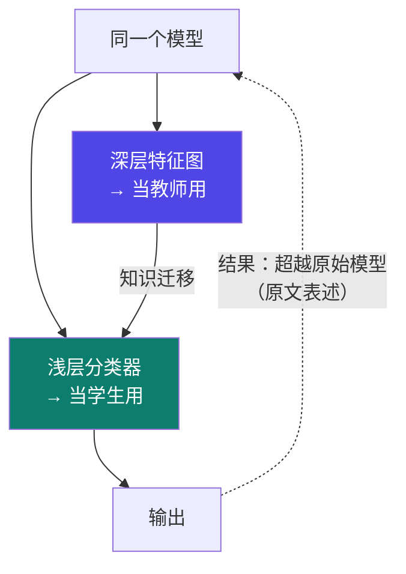
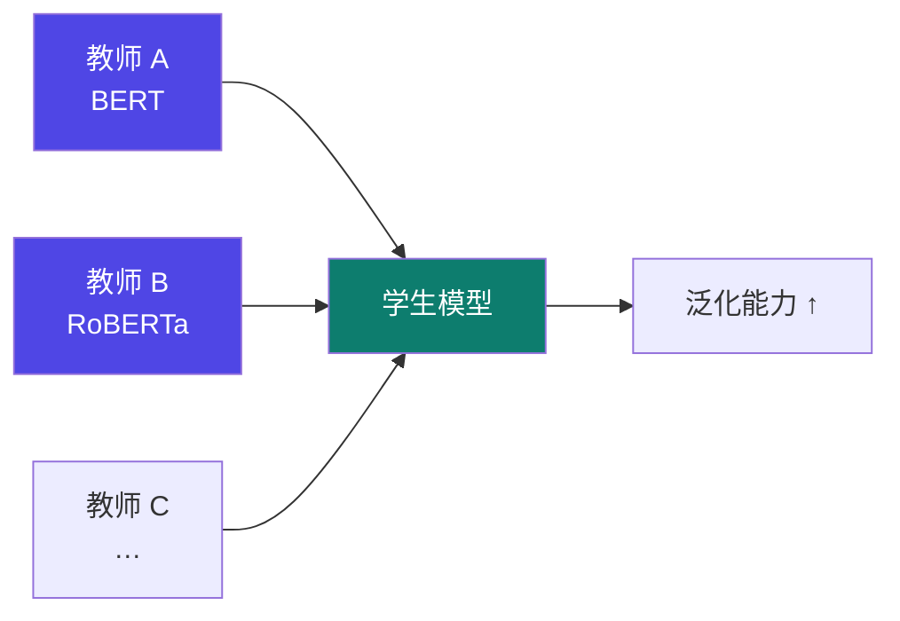
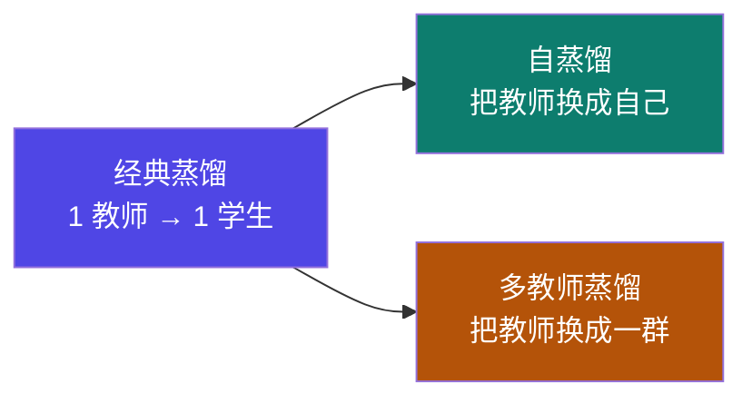

# 5-6 · 蒸馏技术的演进方向

::: info 难度分层 · 本页 = L1（概念层）
L1 能说出自蒸馏与多教师蒸馏各自"多/少了什么"。
:::

## 定位

[5-3](/training/p5/03-response) ~ [5-5](/training/p5/05-relation) 讲的都是"**教师给学生**"这一经典范式。
本页讲两个把它**松开一格**的演进方向：**不要外部教师（自蒸馏）** 与 **要多个教师（多教师蒸馏）**。

## (1) 自蒸馏（Self-Distillation）

> 只有学生模型，学生模型在**向自己学习**后，能够**超越原始模型的性能**。
> **浅层的分类器**可以当做学生模型，**最深层次的特征图**当做教师模型输出。

| 项 | 说明 |
|---|---|
| 教师 | **模型自己**（更深的层）|
| 学生 | **模型自己**（更浅的分类器）|
| 收益 | 学完之后**超越原始模型** |

::: tip 自蒸馏"妙"在哪
传统蒸馏需要一个**外部的大教师**；自蒸馏不需要——它把**同一个模型的深层 → 浅层**当作"教师 → 学生"。
好处：**不依赖外部模型、不增加推理成本**（因为推理时还是同一个模型）。
原文强调的收益很反直觉：**学生向自己学习，最后能超过原来的自己**。
:::

## (2) 多教师蒸馏（Multi-Teacher Distillation）

> 结合**多个教师模型**的知识，提升学生模型的泛化能力。
> 例如，微软的 **MKD（Multi-Knowledge Distillation）** 框架同时利用 **BERT、RoBERTa** 等模型的知识。

| 项 | 说明 |
|---|---|
| 教师 | **多个**（BERT、RoBERTa…）|
| 学生 | 一个 |
| 收益 | **提升泛化能力** |
| 代表框架 | 微软 **MKD**（Multi-Knowledge Distillation）|

::: tip 多教师为什么能提升泛化
单个教师的"偏见"会被学生**继承**（教师的错误也是知识）。
多个教师各有各的强项与偏差 → 学生学到的是**共同/互补的部分**，相当于一种**集成**。
代价：**推理成本翻倍**（要跑多个教师），训练更复杂。
:::

## 两条演进线一览

| 维度 | 经典蒸馏 | 自蒸馏 | 多教师蒸馏 |
|---|---|---|---|
| 教师数量 | 1（外部）| **0（自己）** | **多个** |
| 学生 | 小模型 | 自己的浅层 | 小模型 |
| 代表 | [5-3](/training/p5/03-response)/[5-4](/training/p5/04-feature)/[5-5](/training/p5/05-relation) | 深层 → 浅层 | **MKD**（BERT + RoBERTa）|
| 核心收益 | 变小 + 提速 | **超越原始模型** | **泛化能力 ↑** |
| 额外成本 | 需要外部教师 | 无（推理同模型）| **推理成本高** |

## 坑与自检

> ✕ 以为自蒸馏"没有教师"= 没有蒸馏。

> ✓ 教师仍然存在，只是**换成了模型自己的深层**。

> ✕ 以为多教师蒸馏只是"多训几遍"。

> ✓ 它需要**同时对齐多个教师的输出**，是模型集成思想的一种体现。

> ✕ 以为多教师蒸馏"只有好处"。

> ✓ 训练与**推理成本**都会上升。

**自检清单**：

- [ ] 我能说清自蒸馏的"教师"和"学生"分别是谁
- [ ] 我知道自蒸馏的收益是"超越原始模型"
- [ ] 我能举出多教师蒸馏的代表框架（MKD）与教师（BERT / RoBERTa）
- [ ] 我知道多教师蒸馏的收益是"提升泛化能力"
- [ ] 我知道两者都把"教师"这个角色松开了

---

> 上一节：[5-5 关系式蒸馏](/training/p5/05-relation) ｜ 下一节：[5-7 大模型蒸馏的挑战](/training/p5/07-challenges)
