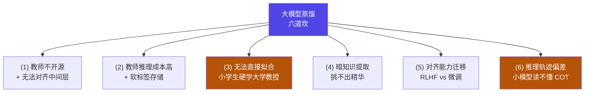

# 5-7 · 大模型特有的蒸馏挑战

::: info 难度分层 · 本页 = L2（问题层）
L2 能复述六大挑战，并说出每个挑战"卡在哪"。
:::

## 定位

[5-3](/training/p5/03-response) ~ [5-6](/training/p5/06-evolution) 讲的都是**方法**——它们成立的前提是"你能拿到教师的 logits、能对齐层、能拟合"。
但**大模型场景下这三条前提几乎全部不成立**。本页就是把这六道坎摊开：

> **为什么"经典蒸馏"搬到大模型上会水土不服？**

## 六大挑战

完整列表（原文编号与表述保留）：

| # | 挑战 | 原文关键句 |
|---|---|---|
| **(1)** | **好教师拿不到 / 对不齐** | 好的 Teacher 模型**不开源**；**无法对齐中间层** |
| **(2)** | **教师太贵 / 软标签存不下** | 教师模型**推理成本高**；**软标签存储问题** |
| **(3)** | **无法直接拟合** | **"小学生硬学大学教授"** |
| **(4)** | **"暗知识"的提取** | 如何从知识海洋中提取对学生模型**最有用精华部分** |
| **(5)** | **对齐能力的迁移** | **RLHF vs 微调迁移** |
| **(6)** | **推理轨迹偏差** | 大小模型**认知推理轨迹存在显著偏差**——小模型**难以理解大模型 COT 过程** |

## 逐条拆解

**(1) 好教师拿不到，也对不齐。** 两个问题叠在一起：
- **不开源**：最强的教师（GPT-4 级别）不给你权重，你连 logits 都拿不到 → 白盒蒸馏直接失效（只能走黑盒）。
- **无法对齐中间层**：即使拿到权重，大模型与小模型的**层数、隐藏维度都不同**（见 [5-4](/training/p5/04-feature) 的硬约束）→ 特征式/关系式做不了。

**(2) 教师太贵，软标签太占地方。**
- **推理成本高**：教师每生成一条数据都要跑前向；数据量一大，成本失控。
- **软标签存储**：教师输出的不是一个词，而是**整个词表的概率分布**。词表 15 万 × 每条样本长度 → 存储量天文数字。

**(3) 无法直接拟合 —— "小学生硬学大学教授"。** 这是最形象的一条：
学生的表达能力有上限，教师的输出**信息密度远超学生能吸收的量**。硬拟合会导致学生"学崩"或不收敛。

**(4) "暗知识"的提取。** 教师的知识是一片海洋，**哪一部分才对学生最有用**？挑不出来，就会把噪声也一起学进去。

**(5) 对齐能力的迁移。** 教师的"好"来自 **RLHF**（人类偏好对齐），不只是**微调**。这种"对齐能力"怎么迁移到学生身上，仍是难点。

**(6) 推理轨迹偏差。** 大模型的 **COT（思维链）** 是小模型**读不懂**的——推理步骤的复杂度超出了学生的理解能力。直接把教师的推理过程丢给学生，学生会"照着背但不会用"。

::: danger 这六条如何"串"成一句话
**(1)(2) 是"拿不到 / 拿不起"；(3)(4) 是"给了也学不会"；(5)(6) 是"学会了也不对"。**
正因为这六道坎，工业界普遍放弃"教科书式白盒蒸馏"，转向**数据驱动的混合路线** → [5-8](/training/p5/08-industry)。
:::

## 挑战 → 工业界的应对（前瞻）

| 挑战 | 工业界对策（详见 [5-8](/training/p5/08-industry)）|
|---|---|
| (1) 教师不开源 | 用 API 教师**生成数据**（黑盒路线）|
| (2) 推理成本高 / 软标签存储 | 只保留**文本结果**，不存全词表分布；用**难度筛选**少而精 |
| (3) 无法直接拟合 | **由浅到深**的渐进式蒸馏 |
| (4) 暗知识提取 | **知识纯度评估模块**做数据质检 |
| (5) 对齐能力迁移 | 学习模型输出 vs 人类标注；Base 蒸馏 vs Chat 蒸馏 |
| (6) 推理轨迹偏差 | 教师回答**精简**后再教；模型**自我蒸馏** |

## 坑与自检

> ✕ 以为"蒸馏方法选对了就能work"。

> ✓ 大模型蒸馏的瓶颈**不在方法，在前提**（拿不到教师 / 对不齐层 / 学生学不动）。

> ✕ 想直接对齐大模型与小模型的中间层。

> ✓ 两者维度不同，**对不上**——这就是挑战 (1) 的后半句。

> ✕ 把教师的完整推理链直接灌给学生。

> ✓ 小模型读不懂大模型 COT（挑战 6），需要**精简 / 改写**后再教。

**自检清单**：

- [ ] 我能完整复述六大挑战
- [ ] 我能解释"小学生硬学大学教授"指的是什么
- [ ] 我知道"软标签存储问题"为什么是问题（全词表分布）
- [ ] 我能说清挑战 (1) 的两个子问题（不开源 + 无法对齐）
- [ ] 我知道六大挑战可以归成三组（拿不到 / 学不会 / 学不对）
- [ ] 我知道工业对策要看 5-8

---

> 上一节：[5-6 演进方向](/training/p5/06-evolution) ｜ 下一节：[5-8 工业方案：DeepSeek 与 Qwen](/training/p5/08-industry)
