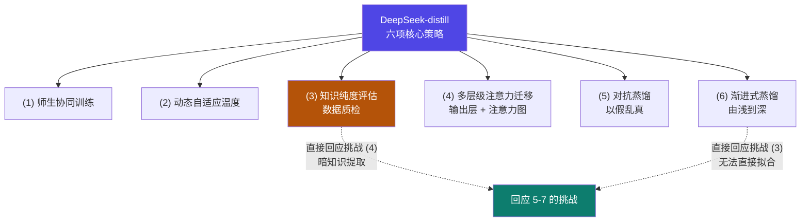
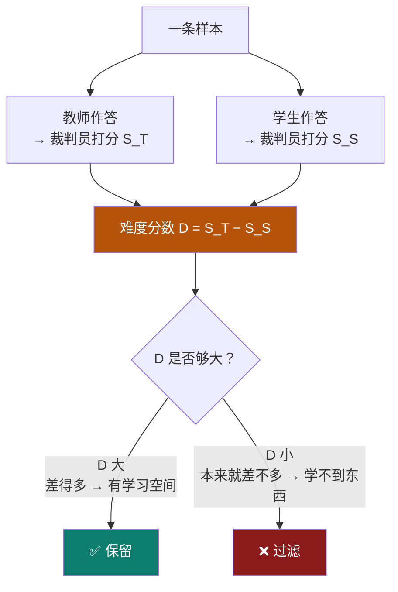

# 5-8 · 工业方案：DeepSeek 与 Qwen

::: info 难度分层 · 本页 = L2→L3（方案 → 决策层）
L2 能列出 DeepSeek 六项策略与 Qwen 的四组策略；L3 能讲清"难度打分筛选"的公式与过滤逻辑。★★
:::

## 定位

[5-7](/training/p5/07-challenges) 摆了六道坎。本页看**工业界怎么绕过去**——两家真实方案：
**DeepSeek-distill** 与 **Qwen-distill**。它们正是"黑盒/混合路线"的落地样本。

## (1) DeepSeek-distill

### 1.1 先定路线：训练路径即蒸馏路径

核心命题：

> **训练路径即蒸馏路径。**

| 选择维度 | 选项 |
|---|---|
| 学什么 | **学习模型输出** VS **学习人类标注** |
| 从哪开始 | **Base 模型蒸馏** VS **Chat 模型蒸馏** |

::: tip "训练路径即蒸馏路径"怎么理解
**你把什么喂给学生，学生就朝哪个方向长。**
- 学**模型输出** → 学生更像**教师**（但可能继承教师偏见）；学**人类标注** → 学生更像**人类偏好**。
- 从 **Base** 开始蒸馏 → 学到的是**基础能力**；从 **Chat** 开始 → 学到的是**对话/对齐后的行为**。

**所以"蒸馏方案"的第一步不是选算法，而是选数据从哪来、模型从哪切。**
:::

### 1.2 六项训练核心策略

| # | 策略 | 原文说明 |
|---|---|---|
| (1) | **Teacher-Student Model 协同训练架构** | 师生协同训练 |
| (2) | **动态自适应温度调节** | 温度随训练动态调整（原文未给调节公式）|
| (3) | **知识纯度评估模块** | 对**蒸馏数据做质检** |
| (4) | **多层级注意力迁移** | **输出层 + 注意力图** |
| (5) | **对抗蒸馏机制** | 让 Student 学会**以假乱真**的能力 |
| (6) | **渐进式蒸馏策略** | 特征学习"**由浅到深**" |



::: warning ⚠ 小注（L4 P22）
原文 (1)~(6) **未给任何超参、公式或实现细节**，仅列策略名称与一句话说明。
其中"动态自适应温度调节"虽在页面上有示意图，但**无可提取数值**。本站不编造。
:::

## (2) Qwen-distill

给出的整体框架：

| 组 | 内容 |
|---|---|
| **架构** | **Teacher(GPT)-Student(Qwen Max)** 协同训练架构 |
| **数据筛选** | 多领域数据集 + **难度打分筛选机制** |
| **三种数据多样性策略** | **任务多样性 / 长度多样性 / 语种多样性** |
| **指令数据优化策略** | 见 §2.3 |
| **两种蒸馏训练** | 见 §2.4 |


### 2.1 难度打分筛选机制（关键）

给出**唯一可量化**的公式：

| 步 | 原文 |
|---|---|
| ① | 将 teacher 模型作为**裁判员模型**进行评分 |
| ② | **模型拟合难度分数 = teacher 回答得分 − student 回答得分** |
| ③ | **过滤拟合难度得分低的样本** |

```text
难度分数 = 教师得分 − 学生得分
```



::: tip 为什么"过滤得分低的样本"
难度分数低 = **学生本来就会**——这种样本丢给学生是**浪费时间**。
只保留"教师会但学生不会"的样本（难度分数 **大**），学习信号才强。
**这就是"挑对学生最有用的精华"（[5-7](/training/p5/07-challenges) 挑战 4）的工程实现。**
:::

### 2.2 三种数据多样性策略

| 策略 | 覆盖什么 |
|---|---|
| **任务多样性** | 不只是问答，覆盖多种任务形态 |
| **长度多样性** | 长短回答都要有 |
| **语种多样性** | 多语种数据 |

### 2.3 指令数据优化策略

| 策略 | 原文说明 |
|---|---|
| **数据扩展** | 使用 **Prompt 模板让教师模型扩展数据** |
| **任务格式优化** | — |
| **教师模型标注回复精简** | 把教师回答**简化**后再给学生 |
| **模型自我蒸馏** | 学生自己教自己（呼应 [5-6](/training/p5/06-evolution)）|

::: tip "教师模型标注回复精简"是在回应挑战 (6)
[5-7](/training/p5/07-challenges) 说"小模型难以理解大模型 COT"。这里的对策就是——
**把教师的长篇推理精简后再教**，而不是原样灌进去。
同理，"数据扩展"用 Prompt 模板批量造数据，是在回应**挑战 (2) 推理成本高**（一次生成、多次复用）。
:::

### 2.4 两种训练策略

| 训练 | 用于 |
|---|---|
| **SFT** | **一般任务** |
| **DPO** | **较难**的指令任务 |

## DeepSeek vs Qwen 方案对照

| 维度 | DeepSeek-distill | Qwen-distill |
|---|---|---|
| 教师 | 未明示（原文标题为 DeepSeek-distill）| **GPT** |
| 学生 | 未明示 | **Qwen Max** |
| 架构 | Teacher-Student 协同训练 | Teacher(GPT)-Student(Qwen Max) 协同训练 |
| 温度 | **动态自适应温度调节** | 原文未提 |
| 数据筛选 | **知识纯度评估模块**（质检）| **难度打分筛选**（`S_T − S_C` 公式）|
| 对齐层级 | **多层级注意力迁移**（输出层 + 注意力图）| 指令数据优化 |
| 特殊机制 | **对抗蒸馏**（以假乱真）| **模型自我蒸馏** |
| 训练顺序 | **渐进式**（由浅到深）| **SFT（一般）→ DPO（难）** |
| 多样性 | 原文未提 | **任务 / 长度 / 语种** 三多样性 |

::: warning 共同点：都不是"教科书白盒蒸馏"
两家都**不是**直接去对齐教师的中间层 logits——而是围绕**数据**做文章：
筛选、扩展、精简、多样性、分难度训练。
**这正是对 [5-7](/training/p5/07-challenges) 六道坎的实战回答：既然拿不到 / 对不齐，那就从"数据"这一侧绕过去。**
:::

## 坑与自检

> ✕ 以为工业蒸馏就是"跑一遍 KL 散度"。

> ✓ 工业方案的主战场在**数据工程**：筛选 / 扩展 / 精简 / 分难度。

> ✕ 把"难度分数"理解成"题目难度"。

> ✓ 它是**相对量**：`教师得分 − 学生得分`，衡量的是"**这条数据对学生有没有学习价值**"。

> ✕ 认为"过滤低分样本"是丢数据浪费。

> ✓ 低分样本是学生**已经会**的，留着只会浪费算力。

**自检清单**：

- [ ] 我能说出"训练路径即蒸馏路径"的两个选择维度
- [ ] 我能列出 DeepSeek 的六项策略
- [ ] 我能列出 Qwen 的四组策略
- [ ] 我能写出难度打分公式并解释"过滤低分样本"的原因
- [ ] 我知道三种数据多样性策略
- [ ] 我知道 Qwen 用 SFT 处理一般任务、DPO 处理较难任务
- [ ] 我能说出两家方案的共同点（都从数据侧绕过六道坎）

---

> 上一节：[5-7 大模型蒸馏的挑战](/training/p5/07-challenges) ｜ 下一节：[5-9 实战：白盒蒸馏 4B → 1.7B](/training/p5/09-practice)
