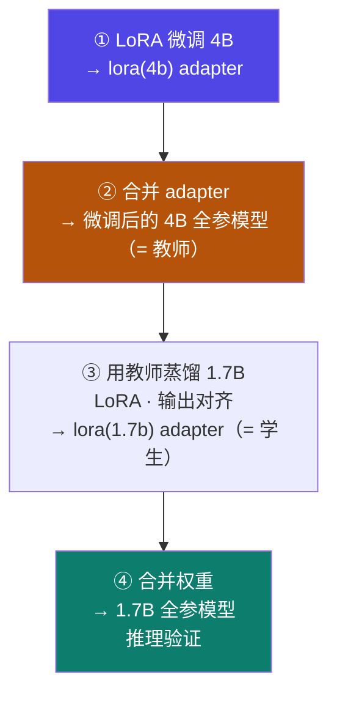
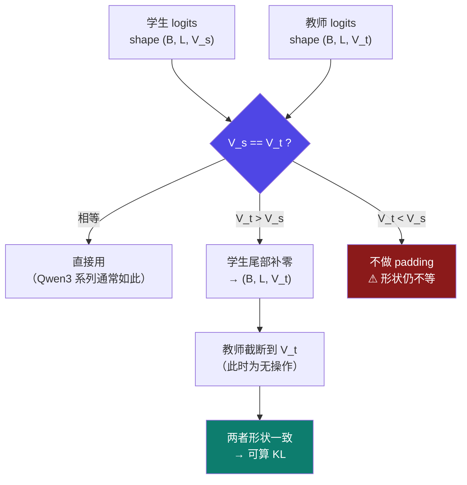

# 5-9 · 实战：白盒蒸馏 4B → 1.7B

::: info 难度分层 · 本页 = L3（可运行 / 源码级）
L3 能读懂 `train.py` 的每一段、说清异构 logits 如何对齐，并跑通四步流程。★★★▶
:::

## 定位

这是 Part 5 的收官页：把 [5-3](/training/p5/03-response) 的公式，落成一份**可直接运行的代码**。
资产：`White_box_Distillation/{train.py, inference.py, requirements.txt}` + 数据集 `identity_modify.json`。

## (1) 训练任务

| 项 | 值 |
|---|---|
| **蒸馏方法** | **白盒蒸馏 - 输出对齐（response based）** |
| **模型** | **Qwen3-4B-Instruct-2507**（教师）→ **Qwen3-1.7B**（学生）|
| **数据集** | `identity_modify.json`（自我认知数据集）|
| **训练方法** | **LoRA** |

::: tip 为什么选"响应式 + LoRA"
- **响应式**：不需要对齐中间层 → 绕开 [5-7](/training/p5/07-challenges) 的挑战 (1)。
- **LoRA**：学生只需训一小部分参数 → 省显存、快（见 [3-2](/training/p3/02-lora)）。
这是**大小模型异构**场景下最现实的组合。
:::

## (2) 四步操作流程

四个步骤：

| 步 | 原文 |
|---|---|
| **第一步** | 使用 `identity_modify` 数据集，通过 LoRA 方式微调 **Qwen3-4B-Instruct-2507**，得到 `lora(4b) adapter`（**epoch=30**）|
| **第二步** | 使用 `lora(4b) adapter` **合并** Qwen3-4B-Instruct-2507，组成**微调后的全参模型** |
| **第三步** | 使用第二步的模型，使用 `identity_modify` 数据集，通过 **LoRA 知识蒸馏 Qwen3-1.7B**，得到 `lora(1.7b) adapter`（epoch=30）|
| **第四步** | 用 `lora(1.7b) adapter` 与 Qwen3-1.7B **合并权重**得到全参模型，进行**推理效果验证** |



::: warning 为什么第一步要先"微调教师"
原始 4B 模型虽然强，但**未必在"自我认知"这个具体任务上答得好**。
先微调一遍，让**教师在这个任务上变好**，学生才有好榜样可学。
→ 这正是 [5-1](/training/p5/01-what) 说的"教师输出就是标准答案"——**教师不准，学生必歪**。
:::

## (3) 代码逐段解析

### 3.1 环境依赖

`requirements.txt`：

```text
peft==0.17.1
transformers==4.57.0
pandas==2.3.3
torch==2.5.1+cu124
```

### 3.2 核心：KL 散度损失

`train.py` 的 `compute_kl_div_loss`：

```python
def compute_kl_div_loss(logits, teacher_logits, target, padding_id, reduction="sum"):
    log_probs = torch.log_softmax(logits, -1, dtype=torch.float32)            # log Q
    teacher_probs = torch.softmax(teacher_logits, -1, dtype=torch.float32)    # P
    teacher_log_probs = torch.log_softmax(teacher_logits, -1, dtype=torch.float32)  # log P
    kl = (teacher_probs * (teacher_log_probs - log_probs))                    # P·(logP − logQ)
    kl = kl.sum(-1)
    if reduction == "sum":
        pad_mask = target.eq(padding_id)          # padding 位置
        kl = kl.masked_fill_(pad_mask, 0.0)       # 置零，不参与损失
        kl = kl.sum()
    return kl
```

逐行对照 [5-3](/training/p5/03-response) 的 KL 定义：

| 代码 | 数学 | 说明 |
|---|---|---|
| `log_softmax(logits)` | `log Q` | 学生，用 log_softmax 保稳定 |
| `softmax(teacher_logits)` | `P` | 教师概率 |
| `log_softmax(teacher_logits)` | `log P` | 教师对数概率 |
| `teacher_probs * (teacher_log_probs - log_probs)` | `P · (logP − logQ)` | 逐元素 |
| `.sum(-1)` | `Σ_i` | 在词表维度求和 → `D_KL(P‖Q)` |
| `masked_fill_(pad_mask, 0.0)` | — | padding 不计入 |

::: tip 两个必须理解的细节
1. **`dtype=torch.float32`**：KL 用 fp32 算，避免 bf16 精度不足导致数值不稳。
2. **`masked_fill_` 而非 `kl[pad_mask]=0`**：原地操作更省内存（`train.py` 里用的是前者）。
:::

### 3.3 数据集：Alpaca → chat 模板 + 只训答案

`train.py` 的 `MyDataset`（**掩码语言模型式训练**）：

```python
instruction_text = data_line['instruction']
input_text       = data_line['input']
output_text      = data_line['output']

query  = instruction_text + input_text
answer = output_text + self.tokenizer.eos_token

messages = [{'role': 'user', 'content': query}]
prompt  = self.tokenizer.apply_chat_template(messages, tokenize=False)

input_ids = tokenizer.encode(prompt) + tokenizer.encode(answer)
labels    = [-100] * len(prompt_input_ids) + answer_input_ids   # 只对答案算 loss
```

| 要点 | 说明 |
|---|---|
| 数据格式 | **Alpaca**（`instruction` / `input` / `output`）→ 见 [2-2](/training/p2/02-data-format) |
| 对话模板 | `apply_chat_template`（Qwen3 自带模板）|
| **关键** | `labels` 把 **prompt 部分全部置 `-100`** → **只对答案计算损失** |
| 超长处理 | 超过 `max_seq_len` 直接截断；不足则 pad |
| padding | `input_ids` 补 `pad_token_id`，`labels` 补 `-100`，`attention_mask` 补 `0` |

::: warning `-100` 是什么
`-100` 是 PyTorch `CrossEntropyLoss` 的**默认 ignore_index**。
把 prompt 位置的 label 设成 `-100`，等价于告诉损失函数"**这些位置不参与计算**"。
**不这么做，模型会去学"预测用户的问题"，那是浪费。**
:::

### 3.4 核心：自定义 Trainer + 异构 logits 对齐

`train.py` 的 `Custom_Trainer.compute_loss`：

```python
outputs = model(**inputs)                     # 学生
with torch.no_grad():
    teacher_outputs = self.teacher_model(**inputs)   # 教师：不建图、不更新

loss           = outputs.loss                 # 学生损失（= L_student，交叉熵）
logits         = outputs.logits
teacher_logits = teacher_outputs.logits

# ⭐ 异构模型 → 输出维度不一致，需要对齐
if logits.shape[-1] != teacher_logits.shape[-1]:
    dimension_diff = teacher_logits.shape[-1] - logits.shape[-1]
    if dimension_diff > 0:
        pad_logits = torch.zeros((logits.shape[0], logits.shape[1], dimension_diff)).to(logits.device)
        logits = torch.cat([logits, pad_logits], dim=-1)      # 学生补零
    teacher_logits = teacher_logits[:, :, :logits.shape[-1]]  # 教师截断

labels = inputs['labels']
kl = compute_kl_div_loss(logits / self.temperature,
                         teacher_logits / self.temperature,
                         labels, padding_id=-100)
alpha = 0.5
loss_total = alpha * kl + (1 - alpha) * loss
```

**异构维度的对齐过程**（⭐ 本节最关键）：



::: danger ⚠ 这段对齐代码只覆盖了"教师词表 ≥ 学生词表"的情况
- `V_t > V_s`：学生补零 → 两者变 `V_t` → **形状一致** ✅
- `V_t == V_s`（**Qwen3-4B 与 Qwen3-1.7B 同系列，词表一致**）→ 直接走通 ✅
- `V_t < V_s`：`dimension_diff < 0`，**不补零**；教师被"截断到 `V_s`"但教师本来就短 → **形状仍不等**，后续 KL 会报错 ⚠

**结论**：本代码实际只处理"教师词表 ≥ 学生词表"。跨系列选教师（如拿一个词表更小的模型当教师）时会踩坑。
> 这是源码层面的**边界缺陷**，本站如实标注，建议跨系列蒸馏时自己补上"学生截断 / 教师补零"的分支。
:::

**总损失**：`loss_total = α · kl + (1−α) · loss`（`α = 0.5`）→ 与 [5-3](/training/p5/03-response) 的 `Total Loss = α·L_distill + (1−α)·L_student` **逐字对应**。

### 3.5 主流程：模型、LoRA、训练参数

`train.py` 的 `__main__`：

```python
# ── 学生模型：Qwen3-1.7B + LoRA ──
model = AutoModelForCausalLM.from_pretrained("/root/.cache/modelscope/hub/models/Qwen/Qwen3-1.7B")
lora_config = LoraConfig(
    r=8,
    lora_alpha=256,      # 注释：更偏向于 lora adapter 部分
    target_modules=["q_proj", "k_proj", "v_proj", "o_proj",
                    "gate_proj", "up_proj", "down_proj"],
    lora_dropout=0.1,
    task_type=TaskType.CAUSAL_LM)
model = get_peft_model(model, lora_config).cuda()

# ── 教师模型：Qwen3-4B-Instruct-2507 + 已训好的 LoRA ──
teacher_model = AutoModelForCausalLM.from_pretrained(
    "/root/.cache/modelscope/hub/models/Qwen/Qwen3-4B-Instruct-2507")
lora_path = '/root/autodl-tmp/LLaMA-Factory/saves/qwen3-4b/lora/sft'
teacher_model = PeftModel.from_pretrained(teacher_model, lora_path).cuda()
teacher_model.eval()          # ⭐ 教师设为推理模式，不更新参数

args = TrainingArguments(
    output_dir='./results1',
    num_train_epochs=10,
    do_train=True,
    per_device_train_batch_size=1,
    gradient_accumulation_steps=16,
    logging_steps=10,
    report_to='tensorboard',
    save_strategy='steps', save_steps=500, save_total_limit=10,
    bf16=True, learning_rate=0.0005, lr_scheduler_type='cosine',
    dataloader_num_workers=4, dataloader_pin_memory=True,
)
dataset = MyDataset('identity_modify.json', tokenizer=tokenizer, max_seq_len=512)
trainer = Custom_Trainer(model=model, teacher_model=teacher_model, args=args,
                         train_dataset=dataset, tokenizer=tokenizer,
                         data_collator=DefaultDataCollator(),
                         temperature=6)     # 温度系数，一般取值范围【3-20】
trainer.train(resume_from_checkpoint=False)
trainer.save_model('./saves1')
```

**LoRA 配置逐项**（对照 [3-2](/training/p3/02-lora)）：

| 参数 | 值 | 说明 |
|---|---|---|
| `r` | `8` | 低秩维度（较小 → 参数量少）|
| `lora_alpha` | `256` | **远大于 r**（`alpha/r = 32`）→ 原文注释"更偏向于 lora adapter 部分" |
| `target_modules` | 7 个投影矩阵 | q/k/v/o + gate/up/down → 覆盖 attention 与 MLP |
| `lora_dropout` | `0.1` | 正则 |
| `task_type` | `CAUSAL_LM` | 因果语言模型 |

**训练参数**：

| 参数 | 值 | 说明 |
|---|---|---|
| `num_train_epochs` | **10** | ⚠ 讲义 P26 写的是 **30**，**代码里是 10**，见下方提示 |
| `per_device_train_batch_size` | 1 | 单卡批 1 |
| `gradient_accumulation_steps` | 16 | 有效批量 = 1 × 16 = 16（[4-14](/training/p4/14-optim-practice) 的梯度累计）|
| `bf16` | `True` | 混合精度 |
| `learning_rate` | `5e-4` | — |
| `lr_scheduler_type` | `cosine` | — |
| `max_seq_len` | 512 | 数据集截断/补齐长度 |
| `temperature` | **6** | 白盒蒸馏温度，讲义注取值范围【3–20】|

::: danger ⚠ 讲义与代码的两处不一致（已核对源码）
1. **epoch 数**：L4 P26 写"**epoch=30**"，而 `train.py` 里 `num_train_epochs=**10**`。
   → 以代码为准 10；或按 P27 课后作业的说法"数据量大时 epoch 设小一些，eg: epoch=10"。
2. **教师 LoRA 路径**：`train.py` 里写死 `/root/autodl-tmp/LLaMA-Factory/saves/qwen3-4b/lora/sft`
   （即 LLaMA-Factory 的 LoRA 输出目录），而 `inference.py` 里写的是
   `/root/autodl-tmp/White_Box_Distillation/results/checkpoint-60`（即本脚本自己 `results1` 的 checkpoint）。
   → **两者不是同一个目录**，实际使用时请统一到你自己的真实路径。
:::

### 3.6 推理验证（第四步）

`inference.py`：

```python
student_model = AutoModelForCausalLM.from_pretrained(
    "/root/.cache/modelscope/hub/models/Qwen/Qwen3-1.7B",
    dtype=torch.float16, device_map="auto")
tokenizer = AutoTokenizer.from_pretrained(".../Qwen3-1.7B")
lora_path = '/root/autodl-tmp/White_Box_Distillation/results/checkpoint-60'
student_model = PeftModel.from_pretrained(student_model, lora_path).eval()

def inference(text, max_length=512):
    prompt = tokenizer.apply_chat_template(
        [{"role": "user", "content": text}], tokenize=False, add_generation_prompt=True)
    inputs = tokenizer(prompt, return_tensors="pt").to(student_model.device)
    with torch.no_grad():
        outputs = student_model.generate(**inputs, max_length=max_length,
                                         temperature=0.7, do_sample=True, top_p=0.9,
                                         pad_token_id=tokenizer.eos_token_id,
                                         eos_token_id=tokenizer.eos_token_id)
    response = outputs[0][inputs['input_ids'].shape[1]:]   # 只取新生成部分
    return tokenizer.decode(response, skip_special_tokens=True)
```

::: tip 这段代码的 3 个可迁移写法
1. **`add_generation_prompt=True`**：让 chat 模板补上"该助手回答了"的前缀，否则模型不知道该接话。
2. **`outputs[0][inputs['input_ids'].shape[1]:]`**：**切掉输入部分**，只解码新生成的 token。
3. **`dtype=torch.float16`**：推理用半精度省显存（训练时用 bf16）。
:::

## (4) 课后作业

| 步 | 要求 |
|---|---|
| ① | 挑选一个**高质量开源数据集**（法律 / 金融等垂直领域，**10 万条以下**）|
| ② | 处理成**代码适配的 Alpaca 格式**（如 `identity_modify.json`）|
| ③ | 用**白盒蒸馏-输出对齐（response based）**方法先对 Qwen3-4B-Instruct-2507 做 LoRA 微调 |
| ④ | 用微调后的 4B 模型，通过 LoRA 方式**蒸馏一个 Qwen3-1.7B**，使 1.7B 具备该垂直领域知识 |

注意事项：

> 推荐租用 **A800 或其他大显存**的显卡；`per_device_batch_size` 设置得高一些；
> **数据量大时 epoch 设置的小一些，eg: epoch=10**。

## 坑与自检

> ✕ 直接拿未微调的 4B 当教师。

> ✓ 第一步必须先**微调教师**——教师不准，学生必歪。

> ✕ 忘了 `teacher_model.eval()`。

> ✓ 教师必须 `eval()` + 在 `torch.no_grad()` 下前向，否则会建计算图、占显存。

> ✕ 用"词表比学生小"的模型当教师，且照抄这段对齐代码。

> ✓ 这段对齐只处理 `V_t ≥ V_s`；跨系列选教师时要自己补分支。

> ✕ 以为 `labels` 里 prompt 部分不用处理。

> ✓ 必须置 `-100`，只对答案算损失。

> ✕ 直接拿讲义 P26 的 "epoch=30" 去跑 `train.py`。

> ✓ 代码里是 `num_train_epochs=10`——**以代码为准**。

**自检清单**：

- [ ] 我能复述四步流程，并说出"为什么要先微调教师"
- [ ] 我能逐行读懂 `compute_kl_div_loss`
- [ ] 我能说清异构 logits 的对齐逻辑，以及它**只覆盖 `V_t ≥ V_s`** 的边界
- [ ] 我知道 `labels` 里 prompt 要置 `-100`
- [ ] 我能写出 `loss_total = α·kl + (1−α)·loss`
- [ ] 我知道 LoRA 配置（r=8 / alpha=256 / 7 个 target_modules）
- [ ] 我知道温度 T=6（范围【3–20】）、`α=0.5`、`lr=5e-4`
- [ ] 我知道讲义 epoch=30 与代码 epoch=10 **不一致**
- [ ] 我能读懂 `inference.py` 的 chat 模板与输出切片

## 练习案例

学完本 Part，用这两道题检验自己**是不是真的能动手**——蒸馏是本册里显存压力最大、也最值得亲手跑一遍的一章：

| # | 题目 | 难度 | 主要练到 | 对应页 |
|---|---|---|---|---|
| **C09** | 跑通白盒蒸馏：教师 4B → 学生 1.7B | 基础 | 四步流水线、KL 损失、`no_grad`、异构 logits 对齐、`alpha=256` 的理由 | [5-3](/training/p5/03-response) / [5-9](/training/p5/09-practice) |
| **C10** | 蒸馏 vs 小模型直接 SFT：效果对比 | 综合 | 对照实验设计、暗知识、可量化评测、loss 不可直接比、诚实边界 | [5-3](/training/p5/03-response) / [5-9](/training/p5/09-practice) |

::: tip 这两道题**尽量复用**，别重复烧钱
[C09](/training/p10/c09-whitebox-distill) 的第 ①② 步（微调+合并教师）可**直接复用 [C05](/training/p10/c05-lora-sft) 的 adapter**；
[C10](/training/p10/c10-distill-vs-sft) 的"蒸馏组"可**直接复用 [C09](/training/p10/c09-whitebox-distill) 的学生**——
各只需要真跑一组。页首都标了预估费用与省钱姿势。
:::

→ **[C09 答案](/training/p10/c09-whitebox-distill)** ｜ **[C10 答案](/training/p10/c10-distill-vs-sft)** ｜ **[案例库总览](/training/p10/)**

---

> 上一节：[5-8 工业方案：DeepSeek 与 Qwen](/training/p5/08-industry) ｜ 下一步：[Part 6 · 部署与推理优化](/training/p6/01-challenges)
