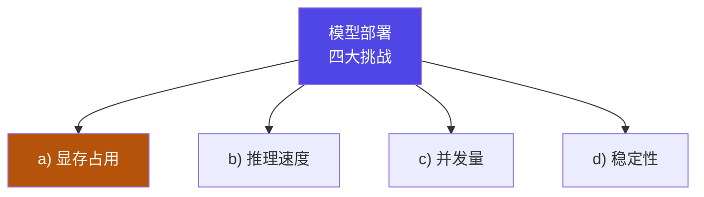

# 6-1 · 部署的四大挑战

::: info 难度分层 · 本页 = L1（概念层）
L1 能说出四大挑战（显存 / 速度 / 并发 / 稳定性）与对应的应对策略。
:::

## 定位

[Part 5](/training/p5/01-what) 之后，你有了一个"训好的模型"。但**训得好 ≠ 跑得好**。
Part 6 解决"**怎么把它稳稳地服务出去**"。本页先摆出**四道坎**——后面 10 页都是对这些坎的逐个拆解。

## (1) 四大挑战

依次给出四类挑战：

### a) 显存占用

给出**数据精度的字节表**（这是全课程最基础的一张表）：

| 精度 | 字节数 | 位（bit）|
|---|---|---|
| **FP32**（单精度浮点）| **4 字节** | 32 |
| **FP16**（半精度浮点）| **2 字节** | 16 |
| **INT8**（量化）| **1 字节** | 8 |
| **INT4**（量化）| **0.5 字节** | 4 |

> 原文首句："数据精度：**1 字节 = 8 位（bit）**"

::: tip 这张表的用法
**显存 ≈ 参数量 × 每参数字节**。
70 亿参数模型：FP32 → `7e9 × 4 = 28 GB`；FP16 → `14 GB`；INT8 → `7 GB`；INT4 → `3.5 GB`。
**精度每降一半，显存就减半**——这就是量化能"救命"的原因（详见 [3-6](/training/p3/06-quantization)）。
:::

### b) 推理速度

列出的瓶颈（含"层融合技术"）：

| 瓶颈 | 原文 |
|---|---|
| ① | **GPU 显存带宽不足**，数据传输成为性能瓶颈 |
| ② | **注意力随序列增长指数级扩展** |
| ③ | **未预分配的张量操作**会导致频繁的内存申请/释放 |
| ④ | **数据处理瓶颈** |

**优化方案**：

| 优化方向 | 原文 |
|---|---|
| 计算侧 | 量化压缩技术、张量并行计算、**KV Cache 显存重用** |
| 结构侧 | 轻量化架构设计、注意力机制改进 |
| 计算图侧 | 计算图优化（**TensorRT / TensorRT-LLM 层融合技术**）、并行计算模式、内存管理策略（**off-load 策略**）|
| 解码侧 | 高效解码方案（GPU 加速）、特征工程优化（PCA 降维）|

### c) 并发量

> 模型推理高并发会**迅速耗尽 GPU 内存**导致请求排队或失败。
> 并发量高时，**总内存消耗巨大，可能引发 OOM 错误**。
> **网络 I/O 带宽占满**；**延迟飙升**。

给出的**应对策略**：

| 策略 | 原文 |
|---|---|
| 1 | **动态扩缩容** |
| 2 | **模型剪枝、量化、知识蒸馏** |
| 3 | 使用**高效编译格式**：如 TensorRT、OpenVINO 等工具将模型编译优化 |
| 4 | 选择**高效的推理服务器**：如 NVIDIA Triton、TensorFlow Serving、TorchServe 等 |

::: tip 注意第 2 条把 Part 3/5 的技术都串起来了
**剪枝**（[6-4](/training/p6/04-pruning)）、**量化**（[3-6](/training/p3/06-quantization)）、**知识蒸馏**（[Part 5](/training/p5/01-what)）——
这三件事**不只是"训练阶段的技术"，更是"部署阶段的降本手段"**。
:::

### d) 稳定性

| 类别 | 原文 |
|---|---|
| **硬件故障** | GPU 驱动崩溃、服务器宕机、网络中断等 |
| **软件错误** | 库版本冲突、内存泄漏、资源竞争导致死锁等 |
| **资源耗尽** | 高并发请求下 GPU 内存耗尽；**非高并发场景下，某些大请求也可能单独耗尽 GPU 内存** |

> 原文旁注："**大请求造成 GPU 内存剧增**"

## (2) 如何安全、高效地更新和运营模型

给出三条工程实践：

| 实践 | 原文 |
|---|---|
| **模型版本管理** | 确保不同版本的模型**可控、可追溯、可回退** |
| **A/B 测试** | 科学地评估新模型（B）相比旧模型（A）在**业务指标**上的优劣，确保模型迭代能带来真正的提升 |
| **灰度发布** | 逐步将新模型开放给用户，在**影响范围可控**的情况下验证其稳定性和效果，降低部署风险 |

::: tip 三条实践是"同一个思路"的三个层次
**核心都是"别一把梭"**：
- 版本管理 → **能退回去**；
- A/B 测试 → **用数据证明新的更好**；
- 灰度发布 → **先小范围试**。

这三条与 [Part 7](/training/p7/01-project) 的"端到端项目闭环"是同一套工程思维。
:::

## 挑战 → 对策 对照

| 挑战 | 主要对策 | 后续页面 |
|---|---|---|
| a) 显存占用 | 量化（INT8/INT4）、KV Cache 优化、剪枝 | [6-2](/training/p6/02-kvcache)、[6-4](/training/p6/04-pruning) |
| b) 推理速度 | KV Cache、连续批处理、编译加速（TensorRT/ONNX）| [6-2](/training/p6/02-kvcache)、[6-3](/training/p6/03-batching)、[6-5](/training/p6/05-compile) |
| c) 并发量 | 连续批处理、PagedAttention、动态扩缩容 | [6-3](/training/p6/03-batching)、[6-8](/training/p6/08-vllm-pagedattention) |
| d) 稳定性 | 版本管理、A/B、灰度、弹性伸缩 | [6-1 本页](#2-如何安全高效地更新和运营模型)、[6-10](/training/p6/10-others) |

## 坑与自检

> ✕ 以为"部署"就是把模型跑起来。

> ✓ 部署要同时解决**显存、速度、并发、稳定性**四件事，缺一不可。

> ✕ 把精度字节表记混（例如以为 INT8 = 0.5 字节）。

> ✓ **FP32=4 / FP16=2 / INT8=1 / INT4=0.5**（字节）。

> ✕ 只在"高并发"时才担心 OOM。

> ✓ 原文明确：**非高并发下，单个大请求也可能单独耗尽 GPU 内存**。

> ✕ 新模型训好就直接全量替换。

> ✓ 必须走**版本管理 → A/B → 灰度**这条路。

**自检清单**：

- [ ] 我能背出四种精度的字节数（4/2/1/0.5）
- [ ] 我能说出推理速度的四个瓶颈
- [ ] 我能说出并发的四条应对策略
- [ ] 我知道"剪枝/量化/蒸馏"在部署阶段的作用是**降本**
- [ ] 我能列出稳定性的三类风险
- [ ] 我能说出版本管理 / A/B / 灰度各自解决什么

---

> 上一节：[5-9 实战：白盒蒸馏 4B→1.7B](/training/p5/09-practice) ｜ 下一节：[6-2 推理优化：KV Cache](/training/p6/02-kvcache)
