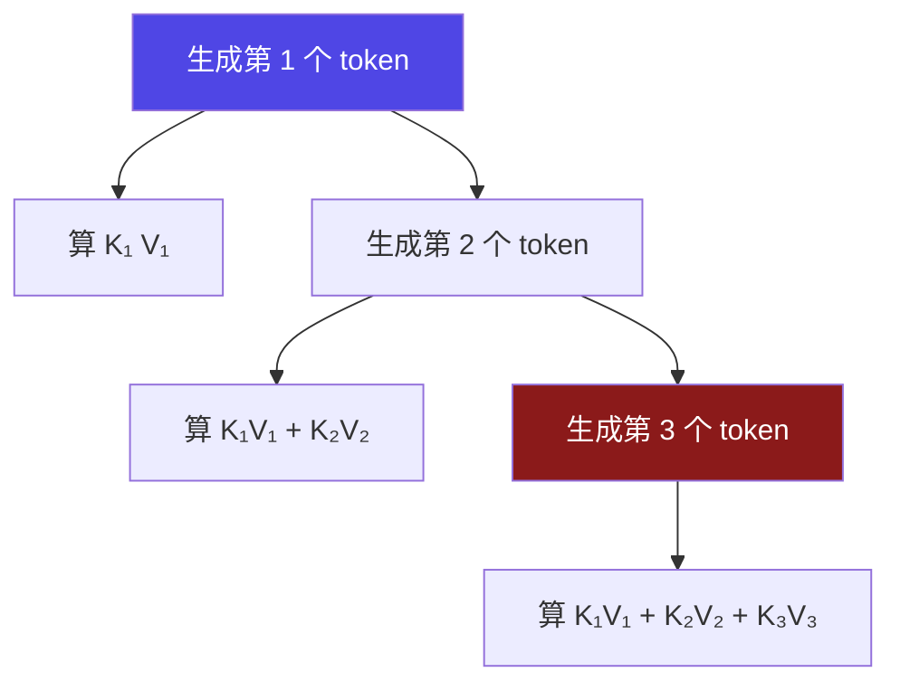
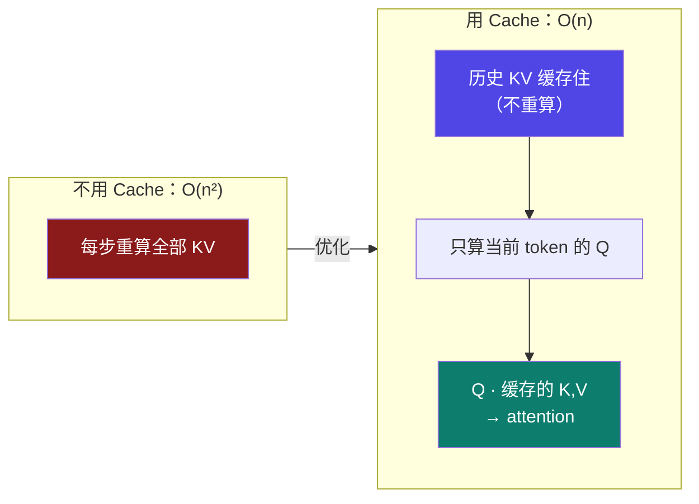
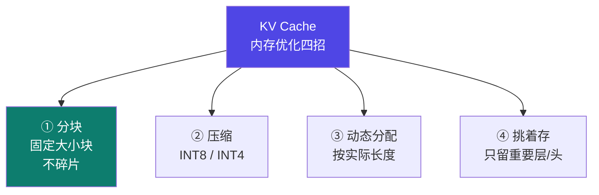

# 6-2 · 推理优化：KV Cache

::: info 难度分层 · 本页 = L2→L3（机制 → 量化层）
L2 能说清 O(n²) → O(n) 的原因；L3 能算清四种内存优化各自的收益与代价。★★★
:::

## 定位

[6-1](/training/p6/01-challenges) 的瓶颈②"**注意力随序列增长指数级扩展**"，就是本页要解决的核心。
KV Cache 是**所有大模型推理优化的地基**——不先讲清它，后面 [6-3 批处理](/training/p6/03-batching)、[6-8 PagedAttention](/training/p6/08-vllm-pagedattention) 都无从谈起。

## (1) 问题：传统 attention 机制

> 每个新 token 都要**重新算所有历史 token 的 K、V**，复杂度是 **O(n²)**。

::: warning "重复计算"到底浪费在哪
注意上面每一步：**K₁V₁ 被算了 3 次，K₂V₂ 被算了 2 次……**
而这些 K、V 的值**从生成那一刻起就再也不会变**。
既然不变，为什么每次都要重算？——这就是 KV Cache 要解决的问题。
:::

## (2) KV Cache：缓存历史 K、V

> 通过**缓存历史计算的 Key 和 Value 矩阵**，避免重复计算。生成新 token 时，**仅需计算当前 token 的 Query**，并与缓存的 K、V 进行注意力计算，大幅提升效率。

三大特点：

| # | 特点 | 原文 |
|---|---|---|
| ① | 避免重复计算 | 避免在大模型生成阶段反复计算 KV 值，从而提高推理速度 |
| ② | 复杂度降阶 | **只算当前 token 的 K、V，复杂度变成 O(n)** |
| ③ | 换的代价 | **显存需求提升换计算推理加快**：KV Cache 能省大概 **90% 的计算量**，文本生成快很多 |

| 维度 | 无 Cache | 有 Cache |
|---|---|---|
| 复杂度 | **O(n²)** | **O(n)** |
| 省下的计算量 | — | **约 90%** |
| 代价 | 计算多 | **显存多了** |

::: tip 一句话记住 KV Cache
**"用显存换计算"**——把不变的历史 K/V 存下来，别重算。
**但这也直接导致了下游的显存问题**：序列越长、并发越多，KV Cache 就越大 → 这正是 [6-8](/training/p6/08-vllm-pagedattention) PagedAttention 要解决的。
:::

## (3) 四种 KV Cache 内存优化

给出四种：

| # | 技术 | 原文 | 收益 |
|---|---|---|---|
| 1 | **分块 KV Cache** | 把连续缓存分成**固定大小的块**（vLLM），内存用得更充分，还**不会碎片化** | 减碎片 |
| 2 | **压缩缓存** | 用 **INT8/INT4** 这类低精度存 K、V，精度稍微降点，内存能少 **75%** | 减容量 |
| 3 | **动态分配缓存** | 按**输入序列长度**调缓存大小，批量处理时内存分配更合理 | 减浪费 |
| 4 | **挑着存缓存** | **不重要层或注意力头就不存**，速度和内存能平衡 | 减冗余 |

### 3.1 压缩缓存：⚠ 原文数值有误

::: danger ⚠ 原文笔误（L5 P11）
原文写："压缩缓存：用 INT8/INT4 这类低精度存 K、V，精度稍微降点，**内存能少 75%（比如 FP16 转 INT8）**"。

**这里"75%"与"FP16 转 INT8"对不上。** 按 [6-1](/training/p6/01-challenges) 给出的精度字节表核对：

| 转换 | 字节变化 | 内存节省 |
|---|---|---|
| FP16 → **INT8** | 2 B → 1 B | **50%**（减半）|
| FP16 → **INT4** | 2 B → 0.5 B | **75%** |

**正确表述应为**：FP16 转 INT8 省 **50%**；转 INT4 才省 **75%**。
原文括号里的例子（FP16 转 INT8）对应的应是"**减半**"。本站按字节表换算，特此标注。
:::

### 3.2 动态分配缓存：原文算例

例子：

> eg: 不再需要 `4 * 1024` 的缓存，而是只需要 `128 + 512 + 256 + 1024 = 1920` 的缓存

**核对**：`128 + 512 + 256 + 1024 = 1920` ✅（算术正确）
对比 `4 × 1024 = 4096` → **从 4096 降到 1920，省约 53%**。

**含义**：批里 4 条序列的真实长度各不相同（128 / 512 / 256 / 1024），
如果按"**最长序列 × 条数**"预分配（4096），那短的序列就会白占空间；
按实际长度分配（1920）就省下来了。

### 3.3 挑着存缓存：原文算例

例子：

> eg: **只缓存最后 6 层**的 K 和 V，而不缓存前面几层

**含义**：不是所有层都同等重要。只保留最关键的若干层，其余不缓存 → 省显存，代价是精度可能略降。

::: warning 四种优化的代价并不相同
| 技术 | 代价 |
|---|---|
| 分块 | 需要**引擎支持**（vLLM 内置）|
| 压缩（INT8/INT4）| **精度下降**（原文"精度稍微降点"）|
| 动态分配 | 需要**运行时判断**，调度更复杂 |
| 挑着存 | **精度损失风险最大**（丢掉了部分层的信息）|

**没有免费的午餐**：省下的每一分显存，都在别处付出代价。
:::

## 决策表：四种优化怎么选

| 你的痛点 | 优先用什么 | 理由 |
|---|---|---|
| 显存碎片多、利用率低 | **分块 KV Cache**（[6-8](/training/p6/08-vllm-pagedattention)）| 专门治碎片，vLLM 已实现 |
| 单纯显存不够 | **压缩缓存（INT8 先试）** | 收益直接，精度损失可控 |
| 批内序列长短差异大 | **动态分配缓存** | 消除"最长序列"的浪费 |
| 极致压榨显存 | **挑着存缓存** | 收益最大，但要评估精度 |

## 坑与自检

> ✕ 以为 KV Cache 只省计算、没代价。

> ✓ KV Cache 的本质是"**显存换计算**"——省了 90% 的计算，但显存占用显著上升。

> ✕ 照抄原文"FP16 转 INT8 省 75%"。

> ✓ 按字节表算：**FP16→INT8 省 50%，FP16→INT4 省 75%**。

> ✕ 以为 KV Cache 让注意力变成"常数复杂度"。

> ✓ 是 **O(n)** 而非 O(1)；序列越长，缓存越大、仍需线性扫描。

> ✕ 一上来就把四种优化全开。

> ✓ 先定位痛点（碎片？容量？浪费？冗余？），再选对应的一招。

**自检清单**：

- [ ] 我能解释传统 attention 为什么是 O(n²)
- [ ] 我能说清 KV Cache 只算"当前 token 的 Q"
- [ ] 我知道 KV Cache 省约 90% 计算量，代价是显存
- [ ] 我能列出四种 KV Cache 内存优化
- [ ] 我知道原文"FP16 转 INT8 省 75%"是**笔误**（应为 50%）
- [ ] 我能核对动态分配的算例 `128+512+256+1024=1920`

---

> 上一节：[6-1 部署的四大挑战](/training/p6/01-challenges) ｜ 下一节：[6-3 推理优化：批处理](/training/p6/03-batching)
