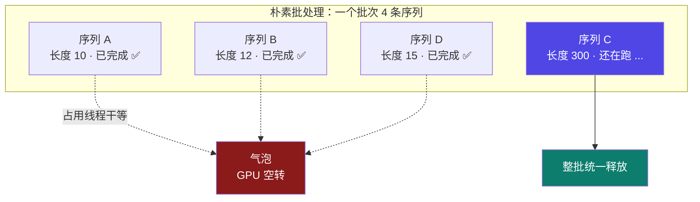
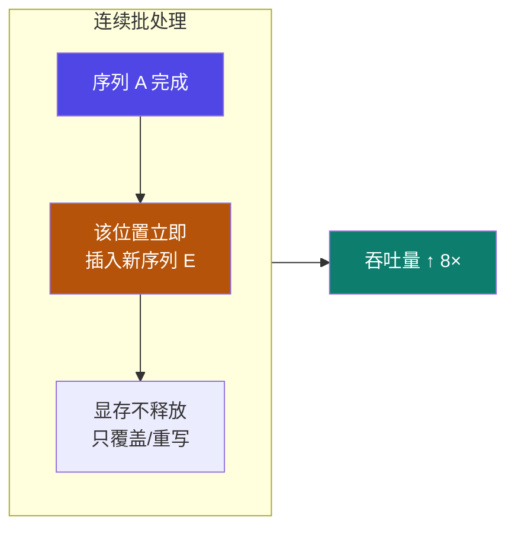

# 6-3 · 推理优化：批处理

::: info 难度分层 · 本页 = L2（机制层）
L2 能解释朴素批处理的"气泡"成因，以及连续批处理为什么能提升 8 倍吞吐。
:::

## 定位

[6-2](/training/p6/02-kvcache) 解决了"单条请求算得快不快"。[6-1](/training/p6/01-challenges) 的挑战 c)"**并发量**"要解决的是"**很多请求一起进来怎么办**"。

本页讲清一个反直觉的事实：**批处理不是"打包一起跑"就完事了**——朴素批处理会让 GPU 大量空转。

## (1) 朴素 / 静态批处理

> 同一批次需要**等待该批次生成最长的文本完成生成后**才能被**统一释放**。
> GPU 在批次中不同序列的生成长度与最大生成长度不同而**未充分利用**。

两大问题：

| 问题 | 原文 |
|---|---|
| **瓶颈** | 整个批次的**处理速度取决于本批次中最长的序列** |
| **资源浪费** | 当短序列处理完后，它们占用的 GPU 线程必须**等待长序列处理完毕**，这被称为**气泡**，计算资源被闲置 |

::: warning "气泡"在推理里的形态
[4-11](/training/p4/11-model-pipeline-parallel) 讲过训练里的"气泡"——GPU 等别的 GPU。
这里的"气泡"是**同一块 GPU 上，短序列的线程等长序列**。
**共同点都是"有资源但用不上"。**
本例中：序列 C 要跑 300 步，而 A/B/D 只需 10~15 步 —— 那么 **A/B/D 的线程有 95% 的时间在空转**。
:::

## (2) 连续批处理

> 一旦批处理中的序列**完成生成，就可以在其位置插入新序列**。
> **显存不释放，只做序列的覆盖/重写**。
> 吞吐量比朴素的批处理**高出 8 倍**。

| 维度 | 朴素批处理 | 连续批处理 |
|---|---|---|
| 批次构成 | **静态**（跑完才换）| **动态**（谁跑完谁下，立刻补新的）|
| 释放时机 | **整批统一释放** | **单条完成即让位** |
| 显存操作 | 重新分配 | **不释放，只覆盖/重写** |
| 瓶颈 | 取决于**最长序列** | 大幅缓解 |
| 吞吐 | 1× | **8×** |

::: tip 连续批处理的关键洞察
朴素批处理把"批次"当成**固定的一组请求**；
连续批处理把"批次"看成**一个不断被填满的槽位**——
**GPU 的空位就是资源，空出来就塞新的进去**。
这就是 vLLM 的 `continuous batching`（[6-8](/training/p6/08-vllm-pagedattention) / [6-9](/training/p6/09-vllm-fastapi) 会看到它的实现细节）。
:::

## (3) 与训练侧"梯度累计"的对比（易混点）

| | 训练：梯度累计 | 推理：连续批处理 |
|---|---|---|
| 目的 | 小显存模拟大 batch | 提高 GPU 利用率 |
| 做法 | 累加若干步再更新 | 谁完成就补新序列 |
| 共同点 | **都是"把有限资源用满"** | 同左 |

::: warning 别把这两个"批"混了
- **梯度累计**（[4-14](/training/p4/14-optim-practice)）：把**多个 micro-batch 串起来**，为了等效更大 batch。
- **连续批处理**：把**多个请求动态填进同一批**，为了不浪费 GPU 空位。

一个是"**拆细了慢慢累**"，一个是"**空的就补上**"。
:::

## 坑与自检

> ✕ 以为"批处理就是把请求打包一起发"。

> ✓ 朴素批处理会被**最长序列**拖住，产生气泡。

> ✕ 以为连续批处理需要"释放显存再重新分配"。

> ✓ 原文明确：**显存不释放，只做序列的覆盖/重写**。

> ✕ 把"连续批处理"和训练里的"梯度累计"混为一谈。

> ✓ 前者是推理调度策略，后者是训练显存技巧。

**自检清单**：

- [ ] 我能解释朴素批处理"气泡"的成因
- [ ] 我知道朴素批处理的瓶颈是"本批次最长的序列"
- [ ] 我能说出连续批处理的两条做法（完成即插新序列 / 只覆盖不释放）
- [ ] 我记住连续批处理的吞吐提升是 **8 倍**
- [ ] 我能区分连续批处理与梯度累计

---

> 上一节：[6-2 推理优化：KV Cache](/training/p6/02-kvcache) ｜ 下一节：[6-4 模型剪枝](/training/p6/04-pruning)
