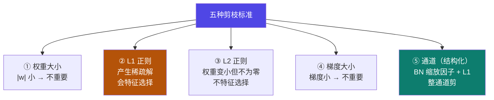

# 6-4 · 模型剪枝

::: info 难度分层 · 本页 = L2（机制层）
L2 能区分结构化 / 非结构化剪枝，并列出五种剪枝标准与各自的判据。⚙
:::

## 定位

[6-1](/training/p6/01-challenges) 的应对策略②提到"**模型剪枝、量化、知识蒸馏**"。
量化在 [3-6](/training/p3/06-quantization)、蒸馏在 [Part 5](/training/p5/01-what)，本页补齐**剪枝**。

本页解决：**剪什么？按什么标准剪？剪完怎么收尾？**

## (1) 剪枝是什么

> 通过**删除或置零不重要的参数或结构**，在**不显著降低模型精度**的前提下，**减少模型大小、降低计算量并加快推理速度**。

::: tip 剪枝 vs 量化 vs 蒸馏：一句话区分
| 手段 | 动作 | 类比 |
|---|---|---|
| **剪枝** | **删掉**不重要的部分 | 删代码 |
| **量化**（[3-6](/training/p3/06-quantization)）| **降低精度** | 压缩文件 |
| **蒸馏**（[Part 5](/training/p5/01-what)）| **换个更小的模型** | 换人 |

三者常**叠加使用**：先蒸馏换小模型，再剪枝瘦身，最后量化压缩。
:::

## (2) 两种剪枝粒度

### 2.1 结构化剪枝

> 以**通道、卷积核、注意力头或层**为单位进行裁剪。
> 能**显著降低内存和计算需求**，但对模型精度的影响**较大**。

### 2.2 非结构化剪枝

> 针对**单个权重参数逐个裁剪**，例如基于权重大小或梯度的重要度评分。
> **不改变模型结构**，只是改变模型权重，通过**稀疏矩阵**的方式。

旁注适用范围："卷积层、attention 层、FC 层等**任意矩阵结构**"。

| 维度 | 结构化剪枝 | 非结构化剪枝 |
|---|---|---|
| 剪的单位 | **通道 / 卷积核 / 注意力头 / 层** | **单个权重** |
| 是否改变结构 | **是** | 否（只改权重值）|
| 存储形式 | 正常稠密矩阵（更小）| **稀疏矩阵** |
| 压缩收益 | **显著** | 看稀疏度 |
| 精度影响 | **较大** | 较小 |
| 硬件加速友好度 | **高**（真变小，跑得更快）| 低（稀疏矩阵需专门支持才能加速）|

::: warning 非结构化剪枝的"坑"：省了参数，未必省时间
非结构化剪枝把权重置零后，矩阵变成**稀疏**的。
但**通用 GPU 并不会因为矩阵稀疏就自动变快**——除非推理框架专门支持稀疏计算。
所以实践中常遇到："**模型文件小了，但推理速度没变**"。
**结构化剪枝虽然精度掉得多，但它是"真变小"，实测提速更可靠。**
:::

## (3) 剪枝流程

> **训练 → 剪枝 → 微调 → 再剪枝 → 微调 …**
> 循环上述过程直到得到**性能和参数量都符合预期**的模型。

::: tip 为什么剪完必须"微调"
剪枝会**破坏**原来的参数组合——精度立刻掉。
**微调就是把掉下去的性能"捞回来"**（用少量数据继续训练）。
然后"再剪、再微调"逐步逼近目标——这叫**迭代式剪枝**。
:::

## (4) 五种剪枝标准

给出五种判据：

| # | 标准 | 判据（原文）| 特点 |
|---|---|---|---|
| 1 | **基于权重大小** | 权重的**绝对值越小**，该权重对模型输出影响越小 | 最直观、最常用 |
| 2 | **基于 L1 正则** | 加入项是权重参数的**绝对值之和**；可产生**稀疏解**——有些权重被压为零，对应特征**完全剔除** | **会做特征选择** |
| 3 | **基于 L2 正则** | 倾向于**使权重变小，但不压为零**；让模型更稳定、减少对某些特征的过度依赖 | **不做特征选择** |
| 4 | **基于梯度大小** | 权重的**梯度**反映其对输出损失的影响程度；**较大梯度 → 重要**；去除较小梯度的权重 | 用"训练信号"判断重要性 |
| 5 | **基于通道** | 剪**整个通道**（一组特征映射）而非单个权重；利用 **BN 层的缩放因子**实现通道稀疏性，在损失函数中加 **L1 正则项**鼓励缩放因子趋零 | 结构化剪枝的典型 |

/ P19 的**操作方式**（两种正则都以行为单位）：

> 以**行为单位**，用 **L1 / L2 公式**计算**每行的重要性**，移除权重中那些**重要性较小的行**。

::: tip L1 vs L2 这个经典选择题
**"L1 会产生稀疏解（很多权重正好为 0），L2 只让权重变小但不为 0"**——这是机器学习的经典结论。
- 想要**特征选择**（真的把某些东西删掉）→ **L1**。
- 想要**模型更稳、别过拟合**（但保留所有特征）→ **L2**。

原文对这个区别的表述非常准确，值得记牢。
:::

## 决策表：剪枝方案怎么选

| 你的目标 | 推荐 | 理由 |
|---|---|---|
| **真提速**（要实测变快）| **结构化剪枝** | 真变小，通用 GPU 直接受益 |
| 只求文件更小、精度少掉 | 非结构化剪枝 | 稀疏存储，但未必提速 |
| 想要"删掉整个没用的特征" | **L1 正则 / 通道剪枝** | 会产生稀疏解 |
| 只想提升泛化、不真删 | **L2 正则** | 权重变小但不为零 |
| 没有明确的输出重要性信号 | 基于权重大小 / 梯度 | 简单有效 |

## 坑与自检

> ✕ 以为非结构化剪枝一定能提速。

> ✓ 稀疏矩阵**需要推理框架专门支持**才提速；否则只是文件变小了。

> ✕ 剪完就直接上线。

> ✓ 必须**微调**把精度捞回来，且通常要**迭代**（剪→调→再剪）。

> ✕ 把 L1 和 L2 的作用搞反。

> ✓ **L1 → 稀疏解（真的置零）**；**L2 → 权重变小但不为零**。

> ✕ 以为"基于梯度"和"基于权重大小"是一回事。

> ✓ 一个看**权重的绝对值**，一个看**权重对损失的梯度**——判据不同。

**自检清单**：

- [ ] 我能给剪枝下一个准确的定义（删/置零 + 不显著降精度）
- [ ] 我能区分结构化与非结构化剪枝（单位 / 是否改结构 / 精度影响）
- [ ] 我知道非结构化剪枝未必提速的原因（稀疏矩阵）
- [ ] 我能默写剪枝流程（训练→剪枝→微调→再剪→再调）
- [ ] 我能列出五种剪枝标准
- [ ] 我能说清 L1 与 L2 的区别
- [ ] 我知道基于通道的剪枝用 BN 缩放因子 + L1 正则

---

> 上一节：[6-3 推理优化：批处理](/training/p6/03-batching) ｜ 下一节：[6-5 编译与加速](/training/p6/05-compile)
