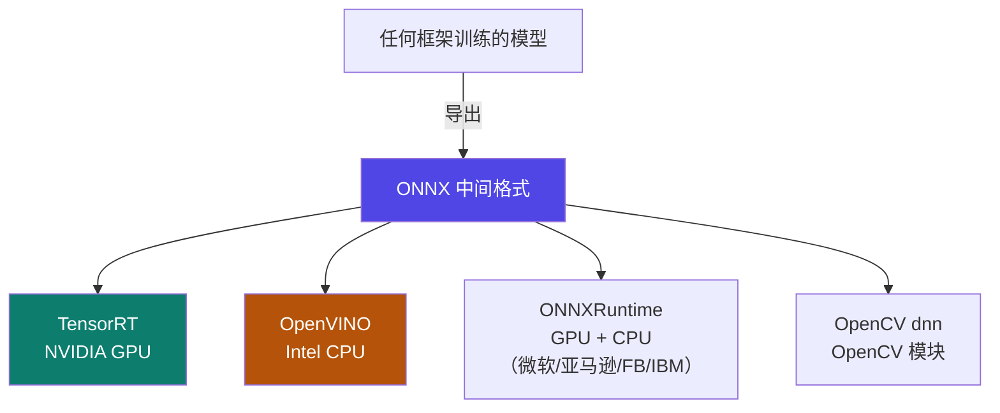

# 6-5 · 编译与加速

::: info 难度分层 · 本页 = L1（概念层）
L1 能说出"为什么要转 ONNX"以及四个运行时各自的硬件归属。
:::

## 定位

[6-1](/training/p6/01-challenges) 的应对策略③："使用**高效编译格式**：如 TensorRT、OpenVINO 等工具将模型编译优化"。
本页解决：**训练出来的模型，怎么转成"跑得快"的格式？各家工具的硬件归属是什么？**

## (1) 核心建议：转 ONNX

第一句结论：

> 无论用什么框架训练的模型，**推荐转为 ONNX 格式，方便部署**。

::: tip 为什么要"先转 ONNX"
训练框架五花八门（PyTorch / TensorFlow / …），但**部署环境希望统一**。
ONNX（Open Neural Network Exchange）就是那个**中间格式**——
**一次导出，多处运行**。这也是它叫"Exchange"的原因。
:::

## (2) 支持 ONNX 的四个运行时

| 运行时 | 归属 | 硬件要求 | 原文说明 |
|---|---|---|---|
| **TensorRT** | **英伟达** | ⚠ **需要英伟达 GPU 硬件支持** | 用于 **GPU 推理加速** |
| **OpenVINO** | **英特尔** | ⚠ **需要英特尔 CPU 硬件支持** | 用于 **CPU 推理加速** |
| **ONNXRuntime** | 微软、亚马逊、Facebook、IBM 等共同开发 | 可用于 **GPU、CPU** | 通用性最好 |
| **OpenCV dnn** | OpenCV | — | OpenCV 调用模型的模块 |

::: warning ⚠ 硬件绑定是"硬门槛"，不是建议
原文两次用了"**注意需要……硬件支持**"：
- **TensorRT → 必须 NVIDIA GPU**
- **OpenVINO → 必须 Intel CPU**

**选错工具等于白做**：没有 N 卡就别选 TensorRT，AMD/ARM 平台要用 ONNXRuntime。
:::

::: warning ⚠ 源材料说明（L5 P21）
原页标题为"（5）模型编译与加速"，**仅列出 ONNX 与上述四个运行时**，
未给出 ONNX 导出命令、也未展开各运行时的加速原理与性能数据。
本站**不编造**这些内容。可运行/可查证的示例见 [6-9](/training/p6/09-vllm-fastapi)（vLLM 侧）与 [6-7](/training/p6/07-ollama)（Ollama 侧）。
:::

## 决策表：运行时怎么选

| 你的硬件 | 推荐 | 理由 |
|---|---|---|
| **NVIDIA GPU** | **TensorRT**（或 TensorRT-LLM）| 官方深度优化，GPU 上最强 |
| **Intel CPU** | **OpenVINO** | 官方为自家 CPU 优化 |
| 混合 / 不确定 | **ONNXRuntime** | GPU、CPU 通吃，通用性最好 |
| 已在用 OpenCV 生态 | OpenCV dnn | 少引入一个依赖 |

## 坑与自检

> ✕ 在 AMD / 非 N 卡环境上选 TensorRT。

> ✓ TensorRT **必须 NVIDIA GPU**；通用场景用 ONNXRuntime。

> ✕ 以为"转了 ONNX 就一定更快"。

> ✓ ONNX 只是**统一格式**，加速来自**具体运行时**（TensorRT / OpenVINO）。

> ✕ 在 Intel CPU 上硬上 TensorRT。

> ✓ Intel CPU 应选 **OpenVINO**。

**自检清单**：

- [ ] 我知道"推荐转 ONNX 方便部署"这条结论
- [ ] 我能说出四个支持 ONNX 的运行时
- [ ] 我知道 TensorRT 绑 NVIDIA GPU、OpenVINO 绑 Intel CPU
- [ ] 我知道 ONNXRuntime 是四家（微软/亚马逊/FB/IBM）共同开发的通用方案
- [ ] 我能按硬件选出对应运行时

---

> 上一节：[6-4 模型剪枝](/training/p6/04-pruning) ｜ 下一节：[6-6 服务化与 API 设计](/training/p6/06-api)
