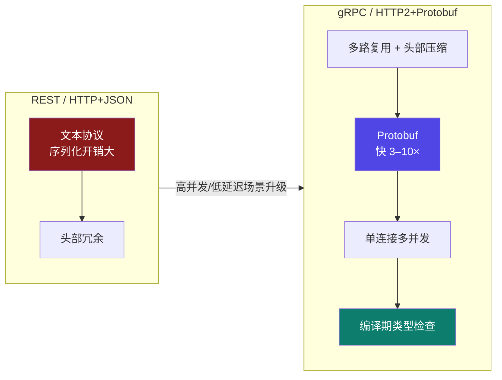

# 6-6 · 服务化与 API 设计

::: info 难度分层 · 本页 = L1→L2（概念 → 选型层）
L1 能区分 HTTP / HTTPS；L2 能说出 gRPC 相对 REST 的优势来源与适用场景。
:::

## 定位

模型跑起来之后，还要**被别人调用**。[6-7](/training/p6/07-ollama)~[6-10](/training/p6/10-others) 都在讲"用哪个引擎"，本页先讲**"接口怎么设计"**——这是服务化的通用底座。

## (1) RESTful API 设计原则

> 使用 HTTP 或 HTTPS 协议。**HTTPS 在 HTTP 的基础上增加了 SSL/TLS 加密**，提供了更安全的通信。

| 协议 | 特点 | 适用 |
|---|---|---|
| **HTTP** | **不加密** | 非敏感数据传输 |
| **HTTPS** | **加密传输**（SSL/TLS）| **敏感数据** |

给出的 URL 示例（阿里云百炼/DashScope）：

```text
https://dashscope.aliyuncs.com/compatible-mode/v1
https://dashscope.aliyuncs.com/api/v1/services/aigc/text2image/image-synthesis
```

::: tip 注意第一条 URL 里的 `compatible-mode`
`compatible-mode` 意味着这个是 **OpenAI 兼容**接口——
**换了服务商，代码里的 `base_url` 一改就能用**，客户端不用重写。
这正是本课程 [6-7](/training/p6/07-ollama) / [6-9](/training/p6/09-vllm-fastapi) 的实战全都围绕"OpenAI 兼容"展开的原因。
:::

## (2) gRPC 设计原则

指出 **REST 的四个痛点**：

> HTTP REST API 在**高并发、低延迟、强类型约束**的场景下暴露出——
> ① **文本协议与序列化开销大**；
> ② **头部冗余与臃肿**；
> ③ **请求/响应模型单一**。

给出 gRPC 的定位：

> gRPC 作为 Google 开源的**现代化 RPC 框架**，基于 **HTTP/2 协议和 Protocol Buffers**，
> 为分布式系统提供了**高性能、类型安全、跨语言**的通信解决方案。

## (3) gRPC 的性能来源

| # | 来源 | 原文 |
|---|---|---|
| 1 | **HTTP/2 特性** | 多路复用、头部压缩、服务器推送 |
| 2 | **序列化** | **Protocol Buffers 比 JSON 快 3–10 倍** |
| 3 | **连接复用** | 单个连接处理多个并发请求 |
| 4 | **类型安全** | 编译时类型检查，减少运行时错误 |
| 5 | **跨语言** | 支持 C++、Java、Python、Go、C# 等 **10+ 种语言** |



**适用场景**：

| 场景 | 原文 |
|---|---|
| 微服务架构 | 服务间高性能通信 |
| 实时系统 | 聊天、游戏、监控等需要**低延迟**的场景 |
| 大数据传输 | 流式数据处理、文件传输 |
| 多语言环境 | 不同语言服务的统一通信 |

## REST vs gRPC 对照

| 维度 | REST（HTTP/JSON）| gRPC（HTTP/2 + Protobuf）|
|---|---|---|
| 协议基础 | HTTP / HTTPS | **HTTP/2** |
| 序列化 | JSON（**文本**）| **Protocol Buffers（二进制）** |
| 序列化速度 | 1× | **3–10×** |
| 头部 | 冗余臃肿 | **压缩** |
| 连接 | 常规 | **多路复用**（单连接多并发）|
| 类型安全 | 弱（运行时才发现）| **强（编译时检查）** |
| 跨语言 | 通用 | **10+ 语言官方支持** |
| 生态/易用 | **最易调试**（curl 就能打）| 需 `.proto` 定义、需生成代码 |
| 适用 | 通用 API、对外服务 | **内部微服务、低延迟、大流量** |

::: tip 实战里的常见选择：**对外 REST，对内 gRPC**
- **对外**：给前端、给第三方 → **REST**（OpenAI 兼容接口就是 REST，见 [6-9](/training/p6/09-vllm-fastapi)）。
- **对内**：推理服务 ↔ 网关 / 微服务之间 → **gRPC**（低延迟、省带宽）。

本课程的部署实战（Ollama / vLLM / SGLang）**都提供 REST（OpenAI 兼容）接口**，
因为"能立刻被现有客户端调用"比"快一点"更重要。
:::

## 坑与自检

> ✕ 对外接口也用 gRPC。

> ✓ 对外优先 REST（生态好、调试易）；gRPC 用在**内部**高并发低延迟链路。

> ✕ 用 HTTP 传敏感数据。

> ✓ 敏感数据必须 **HTTPS**（SSL/TLS 加密）。

> ✕ 以为 gRPC 快是因为"它不是 HTTP"。

> ✓ gRPC 恰恰**基于 HTTP/2**；快主要来自 **Protobuf 二进制序列化 + 头部压缩 + 多路复用**。

**自检清单**：

- [ ] 我能区分 HTTP 与 HTTPS 的适用场景
- [ ] 我知道 `compatible-mode` 意味着 OpenAI 兼容
- [ ] 我能说出 REST 在高并发/低延迟下的三个痛点
- [ ] 我知道 gRPC 基于 HTTP/2 + Protocol Buffers
- [ ] 我记住 Protobuf 比 JSON 快 **3–10 倍**
- [ ] 我能列出 gRPC 的四类适用场景
- [ ] 我知道"对外 REST、对内 gRPC"这条实践

---

> 上一节：[6-5 编译与加速](/training/p6/05-compile) ｜ 下一节：[6-7 Ollama 部署全流程](/training/p6/07-ollama)
