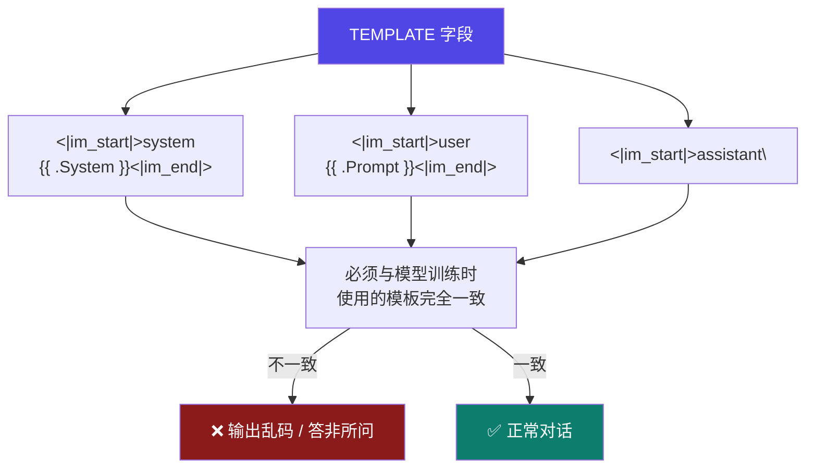
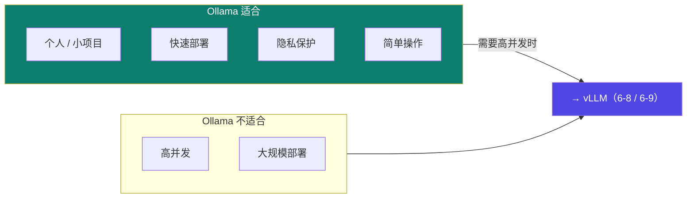

# 6-7 · Ollama 部署全流程

::: info 难度分层 · 本页 = L2→L3（操作 → 源码层）
L2 能完成安装、拉模型、跑推理；L3 能读懂 Modelfile 各字段并挂载 LoRA 适配器。★★▶
:::

## 定位

前面 [6-1](/training/p6/01-challenges)~[6-6](/training/p6/06-api) 都在讲"优化与设计"。
从本页起进入**四套部署方案的落地对比**：**Ollama（本页）→ vLLM（[6-8](/training/p6/08-vllm-pagedattention)/[6-9](/training/p6/09-vllm-fastapi)）→ 其他（[6-10](/training/p6/10-others)）**。

Ollama 是**上手最快**的一个——本页解决：**怎么装、怎么拉模型、怎么把它变成"我自己的模型"？**

## (1) Ollama 是什么

| 项 | 原文 |
|---|---|
| **定位** | 开源大型语言模型平台，让用户能够轻松地在**本地运行、管理和与大型语言模型进行交互** |
| **提供什么** | 不仅提供现成的模型和工具集，还提供**方便的界面和 API** |
| **硬件** | 支持多种硬件加速选项，包括**纯 CPU / GPU 推理**和各类底层计算架构 |
| **操作系统** | **macOS、Windows、Linux** 以及通过 **Docker 容器**运行 |
| **官网** | `https://ollama.com/` |

## (2) 三种安装方式

### 2.1 Windows

```text
1. 访问 https://ollama.com/download ，下载 Windows 安装程序
   下载地址：https://ollama.com/download/OllamaSetup.exe
2. 双击安装程序并按提示完成安装
3. 打开命令行，输入：ollama --version
   → 如果显示版本号，说明安装成功
```

### 2.2 Linux

给出两个方案：

**方案 1（一键脚本）**：

```bash
curl -fsSL https://ollama.com/install.sh | sh
ollama --version   # 验证，显示版本号即成功
```

**方案 2（推荐：本地下载安装包再上传服务器）**：

```bash
# 开启学术加速
source /etc/network_turbo

# 下载 ollama
wget https://ollama.com/download/ollama-linux-amd64.tgz

# 解压缩
sudo tar -C /usr -xzf ollama-linux-amd64.tgz

# 启动服务
ollama serve
```

::: tip 为什么方案 2 被标为"推荐"
因为 Ollama 的下载源**在国内网络下经常超时**。
"**本地下载 → 上传服务器**"是最稳的做法——这也是国内做 AI 工程常见的套路（对比 [Part 1](/training/p1/05-env) 的云算力环境）。
:::

### 2.3 Docker

```bash
# 官方镜像：https://hub.docker.com/r/ollama/ollama
docker pull ollama/ollama
docker run -p 11434:11434 ollama/ollama
# 访问 http://localhost:11434 即可使用
```

## (3) 命令行操作

| 命令 | 作用 |
|---|---|
| `ollama serve` | **先启动 ollama 服务** |
| `ollama <command>` | 运行 ollama 的某个具体命令 |

（模型下载与推理，**shell 方式**）：

| 操作 | 命令 |
|---|---|
| 查看支持的模型 | `https://ollama.com/library` |
| 从模型库下载 | `ollama pull` |
| 运行推理 | `ollama run qwen3:0.6b`（**未下载则自动下载**）|
| 结束对话 | 输入 `/bye` 或按 `Ctrl+d` |
| 查看已安装模型 | `ollama list` |
| 删除模型 | `ollama rm qwen3:0.6b` |

::: tip `ollama run` 的便利：边聊边下
`ollama run qwen3:0.6b` 如果本地没有这个模型，会**自动下载**——省掉一步 `pull`。
这也是 Ollama "上手最快"的体现。
:::

## (4) Python SDK 三种调用方式

```python
# pip install ollama

# ① 文本生成（generate）
import ollama
response = ollama.generate(model="qwen3:0.6b", prompt="你是谁")
print(response)

# ② 对话模式（chat）
from ollama import chat
response = chat(
    model="llama3.2",
    messages=[{"role": "user", "content": "为什么天空是蓝色的？"}])
print(response.message.content)

# ③ 流式响应
from ollama import chat
stream = chat(
    model="qwen3:0.6b",
    messages=[{"role": "user", "content": "为什么天空是蓝色的？"}],
    stream=True)
for chunk in stream:
    print(chunk["message"]["content"], end="", flush=True)
```

::: warning 原文示例中的模型名不一致（L5 P31）
同一页里 `generate` 用的是 `qwen3:0.6b`，而 `chat` 用的是 **`llama3.2`**。
这应是讲义沿用通用示例所致。**实际使用时请统一成你本地已 pull 的模型名**，否则会报"模型不存在"。
:::

## (5) 自定义模型：GGUF + Modelfile ★

### 5.1 GGUF 是什么

> **GGUF（GPT-Generated Unified Format）** 是由 **llama.cpp** 定义的一种高效存储和交换大模型预训练结果的**二进制格式**。
> Ollama 支持采用 **Modelfile** 文件中导入 GGUF 模型。

### 5.2 实操流程（导入 GGUF）

四步：

```text
step 0：modelscope 下载 qwen3-0.6b-GGUF.gguf
step 1：新建文件名为 Modelfile，在其中指定 GGUF 模型路径：
        FROM /root/models/xxx/qwen3-0.6b-GGUF.gguf
step 2：创建模型
        ollama create small_qwen -f ./Modelfile
step 3：运行模型
        ollama run small_qwen
```

### 5.3 Modelfile 完整示例（挂 LoRA + 中文模板）

```dockerfile
FROM qwen3:0.6b
# 指定 LoRA 适配器路径,如果有
ADAPTER ./lora-weights
# 设置模型参数
PARAMETER temperature 0.3
PARAMETER top_p 0.9
PARAMETER num_ctx 32768
PARAMETER num_predict 2048
SYSTEM """你是由咕泡科技开发的智能助手，专门辅导学生做课程学习"""
# 对话模板 - 适配中文对话
TEMPLATE """<|im_start|>system
{{ .System }}<|im_end|>
<|im_start|>user
{{ .Prompt }}<|im_end|>
<|im_start|>assistant\n
"""
```

**字段逐条解释**：

| 字段 | 含义 | 说明 |
|---|---|---|
| `FROM` | 基础模型 | 可以是模型名（`qwen3:0.6b`）或 GGUF 文件路径 |
| **`ADAPTER`** | **LoRA 适配器路径** | ⭐ **这就是把 [3-2](/training/p3/02-lora) 训好的 LoRA 挂到 Ollama 上的方式** |
| `PARAMETER temperature` | 采样温度 | `0.3` |
| `PARAMETER top_p` | 核采样 | `0.9` |
| `PARAMETER num_ctx` | 上下文窗口 | `32768` |
| `PARAMETER num_predict` | 最大生成 token 数 | `2048` |
| `SYSTEM` | 系统提示词 | 设定人设（见 [Agent 站 prompt 章](/)）|
| `TEMPLATE` | 对话模板 | ⭐ **必须与模型训练时的格式一致**，否则效果崩坏 |

::: danger ⚠ 文件名是 `Modelfile`，不是 `Modulefile`
Ollama 的官方文件名是 **`Modelfile`**（Model + file）。
但源材料里**多处把它写成 `Modulefile`**（多了一个 u），包括 L5 P34 的标题"Modulefile 示例"
以及配套代码目录里实际的**文件名就叫 `Modulefile`**。

**`ollama create` 认的是 `Modelfile`**。实践建议：
- 用讲义内容建一个**名为 `Modelfile`** 的文件；
- 若沿用仓库里的 `Modulefile`，`ollama create -f ./Modulefile` 也能指定路径，但**不要依赖默认文件名**。

本站按官方名 `Modelfile` 书写，并标注原文拼写。
:::

::: warning ⚠ 讲义示例与配套文件不一致（已核对）
- **讲义 P34 的示例含 `ADAPTER ./lora-weights`**；
- 但配套代码目录里的 `Modulefile` **实际内容没有 `ADAPTER` 行**（只有 FROM / 4 个 PARAMETER / SYSTEM / TEMPLATE）。

若你确实要挂 LoRA 适配器，**需要自己补上 `ADAPTER` 行**并把路径指到你的 adapter 目录。
:::

### 5.4 Modelfile 里的 TEMPLATE 为什么这么写



<span v-pre>`{{ .System }}`</span> 与 <span v-pre>`{{ .Prompt }}`</span> 是 Ollama 的**变量占位符**，会被运行时替换成实际的系统提示与用户输入。
`<|im_start|>` / `<|im_end|>` 是 Qwen 系列使用的**特殊 token**。

::: tip TEMPLATE 是"最容易踩坑"的字段
模型在训练时就是用某种特定格式（如 [5-9](/training/p5/09-practice) 的 `apply_chat_template`）喂进去的。
**推理时格式不一致 → 相当于给模型喂了"不认识的语法"**，效果会明显变差。
**所以 TEMPLATE 不是"随便写写"，而是要照抄训练时的模板。**
:::

## (6) HTTP API 交互

**启动服务**：

```bash
ollama serve
# 或后台启动
nohup ollama serve > /root/ollama.log 2>&1 &
# 默认运行在 http://localhost:11434 （autodl 需要开启 powershell 隧道）
```

**① 生成文本**：

| 项 | 值 |
|---|---|
| 端点 | **`POST /api/generate`** |
| 功能 | 向模型发送提示词（prompt），并获取生成的文本 |
| 响应 | `{"response": "<generated-text>", "done": true}` |

```bash
curl -X POST http://localhost:11434/api/generate \
  -H "Content-Type: application/json" \
  -d '{"model":"qwen3:0.6b", "prompt":"你好", "stream":false,
       "options":{"temperature":0.7, "max_tokens":100}}'
```

**② 聊天（多轮）**：

| 项 | 值 |
|---|---|
| 端点 | **`POST /api/chat`** |
| 功能 | 支持多轮对话，模型会记住上下文 |
| 响应 | `{"message": {"role":"assistant", "content":"<generated-text>"}, "done": true}` |

```bash
curl http://localhost:11434/api/chat -d '{
  "model": "qwen3:0.6b",
  "messages": [
    {"role": "user", "content": "你好，请介绍一下你自己"},
    {"role": "assistant", "content": "我是咕泡科技开发的AI助手，能唱歌跳舞很高兴为你服务。"},
    {"role": "user", "content": "你是谁开发的？"}],
  "stream": false }'
```

Python SDK 交互"详见 `ollama与python交互.ipynb` 文档"（本页 §4 已覆盖其核心内容）。

## (7) Web UI

```bash
# 推荐 python3.11
pip install open-webui
open-webui serve --port 6006
# 浏览器访问 http://localhost:6006
```

## (8) 优缺点与适用场景

| 类别 | 原文 |
|---|---|
| **适用场景** | 适合**个人用户、小型项目或需要快速部署**的场景；适合**隐私保护和简单操作**的应用 |
| **优点** | **易于使用、安装简便、支持多种硬件配置** |
| **缺点** | 相较于其他高性能推理框架，可能在**高并发和大规模部署方面表现不如** |



## 坑与自检

> ✕ 把文件名写成 `Modulefile`。

> ✓ Ollama 认 **`Modelfile`**（源材料多处拼写作 Modulefile，属原文问题）。

> ✕ 以为 Modelfile 里 `TEMPLATE` 可以随便写。

> ✓ **必须与训练时的对话模板一致**，否则效果崩坏。

> ✕ 照抄配套 `Modulefile` 就想挂 LoRA。

> ✓ 那份文件**没有 `ADAPTER` 行**，要自己补。

> ✕ 用 Ollama 上生产高并发。

> ✓ Ollama 的定位是**个人 / 小型 / 快速验证**；高并发上 vLLM。

**自检清单**：

- [ ] 我能说出 Ollama 的三种安装方式
- [ ] 我知道 Linux"方案 2"被推荐的原因（国内下载慢）
- [ ] 我能列出常用 CLI（serve / pull / run / list / rm）
- [ ] 我能写出 Python SDK 的三种调用（generate / chat / stream）
- [ ] 我知道 GGUF 是 llama.cpp 定义的二进制格式
- [ ] 我能逐字段解释 Modelfile（含 `ADAPTER` 挂 LoRA）
- [ ] 我知道 `TEMPLATE` 必须与训练模板一致
- [ ] 我知道文件名应为 `Modelfile`
- [ ] 我能说出 Ollama 的两个缺点（高并发 / 大规模）

---

> 上一节：[6-6 服务化与 API 设计](/training/p6/06-api) ｜ 下一节：[6-8 vLLM 深入：PagedAttention](/training/p6/08-vllm-pagedattention)
