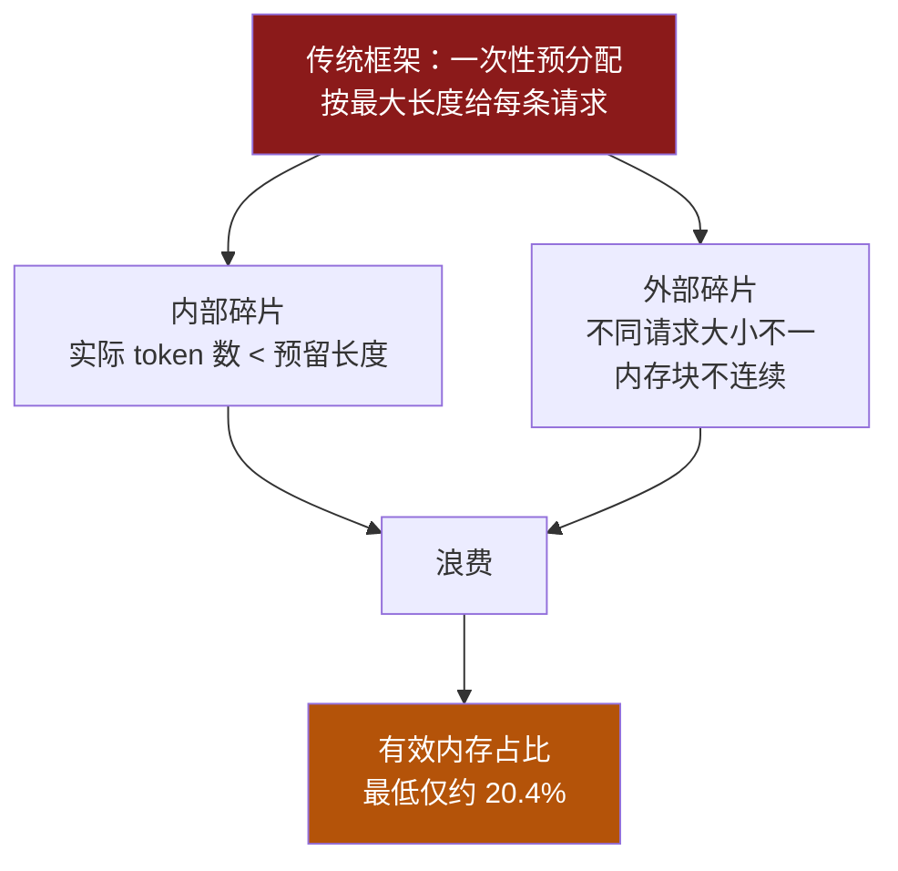
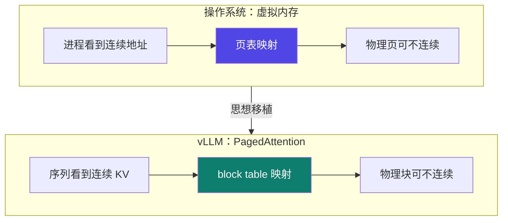
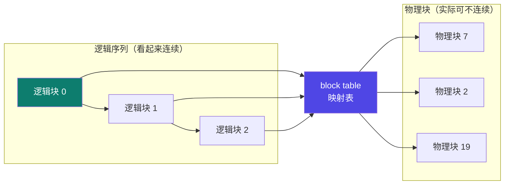
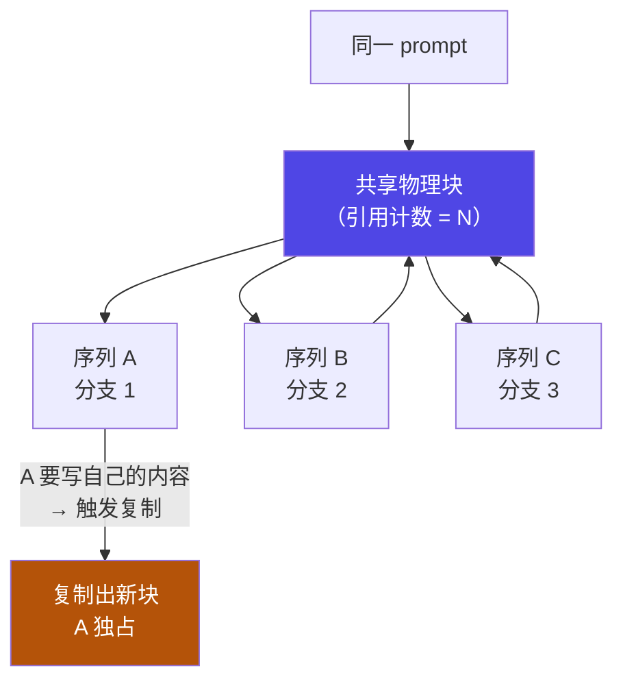

# 6-8 · vLLM 深入：PagedAttention

::: info 难度分层 · 本页 = L3（机制 / 源码级概念）
L3 能讲清"有效内存占比仅 20.4%"的成因、block table 的映射关系，以及 copy-on-write 与引用计数如何实现共享。★★★
:::

## 定位

[6-2](/training/p6/02-kvcache) 讲了"KV Cache 是什么"，也讲了它**带来显存问题**。
本页解决：**vLLM 是怎么把 KV Cache 的显存利用率从 ~20% 救回来的？**

这是理解 vLLM 的核心，也是 [6-9](/training/p6/09-vllm-fastapi) 实战的理论基础。

## (1) 为什么需要 vLLM

> 随着大语言模型参数规模的不断增长，传统的推理框架在处理大规模模型时面临以下几个瓶颈：

| # | 瓶颈 |
|---|---|
| ① | **显存占用高** |
| ② | **批处理效率低** |
| ③ | **服务延迟高** |

> 原文旁注："不同推理框架吞吐量对比"（配图）。

## (2) 传统推理的两个阶段

| 阶段 | 原文 |
|---|---|
| **prefill 阶段** | 接收完整输入，并**一次性利用 GPU 并行计算所有 token 的 Q、K 和 V 向量** |
| **decode 阶段** | **逐 token 生成输出**。利用 **KV Cache** 加速 attention 计算 |

关键观察：

> 生成的 token 数量增加，**KV Cache 会线性增长**，并逐步**占据大量 GPU 显存**。

## (3) 症结：预分配导致碎片，有效占比仅 20.4%

**这是全页最关键的一组数字**：

> KV Cache 为什么成了 LLM 推理的瓶颈？
> - **预分配导致内存碎片严重**，造成空间浪费
> - 已预留但尚未使用的空间，产生碎片
> - **内部碎片**：实际 token 数**小于预留长度**，产生碎片
> - **外部碎片**：不同请求所需内存大小不一，造成**内存块间不连续**，产生碎片
> - **真正用于存放 KV Cache 的有效内存占比最低仅约 20.4%，其余全为浪费**

::: warning "20.4%" 意味着什么
**每分配 100 份显存，真正装 KV Cache 的只有约 20 份，其余 80 份是浪费。**
换句话说：**显存利用率不到 1/5**。
如果能把这个比例提上去，就等于**同样的卡能服务 4~5 倍的并发**——这就是 vLLM 的价值所在。
（原文给的是"**最低仅约** 20.4%"，即最坏情况。）
:::

| 碎片类型 | 成因（原文）|
|---|---|
| **内部碎片** | 实际 token 数**小于**预留长度 |
| **外部碎片** | 不同请求所需内存大小不一 → 内存块之间**不连续** |

## (4) PagedAttention：把操作系统那套搬过来

> **paged_attention（内存分页机制）**：解决 KV Cache 内存管理中的**高占用、严重碎片和复用困难**等问题：
> - 每个序列的 Key/Value 缓存被**分割成多个块（Page）**
> - 块之间通过**指针链接**，实现**非连续存储**
> - **类似操作系统中的虚拟内存管理**

> 原文旁注："**操作系统内存管理 → vLLM 内存管理**"

::: tip 为什么"分页"能同时解决三件事
| 问题 | 分页怎么解决 |
|---|---|
| **高占用** | 按块分配，**用多少给多少**，不再按最大长度预分配 |
| **碎片** | 块可以**不连续**——内部碎片最多剩"最后一块没用满"的量；外部碎片被指针链接消除 |
| **复用困难** | 块可以被**多个序列共享**（见 §6 的 CoW）|

**一句话：把"要一整块连续内存"变成"要一堆小方块 + 一张映射表"。**
:::

## (5) block table：逻辑块 → 物理块

> vLLM 在 **decode 阶段**使用 PagedAttention 配合 **block-level 的内存管理机制**，实现高效、动态的 KV Cache 管理。
>
> **分页 block table 机制**：
> - 每个**逻辑块仅在前一个块被填满后**才会分配新的物理块，从而**最大程度地减少内存浪费**
> - vLLM 通过 **block table 映射关系**，将连续 KV Cache 序列的**逻辑块映射到非连续的实际物理块**，从而完成数据的读取与计算

::: tip "前一个块填满才分配下一个"解决了内部碎片
这正是 [6-2](/training/p6/02-kvcache) 说的"**动态分配缓存**"的极致版本：
**不再按"最大可能长度"预分配，而是填满一块再给下一块。**
所以内部碎片最多只剩"最后一块的未用部分"，几乎可以忽略。
:::

## (6) 共享与隔离：引用计数 + copy-on-write ★

> 同一个 prompt 会生成多个候选输出，其对应的 KV Cache 也**可以共用同一组物理块**。
> PagedAttention 通过**引用计数**和 **block-level 的 copy-on-write 机制**实现**共享与隔离的平衡**：
> **只有当序列出现不同分支时，才会触发复制操作。**

::: tip copy-on-write 的精髓："写时才复制"
**不写的时候共用，要写的时候才复制。**
- **引用计数**：记录有多少个序列在共享这个块。
- **CoW**：某序列要往块里写新东西时，**先复制一份再写**，不污染其他序列。

**收益**：多个候选输出（如 beam search、n>1 采样）在**分叉之前**完全共享 KV Cache——
省掉大量重复存储。这正是 [6-2](/training/p6/02-kvcache) 里"复用困难"问题的解药。
:::

## (7) 三条核心特性汇总

| 机制 | 解决什么 | 关键点 |
|---|---|---|
| **分页（Page）** | 高占用 + 碎片 | KV Cache 切成块，指针链接，非连续存储 |
| **block table** | 内存浪费 | 逻辑块 → 物理块映射；填满才分配下一块 |
| **引用计数 + CoW** | 复用困难 | 分叉前共享，写时才复制 |

## 坑与自检

> ✕ 以为 vLLM 只是"跑得更快的推理框架"。

> ✓ vLLM 的核心创新是**显存管理**（PagedAttention），不是计算本身。

> ✕ 以为"20.4%"是个别情况的小问题。

> ✓ 原文用"**最低仅约**"——最坏情况下**八成显存是浪费的**。

> ✕ 把"内部碎片"和"外部碎片"搞混。

> ✓ **内部**：实际 token 数 < 预留长度；**外部**：请求大小不一导致内存块不连续。

> ✕ 以为多个候选输出各占一份 KV Cache。

> ✓ 分叉前**共享物理块**（引用计数），分叉时才 CoW 复制。

**自检清单**：

- [ ] 我能说出 vLLM 要解决的三个瓶颈
- [ ] 我能区分 prefill 与 decode 两个阶段
- [ ] 我知道 KV Cache 随 token 数线性增长
- [ ] 我能解释内部 / 外部碎片的成因
- [ ] 我记住"有效内存占比最低仅约 **20.4%**"
- [ ] 我能说清 PagedAttention 与操作系统虚拟内存的类比
- [ ] 我知道 block table 做逻辑块 → 物理块的映射
- [ ] 我知道"填满才分配下一块"消除内部碎片
- [ ] 我能解释引用计数 + copy-on-write 如何实现共享与隔离

---

> 上一节：[6-7 Ollama 部署全流程](/training/p6/07-ollama) ｜ 下一节：[6-9 vLLM + FastAPI 实战](/training/p6/09-vllm-fastapi)
