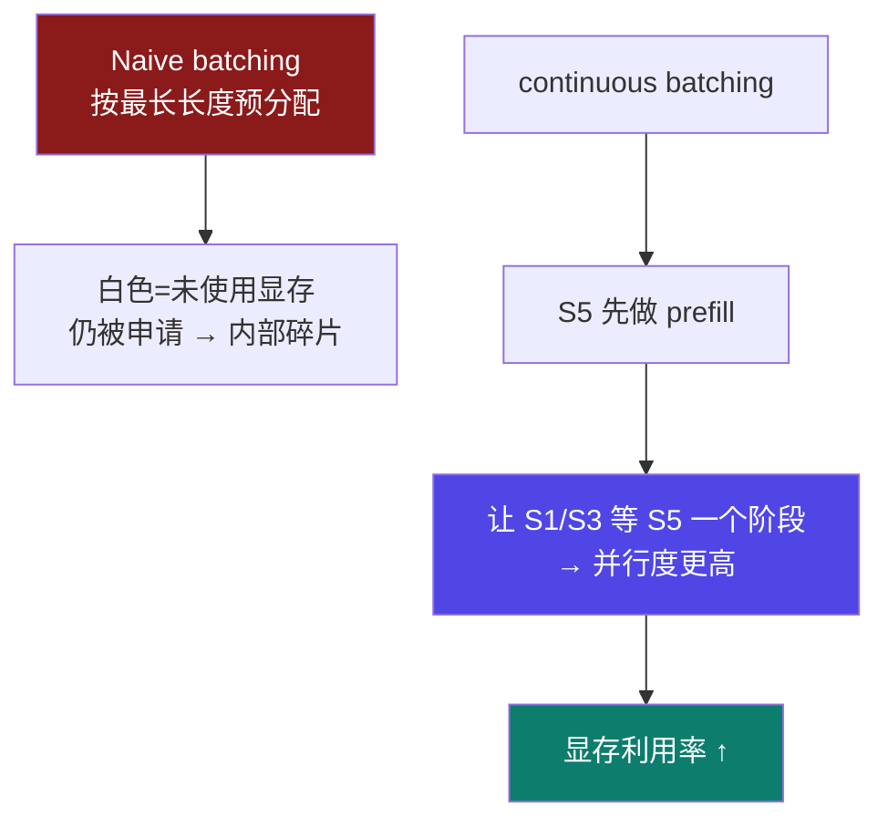

# 6-9 · vLLM + FastAPI 实战

::: info 难度分层 · 本页 = L3（可运行 / 源码级）
L3 能读懂 `fastapi_server.py` 的每个环节，并跑通两条服务化路径。★★★▶
:::

## 定位

[6-8](/training/p6/08-vllm-pagedattention) 讲了 vLLM 的"为什么"。本页是**落地**：
两条并行路径——**(a) 直接用 vLLM 的 OpenAI 兼容接口** / **(b) vLLM 作后端 + FastAPI 作前端**。

资产：`vllm相关代码/{fastapi_server.py, qwen3_1_7b.yaml, vllm&fastapi部署.ipynb}`。

## (1) vLLM 的连续批处理（再深入一层）

**朴素批处理的问题**：

> 白色部分显存虽然可能当前阶段不会用到甚至可能永远生成结束也不会用到，
> 但是**仍然会申请这部分显存**，这就造成了**内部碎片**的空间浪费。

**continuous batching 策略**的五个阶段示意（prefill / generate / 部分序列推理完成 ×2 / s1、s3 等 s5 一个预填充阶段）：

| 要点 | 原文 |
|---|---|
| S5 入场 | S5 是**没有经过 prefill 阶段**的，必须**先 prefill 之后才能进行 generation** |
| 限制 | **prefill 和 generation 的计算流程不同，这两种状态的请求不可能同时操作** |
| 策略 | **让 S1 和 S3 等 S5 一个阶段**，就能获得更高的并行程度；相比"s1/s3 生成完成之后再让 S5 参与计算"，前者**更加划算** |
| 图注 | 斜线阴影部分代表**未使用的显存** |



其他处理与优势：

| 类别 | 原文 |
|---|---|
| **其它处理** | **排队抢占机制**；不能分配下显存时**释放部分 KV Cache** |
| **优势** | 支持连续批处理；**显存利用率提高 24% 以上**；更好的支持并发推理 |

## (2) FastAPI 是什么

> FastAPI 是一个用于构建 API 的**高性能 web 框架**，专为 Python 中构建 **RESTful API** 而设计。

| 类别 | 原文 |
|---|---|
| **特点** | **高性能**（支持 Starlette、Pydantic）；**类型注解支持**；**异步支持** |
| **适用场景** | 构建 API 后端；微服务架构（可作为微服务后端框架，支持快速开发和部署）；数据处理 API（接收和返回 JSON）；支持 **WebSocket** 实时通信 |

::: tip FastAPI 的三个特点正好对应 `fastapi_server.py` 的三处写法
- **Pydantic** → `class GenerateRequest(BaseModel)` 定义请求体
- **类型注解** → `prompt: str` / `is_stream: Optional[bool] = True`
- **异步** → `async def` + `AsyncOpenAI`（见 §4）
:::

## (3) 实战任务与依赖

```bash
pip install vllm==0.8.2
pip install flash-attn==2.7.2.post1
pip install fastapi
```

| 任务 | 内容 |
|---|---|
| **任务 (a)** | 通过 **vLLM 框架**部署模型服务，并通过 **OpenAI 兼容接口**访问。模型：qwen3-1.7B。启动 LLaMA-Factory 中的 vLLM 推理框架 |
| **任务 (b)** | 使用 **FastAPI** 部署模型服务，并通过 **OpenAI 兼容接口**访问。模型：qwen3-1.7B。详见 `vllm&fastapi部署.ipynb` |

**任务 (a) 的启动命令**（原文）：

```bash
API_PORT=6006 llamafactory-cli api examples/inference/qwen3_1_7b.yaml \
  infer_backend=vllm vllm_enforce_eager=true
```

**`qwen3_1_7b.yaml` 配置**（原文）：

```yaml
model_name_or_path: /root/autodl-tmp/Qwen/
template: qwen3
infer_backend: vllm  # choices: [huggingface, vllm, sglang]
trust_remote_code: true

# VLLM特定配置
vllm_config:
  dtype: float32
  gpu_memory_utilization: 0.9 # GPU能利用的空间比例，越高的比例代表能抗越高的并发
  max_model_len: 8192 # 能够一次性处理和生成的最大文本长度
```

**字段解释**：

| 字段 | 值 | 说明 |
|---|---|---|
| `infer_backend` | `vllm` | 可选 `huggingface` / `vllm` / `sglang` |
| `gpu_memory_utilization` | `0.9` | **GPU 能利用的空间比例，越高越能抗并发**（原文注释）|
| `max_model_len` | `8192` | 一次性处理和生成的最大文本长度 |
| `template` | `qwen3` | 对话模板 |

::: warning ⚠ 关于 `dtype: float32`（原文如此）
原文配置写的是 `dtype: float32`。**推理场景通常用 `float16` / `bfloat16`**——
float32 会让显存占用**翻倍**（对比 [6-1](/training/p6/01-challenges) 的字节表：FP32=4B vs FP16=2B）。
本站**如实保留原文值**，但提示：若遇到 OOM，**优先检查这一项是否应该改成 `float16`**。
:::

## (4) `fastapi_server.py` 逐段解析

资产 `vllm相关代码/fastapi_server.py`：

### 4.1 连接 vLLM（OpenAI 兼容）

```python
from openai import AsyncOpenAI

openai_api_key = "EMPTY"                          # vLLM 不需要真实 OpenAI Key
openai_api_base = "http://localhost:6006/v1"      # vLLM 服务器地址

client = AsyncOpenAI(api_key=openai_api_key, base_url=openai_api_base)
```

::: tip 两处关键设计
1. **`api_key="EMPTY"`**：vLLM 的 OpenAI 兼容接口**不校验 Key**，填什么都能过。
2. **`AsyncOpenAI`**：异步客户端——FastAPI 是异步框架，用同步客户端会**阻塞事件循环**。

**"OpenAI 兼容"最大的价值**：客户端代码**完全不用改**，只是把 `base_url` 从 OpenAI 换成 vLLM。
:::

### 4.2 请求模型（Pydantic）

```python
class GenerateRequest(BaseModel):
    prompt: str                                  # 必填：含历史对话+本轮对话的字符串
    model: Optional[str] = ""
    is_stream: Optional[bool] = True             # 控制流式/非流式
    max_tokens: Optional[int] = 32768
    temperature: Optional[float] = 0.6
    top_p: Optional[float] = 0.95
    top_k: Optional[int] = 20
    system_message: Optional[str] = None
```

### 4.3 流式生成（SSE）

```python
if is_stream:
    stream = await client.chat.completions.create(
        model=model, messages=messages, stream=True,
        max_tokens=max_tokens, temperature=temperature, top_p=top_p,
        extra_body={"top_k": top_k})              # ⭐ vLLM 扩展参数

    async def generate_stream():
        async for chunk in stream:
            if (chunk.choices[0].delta.content is not None and
                'tool_call' not in chunk.choices[0].delta.content):
                content = chunk.choices[0].delta.content
                data = json.dumps({"content": content}, ensure_ascii=False)
                yield f"{data}\n\n"
        yield "[DONE]\n\n"

    return generate_stream()
```

::: tip 三个细节
1. **`extra_body={"top_k": top_k}`**：`top_k` **不是 OpenAI 标准参数**，是 vLLM 的扩展 → 必须走 `extra_body`。
2. **`ensure_ascii=False`**：JSON 里**保留中文原文**，不转义成 `\uXXXX`（否则前端会看到乱码）。
3. **`yield f"{data}\n\n"`**：SSE（Server-Sent Events）格式要求**每条消息以两个换行结尾**；最后发 `[DONE]` 通知客户端结束。
:::

### 4.4 非流式生成

```python
else:
    response = await client.chat.completions.create(
        model=model, messages=messages, stream=False,
        max_tokens=max_tokens, temperature=temperature, top_p=top_p,
        extra_body={"top_k": top_k})
    if response.choices and response.choices[0].message.content:
        return response.choices[0].message.content
    else:
        return "模型未返回有效回复"
```

### 4.5 路由：一个接口同时支持流式与非流式

```python
app = FastAPI(title="vLLM API Server", description="基于vLLM的流式和非流式文本生成API")

@app.post("/generate")
async def generate(request: GenerateRequest):
    result = await generate_text(
        prompt=request.prompt,
        model=request.model or DEFAULT_MODEL,
        is_stream=request.is_stream if request.is_stream is not None else DEFAULT_IS_STREAM,
        ...)
    if request.is_stream:
        return StreamingResponse(                # ⭐ HTTP SSE 框架
            result,
            media_type="text/event-stream; charset=utf-8",
            headers={
                "Cache-Control": "no-cache",
                "Connection": "keep-alive",
                "Access-Control-Allow-Origin": "*",
                "Access-Control-Allow-Headers": "*",
            })
    else:
        return {"response": result}
```

::: tip 路由设计的两个亮点
1. **一个 `/generate` 接口，用 `is_stream` 参数分流** —— 调用方不用记两个 URL。
2. **CORS 头（`Access-Control-Allow-Origin: *`）** —— 让**浏览器前端能直接调用**，否则会被同源策略拦住。
:::

### 4.6 启动

```python
if __name__ == "__main__":
    import uvicorn
    uvicorn.run(app, host="0.0.0.0", port=6008)
```

::: warning ⚠ 注意端口：**6006 vs 6008**
- **vLLM 服务**跑在 `6006`（`fastapi_server.py` 里的 `openai_api_base`，以及任务 a 的 `API_PORT=6006`）。
- **FastAPI 服务**跑在 `6008`（本文件 `uvicorn.run(port=6008)`）。

**两个服务是两个进程**：先起 vLLM（6006），再起 FastAPI（6008）。
客户端打 6008，FastAPI 内部再去打 6006。**搞错端口会连接失败。**
:::

## (5) 验证服务

**任务 (a)：直接打 vLLM（6006）**

`vllm&fastapi部署.ipynb`：

```python
from openai import OpenAI
client = OpenAI(api_key="EMPTY", base_url="http://localhost:6006/v1")

# 非流式
chat_response = client.chat.completions.create(
    model="qwen1.7b",          # 这里填什么都无所谓
    messages=[{"role": "user", "content": "你好呀。"}],
    max_tokens=32768, temperature=0.6, top_p=0.95,
    extra_body={"top_k": 20})
print(chat_response.choices[0].message.content)

# 流式
stream = client.chat.completions.create(
    model="", messages=[{"role": "user", "content": "你好呀。"}], stream=True, ...)
for chunk in stream:
    if chunk.choices[0].delta.content is not None and 'tool_call' not in chunk.choices[0].delta.content:
        print(chunk.choices[0].delta.content, end="", flush=True)
```

**任务 (b)：打 FastAPI（6008）**

```bash
# 用 curl
curl -X POST "http://localhost:6006/generate" \
  -H "Content-Type: application/json" \
  -d '{"prompt": "你好","temperature": 0.6,"max_tokens": 2000}'
```

```python
# 用 requests —— 非流式
import requests
response = requests.post(
    "http://127.0.0.1:6008/generate",
    json={"prompt": "你是谁","temperature": 0,"max_tokens": 2000,"is_stream":False})
print(response.json())
```

```python
# 用 requests —— 流式
import requests, json
response = requests.post(
    "http://127.0.0.1:6008/generate",
    json={"prompt": "你是谁","temperature": 0,"max_tokens": 2000,"is_stream":True})
print("流式响应:")
for chunk in response.iter_lines():
    if chunk:
        chunk_str = chunk.decode('utf-8')
        if '[DONE]' in chunk_str:
            break
        try:
            data_obj = json.loads(chunk_str)
            print(data_obj['content'], end='', flush=True)
        except:
            pass
```

::: warning ⚠ 原文 curl 示例的端口写错了（L5，`vllm&fastapi部署.ipynb`）
原文 curl 示例写的是 `http://localhost:**6006**/generate`，
但 `/generate` 这个路由属于 **FastAPI 服务（6008）**，不是 vLLM（6006）。
**正确应为 `http://localhost:6008/generate`**（原文下方的 requests 示例用的就是 6008，可互相印证）。
:::

## 两条路径怎么选

| 维度 | (a) 直接用 vLLM | (b) vLLM + FastAPI |
|---|---|---|
| 端口 | 6006 | FastAPI 6008 → vLLM 6006 |
| 接口形态 | **标准 OpenAI 兼容**（`/v1/chat/completions`）| **自定义 `/generate`** |
| 定制能力 | 弱（受限于 OpenAI 协议）| **强**（可加鉴权、日志、改写、多模型路由）|
| 何时选 | **快速接入、客户端已用 OpenAI SDK** | 需要**业务定制**（如统一网关、SSE 特殊格式）|

## 坑与自检

> ✕ 把 vLLM 和 FastAPI 当成一个服务。

> ✓ 是**两个进程、两个端口**（6006 / 6008）；客户端打 6008，FastAPI 打 6006。

> ✕ 用 `top_k` 直接传给 OpenAI SDK 顶层参数。

> ✓ `top_k` 是 vLLM 扩展，必须放 **`extra_body`**。

> ✕ 忘记 `ensure_ascii=False`。

> ✓ 否则中文会被转义成 `\uXXXX`。

> ✕ 用同步 `OpenAI` 客户端写 FastAPI。

> ✓ 用 **`AsyncOpenAI`**，否则阻塞事件循环。

> ✕ 抄 `dtype: float32` 然后 OOM。

> ✓ 推理优先 `float16` / `bfloat16`。

**自检清单**：

- [ ] 我能说出连续批处理相比朴素批处理的优势（含 24% 显存利用率提升）
- [ ] 我知道 FastAPI 的三个特点分别对应代码里的哪处写法
- [ ] 我能写出任务 (a) 的启动命令
- [ ] 我能逐段读懂 `fastapi_server.py`（连接 / 请求模型 / 流式 / 非流式 / 路由 / 启动）
- [ ] 我知道 `top_k` 必须放 `extra_body`
- [ ] 我知道两个服务的端口分别是 6006 和 6008
- [ ] 我知道原文 curl 示例的端口有误（应为 6008）
- [ ] 我知道 `dtype: float32` 在推理中不常见

---

> 上一节：[6-8 vLLM 深入：PagedAttention](/training/p6/08-vllm-pagedattention) ｜ 下一节：[6-10 其他部署方案](/training/p6/10-others)
