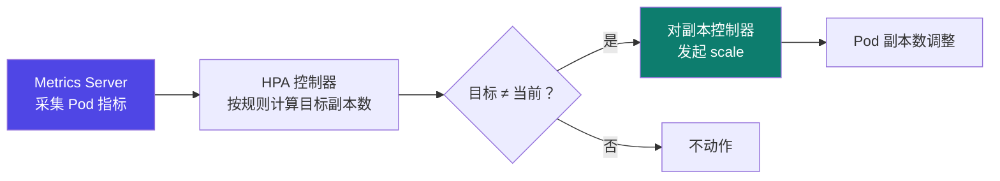

# 6-10 · 其他部署方案

::: info 难度分层 · 本页 = L1→L2（概念 → 选型层）
L1 能说出 Triton / OpenVINO MS / Ray Serve / SGLang / K8s 各自是什么；L2 能按场景选型。▶
:::

## 定位

[6-7](/training/p6/07-ollama)（Ollama）与 [6-8](/training/p6/08-vllm-pagedattention)/[6-9](/training/p6/09-vllm-fastapi)（vLLM）是**两种主力方案**。
本页补齐**其余五种**，让你在"个人验证"和"生产集群"之间有一张完整的地图。

## (1) Triton Inference Server

> **NVIDIA** 提供的一种**开源软件**，旨在**标准化 AI 模型的部署和执行**。
> 支持在**云端和边缘设备**上进行推理，并优化了 CPU 和 GPU 的使用。

主要功能和特点：

| 类别 | 原文 |
|---|---|
| **多后端支持** | 包括 TensorRT、TensorFlow、PyTorch、ONNX Runtime 和 OpenVINO 等 |
| **多协议支持** | **HTTP 和 GRPC** 协议 |
| **多设备支持** | 支持**单 GPU、多 GPU 和 CPU** 的推理 |
| **模型管理** | **模型热加载**、模型版本切换和**动态批处理**等功能 |

使用方式（原文）：

> 1. **创建模型仓库**，并将模型文件放入其中。可以使用以下命令克隆 Triton 的示例模型仓库（参考官方 quickstart 文档）。

::: tip Triton 的定位：**"模型服务器的服务器"**
它最大的特点是**多后端 + 多协议 + 多设备**——不管你用什么框架训的模型，都能塞进同一个服务里统一管理。
**"模型热加载"和"版本切换"** 对应 [6-1](/training/p6/01-challenges) 讲的"版本管理"要求。
:::

## (2) OpenVINO Model Server

> 一个**高性能的推理服务器**，基于 **Intel 的 OpenVINO™ 工具套件**，支持多种模型格式，
> 并能无缝集成到 **Kubernetes** 等容器编排系统中，非常适合**大规模模型部署和推理服务**。

核心功能：

| 功能 | 原文 |
|---|---|
| **远程推理** | 通过 **REST 或 gRPC API** 进行推理，支持轻量级客户端 |
| **多框架支持** | 兼容 **TensorFlow、ONNX、PaddlePaddle** 等模型格式 |
| **动态模型管理** | 支持**模型版本控制和运行时更新** |
| **高效资源利用** | 支持**水平和垂直**推理扩展 |
| **多平台支持** | 可运行于 **Docker 容器、裸机以及 Kubernetes** 环境中 |

```bash
pip install -U openvino
# 项目地址：https://github.com/openvinotoolkit/openvino
```

::: warning 别把两个"OpenVINO"搞混
- **[6-5](/training/p6/05-compile) 的 OpenVINO**：是一个**推理加速工具**（要求 Intel CPU）。
- **本页的 OpenVINO Model Server**：是一个**推理服务器**（对外的服务化组件）。

一个是"引擎"，一个是"服务器"。
:::

## (3) Ray Serve

给出四大能力：

| # | 能力 | 原文 |
|---|---|---|
| (1) | **构建端到端应用** | 超越"张量进，张量出"的单一模型服务；将 ML 模型、业务逻辑与 Web 服务（如数据库）**统一在单一 Python 框架中** |
| (2) | **可编程模型组合** | 用直观的 Python API 组合**多模型流水线**；每个模型可**独立配置资源（CPU/GPU）**并分布式运行 |
| (3) | **精细化资源管理** | **动态扩缩容**（按负载调整副本数）；**请求批处理**（提升 GPU 利用率）；**灵活资源分配** |
| (4) | **避免厂商锁定** | **框架无关**（不绑定特定 ML 库）；**环境无关**（笔记本 / K8s / 任何云或本地）|

使用方式：

```text
教程：https://docs.rayai.org.cn/en/latest/serve/getting_started.html

核心步骤：
- 装饰器 @serve.deployment 封装 ray server
- 新方法 __call__ 实现接收请求调用推理方法返回结果
- translator_app = Translator.bind() 定义应用程序
- serve run serve_quickstart:translator_app 启动服务
```

::: tip Ray Serve 的核心差异：**"组合"而不是"单个模型"**
Ollama / vLLM 解决的是"**一个模型怎么服务出去**"。
Ray Serve 解决的是"**多个模型 + 业务逻辑 + 数据库怎么组合成一条流水线**"。
所以它天然适合**多模型编排**的场景（比如：检索模型 → 排序模型 → 生成模型）。
:::

## (4) SGLang

> 一个用于**大型语言模型和视觉语言模型**的快速服务框架。
> 通过**协同设计后端运行时和前端语言**，使您与模型的交互**更快、更可控**。

核心功能：

| 功能 | 原文 |
|---|---|
| **快速后端运行时** | 通过**零开销 CPU 调度器、连续批处理、分页注意力、张量并行、分块预填充、结构化输出、量化（FP8/INT4/AWQ/GPTQ）和多 LoRA 批处理**来提供高效服务 |
| **灵活前端语言** | 提供用于编程 LLM 应用程序的直观接口，包括**链式生成调用、高级提示、控制流、多模态输入、并行性以及外部交互** |
| **广泛模型支持** | 支持多种生成模型、嵌入模型和奖励模型，易于扩展 |
| **活跃社区** | 开源，拥有活跃社区及工业界应用 |

::: tip SGLang 与 vLLM 的关系：**同类竞品**
看 SGLang 的后端特性清单——**连续批处理、分页注意力、张量并行、量化**——
这些正是 [6-8](/training/p6/08-vllm-pagedattention) 里 vLLM 的看家本领。
**两者是同一条赛道上的竞品**；SGLang 的差异点是**"前端语言"**（用代码编排 LLM 流程，类似把 prompt 编排做成编程语言）。
:::

### 4.1 SGLang 项目实战

> 项目实战：使用 **SGLang 部署一个 Qwen3-1.7B 模型，并进行推理**。
> 教程：`https://docs.sglang.com.cn/`

**踩坑记录**（这页是"实战问题"）：

| 项 | 原文 |
|---|---|
| **问题描述** | 启动 sglang 的主节点时出现报错：**`SGLang only supports sm75 and above`** |
| **原因** | GPU 显卡**计算能力不够**，提示至少计算能力要 **SM7.5** |
| **解决方案** | 换成**计算能力大于等于 SM7.5** 的 GPU |

::: danger ⚠ 这条报错非常值得记住
`sm75` = **算力 7.5**（如 T4、RTX 20 系）。
**显卡算力不够时，框架会直接拒绝启动**——不是"跑得慢"，而是**根本起不来**。
→ 所以 [Part 1 的显卡选型](/training/p1/04-gpu) 和 [Part 4 的网络/硬件](/training/p4/01-basics) 都是**前置条件**，不是可选项。
:::

### 4.2 SGLang 启动与调用（来自 notebook）

资产 `SGlang相关代码/SGlang部署.ipynb`：

```bash
# 安装（RTX 3080×2 · 1卡场景）
pip install "sglang[all]>=0.4.6.post4" -i https://pypi.tuna.tsinghua.edu.cn/simple/
pip install flashinfer-python -i https://pypi.tuna.tsinghua.edu.cn/simple/

# 启动服务
python3 -m sglang.launch_server \
  --model-path /root/.cache/modelscope/hub/models/Qwen/Qwen3-4B-Instruct-2507 \
  --host 0.0.0.0 --port 30000

# 后台启动
nohup python3 -m sglang.launch_server --model-path ... --host 0.0.0.0 --port 30000 &
```

**① 对话补全（OpenAI 兼容）**：

```python
import openai
client = openai.Client(base_url="http://127.0.0.1:30000/v1", api_key="None")
response = client.chat.completions.create(
    model="Qwen/Qwen3-4B-Instruct-2507",
    messages=[{"role": "user", "content": "你是谁"}],
    temperature=0, max_tokens=8000)
```

**② 深度思考（reasoning）**：

```python
response = client.chat.completions.create(
    model=model, messages=messages,
    extra_body={
        "chat_template_kwargs": {"enable_thinking": True},   # 启用深度思考推理模式
        "separate_reasoning": True})
print(response.choices[0].message.reasoning_content)   # 思考过程
print(response.choices[0].message.content)             # 最终回答
```

**③ 结构化输出（Pydantic + json_schema）**：

```python
from pydantic import BaseModel, Field
class CapitalInfo(BaseModel):
    name: str = Field(..., pattern=r"^\w+$", description="Name of the capital city")
    population: int = Field(..., description="Population of the capital city")

response = client.chat.completions.create(
    model=..., messages=[...], temperature=0, max_tokens=128,
    response_format={
        "type": "json_schema",
        "json_schema": {"name": "foo", "schema": CapitalInfo.model_json_schema()}})
capital_info = CapitalInfo.model_validate_json(response.choices[0].message.content)
```

**④ 工具调用（tools）**：传 `tools=[{...}]`，读 `response.choices[0].message.tool_calls`。

**⑤ 部署 LoRA 适配器**：

```bash
python3 -m sglang.launch_server --model-path /root/.cache/.../Qwen3-4B-Instruct-2507 \
  --lora-paths lora0="第一个lora适配器的权重路径" lora1="第二个lora适配器的权重路径" \
  --port 30001 \
  --max-loras-per-batch 2 --lora-backend triton \
  --disable-radix-cache
```

::: tip SGLang 的"多 LoRA"是它的一个亮点
原文注释："**sglang 支持一个基础模型，同时适配多个 lora 低秩适配器**"。
`--lora-backend triton` 指的是**用 Triton 作为 LoRA 优化的后端实现引擎**，加速 LoRA 的特定运算。
**一个底座 + 多套 LoRA = 多租户/多业务共用一张卡**——这在 [Part 3](/training/p3/02-lora) 的 LoRA 生态里是很实用的一招。
:::

## (5) 基于 Kubernetes 的弹性伸缩

> 当集群的容量规划**无法满足应用 Pod 调度**时，可以使用**节点伸缩**功能，
> 自动扩缩节点资源以进行**调度容量的补充**。
> 弹性方案：**节点自动伸缩**与**节点即时弹性**。

**Node 自动扩容**（）：

| 要点 | 原文 |
|---|---|
| Pod 是什么 | Kubernetes 创建的一个**隔离的、可配置的运行环境** |
| 扩容机制 | **集群自动扩缩器**定期检测是否有充足资源来调度新创建的 Pod，**资源不足时调用 Cloud Provider 创建新的 Node** |

**Node 自动缩容**（）：

> 集群自动扩缩器会定期监测 Node 的资源使用情况，
> 当一个 Node **长时间资源利用率都很低时（低于 50%）**自动将其所在虚拟机从云服务商中删除。
> 此时，原来的 Pod 会**自动调度到其他 Node** 上面。

**Kubernetes 如何监控扩缩容**（）：

> Kubernetes 中的 **Metrics Server** 持续采集所有 Pod 副本的指标数据。
> **HPA 控制器**通过 Metrics Server 的 API 获取这些数据，基于用户定义的扩缩容规则进行计算，得到**目标 Pod 副本数量**。
> 当目标 Pod 副本数量与当前副本数量不同时，HPA 控制器就向 Pod 的副本控制器发起 **scale 操作**，调整 Pod 的副本数量，完成扩缩容。



::: warning ⚠ 两个易混概念：Node 伸缩 vs Pod 伸缩
| 层级 | 谁在扩缩 | 触发条件（原文）|
|---|---|---|
| **Node（节点）伸缩** | 集群自动扩缩器 | 资源不足 → **创建 Node**；利用率 **< 50%** 长期低 → **删 Node** |
| **Pod（副本）伸缩** | **HPA 控制器** | 根据 Metrics Server 指标 + 用户定义的规则 |

**顺序关系**：HPA 想加 Pod，但**没有 Node 装得下** → 这时 Node 伸缩才介入。
:::

## 五种方案横向对照

| 方案 | 归属 | 一句话定位 | 关键差异点 |
|---|---|---|---|
| **Triton** | NVIDIA | 标准化模型部署 | 多后端 / 多协议 / 热加载 / 动态批处理 |
| **OpenVINO MS** | Intel | 高性能推理服务器 | Intel 工具链 / K8s 集成 |
| **Ray Serve** | 开源（Ray）| **多模型组合编排** | 端到端应用 / 可编程组合 / 避免锁定 |
| **SGLang** | 开源 | LLM 快速服务框架 | 前端语言 + 多 LoRA / 结构化输出 / reasoning |
| **K8s 弹性伸缩** | CNCF | **基础设施层弹性** | Node 伸缩 + HPA（不是推理框架）|

::: tip 注意 K8s 与其余四个不是同一层
Triton / OpenVINO MS / Ray Serve / SGLang 是**推理服务框架**；
**Kubernetes 弹性伸缩是"跑这些服务的基础设施"**。
实践中常是"**K8s + 上面某一种推理框架**"的组合。
:::

## 坑与自检

> ✕ 把 [6-5](/training/p6/05-compile) 的 OpenVINO 与本页的 OpenVINO Model Server 混为一谈。

> ✓ 一个是**加速引擎**，一个是**推理服务器**。

> ✕ 以为 Ray Serve 和 vLLM 是竞品。

> ✓ Ray Serve 解决"**多模型组合**"；vLLM 解决"**单个 LLM 服务得快**"。二者**可组合**。

> ✕ 显卡算力不够还想跑 SGLang。

> ✓ 报 `only supports sm75 and above` → **换 ≥ SM7.5 的卡**。

> ✕ 把 HPA 和 Node 伸缩当成一回事。

> ✓ HPA 调 **Pod 副本数**；集群自动扩缩器调 **Node 数量**。

**自检清单**：

- [ ] 我能说出 Triton 的四大特点
- [ ] 我能区分"OpenVINO 加速引擎"与"OpenVINO Model Server"
- [ ] 我能说出 Ray Serve 的四大能力（尤其"可编程模型组合"）
- [ ] 我知道 SGLang 与 vLLM 是同类竞品，差异点在前端语言
- [ ] 我记住 `SGLang only supports sm75 and above` 的原因与解法
- [ ] 我知道 SGLang 支持一个底座 + 多个 LoRA
- [ ] 我能说清 Node 伸缩（< 50% 删节点）与 HPA（Metrics Server + 规则）的分工
- [ ] 我知道 K8s 与其他四种不属同一层

---

> 上一节：[6-9 vLLM + FastAPI 实战](/training/p6/09-vllm-fastapi) ｜ 下一节：[6-11 MLOps 与大模型生命周期](/training/p6/11-mlops)
