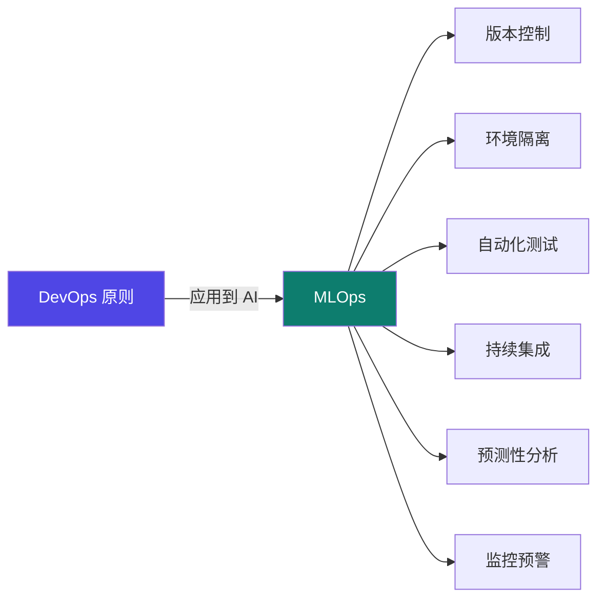
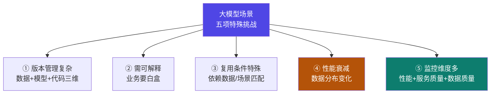

# 6-11 · MLOps 与大模型生命周期

::: info 难度分层 · 本页 = L2（体系层）
L2 能说出 MLOps 要解决的核心问题、CT/CI/CD 各自含义，以及大模型场景的五项特殊挑战。
:::

## 定位

[6-1](/training/p6/01-challenges)~[6-10](/training/p6/10-others) 讲的都是"**把模型服务出去**"这一个点。
本页把视角拉高：**模型上线之后怎么持续运营、迭代、治理？** —— 这就是 MLOps。

## (1) MLOps 是什么

> 机器学习运维（MLOps）是**将 DevOps 原则应用于人工智能领域**的实践体系，
> 旨在解决机器学习模型**从开发到生产环境部署的全生命周期管理**问题。
> 通过**版本控制、环境隔离、自动化测试**等技术手段，实现模型训练与部署的标准化。
> 该体系包含**持续集成、预测性分析、监控预警**等核心模块，
> 能够有效提升模型迭代效率并降低运维风险。

## (2) 微软的 MLOps 实践准则

> **2023 年微软提出 MLOps 七项实践准则**，其中列出：

| # | 准则（原文列出）|
|---|---|
| 1 | **模型可复用性和版本管理** |
| 2 | **模型可审计性与可解释性** |
| 3 | **模型的封装与验证** |
| 4 | **模型部署与监控** |
| 5 | **模型的持续训练** |

::: danger ⚠ 源材料缺口（L5 P63）
原文说"**七项**实践准则"，但页面**只列出 5 项**（如上表），缺 2 项。
本站**不补全、不编造**。如需完整七项，请查微软官方 MLOps 文档。
:::

MLOps 工作流（五个阶段）：

| 阶段 | 名称 |
|---|---|
| A | MLOps 项目启动 |
| B1 | 特征工程流水线的要求 |
| B2 | 特征工程流水线 |
| C | 实验流水线 |
| D | 自动化 ML 工作流 |

## (3) 自动化训练（CT）

| 项 | 原文 |
|---|---|
| **核心思想** | 将模型训练（或软件构建）过程中的**所有步骤自动化**，包括**数据预处理、特征工程、模型训练、超参数调优、模型评估**等 |
| **目标** | **无需人工干预**，就能从数据和代码开始，自动产出一个**训练好的、可用的模型或软件构建物** |
| **关键组成部分** | ① **版本控制**：代码、数据和配置文件都必须被版本化管理 ② **自动化脚本**：用脚本定义每一个步骤 ③ **环境管理**：使用**容器技术**确保训练环境的一致性 ④ **流水线**：将各个步骤串联起来，形成完整的自动化流程 |

::: tip CT 的四个组成部分，正好是"可复现"的四个前提
**版本控制（代码+数据+配置） + 自动化脚本 + 容器环境 + 流水线**
——少任何一环，实验就"复现不了"。
这与你手写 `train.py`（[5-9](/training/p5/09-practice)）时靠"记笔记/手动跑"形成鲜明对比。
:::

## (4) CI / 持续交付 / 持续部署

| # | 名称 | 原文 |
|---|---|---|
| (2) | **持续集成（CI）** | 开发人员**频繁地将代码变更合并到主干分支**。每次合并后，**自动触发一个构建和测试流程**，以尽快发现集成错误 |
| (3) | **持续交付（CD）** | 持续交付的**更高阶形态**。只要代码通过所有自动化测试阶段，就**自动部署到生产环境，无需任何人工干预**。目标：实现最快速度的反馈循环 |
| (4) | **持续部署（CD）** | 通过自动化流程，**确保代码总是处于可以随时发布到生产环境的状态** |

::: danger ⚠ 原文两处问题（L5 P66）
**问题 1：(3) 与 (4) 的定义被写反了。**
按行业标准定义：
- **持续交付（Continuous Delivery）** = 代码**总是处于可随时发布的状态**（发布仍可人工决定）
  → 这正是原文 **(4)** 的表述。
- **持续部署（Continuous Deployment）** = 通过测试就**自动部署到生产，无需人工干预**
  → 这正是原文 **(3)** 的表述。

**正确对应应是：(3) 持续部署 = 自动部署到生产；(4) 持续交付 = 随时可发布。**

**问题 2：本页 section 标题与内容不符。**
本页标题为"**B. MLOps 在大模型场景的特殊挑战**"，但正文写的却是 **CT / CI / CD**；
真正的"大模型特殊挑战"在下一页（P67）。这是讲义的结构错位，本站按内容归类，特此标注。
:::

## (5) 大模型场景的五项特殊挑战

| # | 挑战 | 原文 |
|---|---|---|
| 1 | **版本管理复杂** | 需**同时管理数据、模型、代码三个维度**，数据变化直接影响模型效果 |
| 2 | **特征与模型需可解释** | 输入特征和输出结果必须满足业务"**白盒**"要求，传统开发不涉及此方面 |
| 3 | **模型复用条件特殊** | **复用依赖数据/场景匹配**，常需重新训练和流水线调整 |
| 4 | **模型存在性能衰减** | **数据分布变化导致预测能力下降**，需持续重训练保持服务高质量 |
| 5 | **监控维度多元化** | 既要监控**系统性能**（如延迟），更要关注**服务质量**（如准确率）和**数据质量** |

::: tip 五项挑战其实在回答"为什么大模型运维比传统 ML 更难"
**传统开发的关注点：功能对不对。**
**大模型的关注点多了三层**：
- 多了"**数据**"（挑战 1、4、5）
- 多了"**质量问题**"（准确率，挑战 2、5）
- 少了"**一次训好就完事**"（挑战 3、4——需要持续重训）

这正好呼应 [6-1](/training/p6/01-challenges) 的"版本管理 / A/B / 灰度"——它们是这些挑战的**工程解法**。
:::

## 坑与自检

> ✕ 以为 MLOps 就是"写个 CI/CD 流水线"。

> ✓ MLOps 覆盖**全生命周期**，且大模型场景多了**数据、质量、持续重训**三层。

> ✕ 照抄原文的"持续交付 = 自动部署到生产"。

> ✓ **持续交付 = 随时可发布；持续部署 = 自动上线**（原文 (3)(4) 写反了）。

> ✕ 以为模型上线后就稳定了。

> ✓ 原文挑战 4 明确：**数据分布变化导致性能衰减，需持续重训练**。

> ✕ 只监控延迟等系统指标。

> ✓ 还要监控**服务质量（准确率）与数据质量**。

**自检清单**：

- [ ] 我能说出 MLOps 要解决的核心问题
- [ ] 我知道微软提的是"七项准则"，但原文只列了 5 项（缺口）
- [ ] 我能列出 MLOps 工作流的五个阶段
- [ ] 我知道 CT 的四个关键组成部分
- [ ] 我能正确区分 CI / 持续交付 / 持续部署
- [ ] 我知道原文 (3)(4) 定义写反、且本页标题与内容错位
- [ ] 我能列出大模型场景的五项特殊挑战

## 练习案例

学完本 Part，用这两道题检验自己**是不是真的能动手**——部署是"最容易被忽略的持续花钱项"，所以这两道题的重点是"起得来 + 验证完就停"：

| # | 题目 | 难度 | 主要练到 | 对应页 |
|---|---|---|---|---|
| **C11** | vLLM + FastAPI 部署微调后模型并调通 | 基础 | OpenAI 兼容接口、两进程两端口（6006/6008）、SSE 流式、`extra_body`、`/health` | [6-9](/training/p6/09-vllm-fastapi) / [6-6](/training/p6/06-api) |
| **C12** | Ollama 自定义模型 + 前缀缓存/批处理吞吐优化 | 综合 | Modelfile 全字段、`ADAPTER` 挂 LoRA、`TEMPLATE` 一致性、11434 API、前缀缓存、两条路线取舍 | [6-7](/training/p6/07-ollama) / [6-10](/training/p6/10-others) |

::: tip 这两道题都只花 1 张卡的钱，而且**验证完就该停服务**
部署按时长计费——**服务挂着不动也在花钱**。用 1.7B 甚至 0.6B 做演示，验证几次请求就够。
页首都标了预估费用与省钱姿势。
:::

→ **[C11 答案](/training/p10/c11-vllm-fastapi)** ｜ **[C12 答案](/training/p10/c12-ollama)** ｜ **[案例库总览](/training/p10/)**

---

> 上一节：[6-10 其他部署方案](/training/p6/10-others) ｜ 下一步：[Part 7 · 综合实战与展望](/training/p7/01-project)
