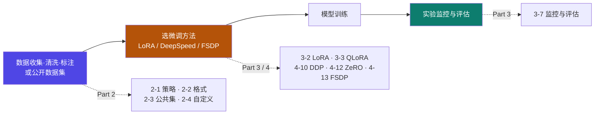
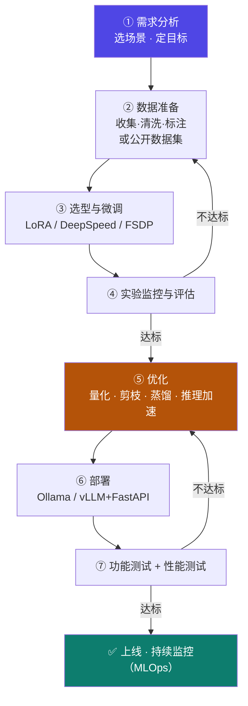

# 7-1 · 端到端综合项目

::: danger ⚠ 源材料边界声明（重要）
本页内容**仅来自课程大纲文字**（《大模型分布式微调与高效部署实战课程大纲》第六部分），
**没有配套讲义 PPT、没有代码资产、没有数据集**。
因此本页给出的是**流程框架与自查清单**，而非"可照抄的步骤"。
**每一环的具体做法，请回查 Part 1–6 的对应页面。**

> 另：大纲中本部分内部编号误写为 **5.1 / 5.1.1 / 5.2**（应为 7.1 / 7.1.1 / 7.2）。
> 本站已规范化为 **Part 7**，原文编号有误，特此标注。
:::

## 定位

Part 1–6 是"**零件**"：环境、数据、方法、分布式、蒸馏、部署。
本页把它们**串成一条完整闭环**——这正是大纲第六部分"**综合实践**"要训练的能力。

## (1) 项目选择与需求分析

大纲第六部分 5.1.1（**1 课时，与 5.1.2 合计**）：

> - 结合**学员兴趣或实际业务场景**，选择一个大模型应用项目
> - 如：特定领域（**金融、医疗、工业**等）的**智能问答系统、代码生成助手、报告摘要生成器**等

| 项目类型 | 对应本课程哪个 Part 的技术栈 |
|---|---|
| **智能问答系统**（垂直领域）| 数据工程（[Part 2](/training/p2/01-data-strategy)）+ 微调（[Part 3](/training/p3/01-methods-overview)）+ 部署（[Part 6](/training/p6/01-challenges)）|
| **代码生成助手** | 同左，数据集偏向代码语料 |
| **报告摘要生成器** | 同左，通常结合 [知识蒸馏](/training/p5/01-what) 压模型 |

## (2) 数据准备与微调实践

大纲第六部分 5.1.2：

> - **数据集收集、清洗、标注**（或使用公开数据集）
> - **选择合适的微调方法**（**LoRA / DeepSpeed / FSDP**），进行模型训练
> - **实验监控与评估**

**对应到本课程的具体页面**：

| 大纲要求 | 回查页面 |
|---|---|
| 数据集收集、清洗、标注 | [2-1 构建策略](/training/p2/01-data-strategy)、[2-4 自定义数据集](/training/p2/04-custom-dataset) |
| 使用公开数据集 | [2-3 公共数据集使用](/training/p2/03-public-dataset) |
| 数据格式 | [2-2 Alpaca / ShareGPT 与注册](/training/p2/02-data-format) |
| **LoRA** | [3-2 LoRA](/training/p3/02-lora)、[3-3 QLoRA](/training/p3/03-qlora) |
| **DeepSpeed** | [4-12 DeepSpeed 与 ZeRO](/training/p4/12-deepspeed-zero) |
| **FSDP** | [4-13 FSDP 与 DeepSpeed](/training/p4/13-fsdp) |
| 分布式训练 | [Part 4 全篇](/training/p4/01-basics) |
| 实验监控与评估 | [3-7 监控与评估](/training/p3/07-monitor-eval) |

## (3) 模型优化与部署实践

大纲第六部分 5.1.3（**1 课时**）：

> - 应用**量化、推理加速**等优化技术
> - 选择合适的**部署方案（Ollama / VLLM + FastAPI）**，搭建推理服务
> - 进行简单的**功能测试与性能测试**

| 大纲要求 | 回查页面 |
|---|---|
| 量化 | [3-6 量化技术专题](/training/p3/06-quantization) |
| 推理加速 | [6-2 KV Cache](/training/p6/02-kvcache)、[6-3 批处理](/training/p6/03-batching)、[6-5 编译加速](/training/p6/05-compile) |
| 模型压缩 | [6-4 剪枝](/training/p6/04-pruning)、[Part 5 蒸馏](/training/p5/01-what) |
| **Ollama 部署** | [6-7 Ollama 全流程](/training/p6/07-ollama) |
| **VLLM + FastAPI 部署** | [6-9 vLLM + FastAPI 实战](/training/p6/09-vllm-fastapi) |
| 服务化与 API | [6-6 API 设计](/training/p6/06-api) |
| 生命周期与运维 | [6-11 MLOps](/training/p6/11-mlops) |

## 完整闭环（一张图）

::: tip 这张图有三条"回头路"，才是它真正的价值
- ④ → ②：**评估不达标，回数据层**（最常见，也最容易被忽略）
- ⑦ → ⑤：**测试不达标，回优化层**
- ⑧ → ②：**上线后性能衰减，回数据层重训**（[6-11](/training/p6/11-mlops) 的"持续训练"）

**很多人的项目失败，是因为只走直线、不会回头。**
:::

## 自查清单（无讲义，故给"提问式"清单）

::: warning 本清单是**提问**，不是**答案**
因为源材料只有大纲文字，以下问题的答案需要你自己跑一遍才知道。
**这正是"综合实践"的意义——它没有标准答案。**
:::

**① 需求分析阶段**
- [ ] 我选了什么场景？目标用户是谁？
- [ ] "好"的标准是什么（准确率？延迟？成本？）

**② 数据阶段**
- [ ] 我的数据从哪来？怎么清洗？多少条？
- [ ] 用的是 Alpaca 还是 ShareGPT 格式？（[2-2](/training/p2/02-data-format)）
- [ ] 有没有踩过"数据对模型的负向影响"的坑？（[2-1](/training/p2/01-data-strategy)）

**③ 微调阶段**
- [ ] 为什么选 LoRA，而不是全参 / QLoRA？（[3-1](/training/p3/01-methods-overview)）
- [ ] 单卡装得下吗？装不下要上什么？（[4-10](/training/p4/10-ddp) 的边界）
- [ ] 训练参数（r / alpha / lr / 温度）是怎么定的？

**④ 评估阶段**
- [ ] 我用了什么指标？（[3-7](/training/p3/07-monitor-eval)）
- [ ] 评估不达标时，我知道该回哪一层吗？

**⑤ 优化阶段**
- [ ] 显存瓶颈在哪？（[6-1](/training/p6/01-challenges) 四项挑战哪一项）
- [ ] 量化方案怎么选？（[3-6](/training/p3/06-quantization)）

**⑥ 部署阶段**
- [ ] 选 Ollama 还是 vLLM？为什么？（[6-7](/training/p6/07-ollama) vs [6-9](/training/p6/09-vllm-fastapi)）
- [ ] 服务暴露的接口是 OpenAI 兼容的吗？
- [ ] 有没有做版本管理 / 灰度？（[6-1](/training/p6/01-challenges)）

**⑦ 测试阶段**
- [ ] 功能测试覆盖了哪些 case？
- [ ] 性能测试测了什么（吞吐 / 延迟 / 并发）？
- [ ] 结果达到预期了吗？差多少？

---

> 上一节：[6-11 MLOps 与大模型生命周期](/training/p6/11-mlops) ｜ 下一节：[7-2 趋势与职业路径](/training/p7/02-trends)
