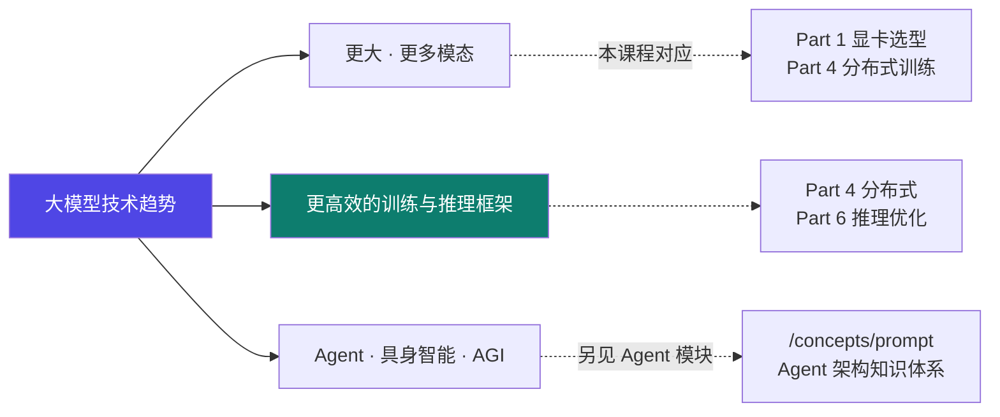
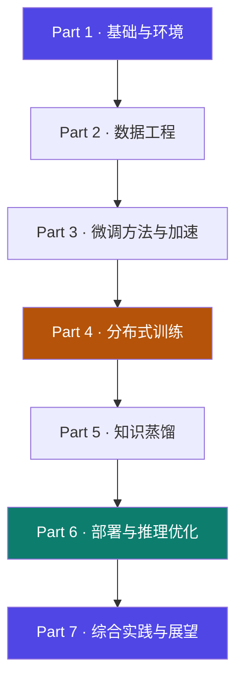

# 7-2 · 趋势与职业路径

::: danger ⚠ 源材料边界声明（重要）
本页内容**仅来自课程大纲文字**（第六部分 5.2），**无讲义、无代码**。
大纲在此处只给了**标题级要点**，没有展开论述。
因此本页**不展开推测性内容**，只做"大纲要点 + 与本课程的技术对应"，并标注哪些属于【推断】。
:::

## 定位

[7-1](/training/p7/01-project) 讲"**怎么把学的东西用起来**"。本页讲"**往哪走**"——
技术趋势、工业界趋势、职业路径。

## (1) 大模型技术发展趋势

大纲 5.2.1 的三个要点：

| # | 趋势 |
|---|---|
| 1 | **更大的模型、更强的多模态能力** |
| 2 | **更高效的训练与推理框架** |
| 3 | **Agent、具身智能、AGI 发展方向** |

::: tip 趋势 2 就是本课程的主线
"**更高效的训练与推理框架**"——Part 4（ZeRO / FSDP / 3D 并行）与 Part 6（KV Cache / PagedAttention / 连续批处理）**全部在讲这件事**。
所以从这个意义上说，**学完 Part 1–6，你已经站在了"效率"这条主线上**。
:::

::: info 关于趋势 3 与本站另一个模块
大纲提到的 **Agent**，属于本站**另一个模块**（`Agent 架构`）的领域：
`prompt / context / harness / loop / graph / skill` 六大主轴 + 框架实例 + 复刻实战 + 生产流程。
**两个模块内容零依赖**，但 reader 可以按需跳转。
:::

## (2) 工业界大模型应用趋势

大纲 5.2.2 的两个要点：

| # | 趋势 |
|---|---|
| 1 | **垂直领域大模型、企业私有化部署** |
| 2 | **大模型与边缘计算、数字孪生等技术融合** |

| 趋势 | 本课程的技术支撑 |
|---|---|
| **垂直领域大模型** | 数据工程（[Part 2](/training/p2/01-data-strategy)）+ 微调（[Part 3](/training/p3/01-methods-overview)）+ 蒸馏（[Part 5](/training/p5/01-what)）|
| **企业私有化部署** | [6-7 Ollama](/training/p6/07-ollama)（本地/隐私）、[6-9 vLLM](/training/p6/09-vllm-fastapi)、[6-10](/training/p6/10-others)（K8s 弹性）|
| **边缘计算** | [6-4 剪枝](/training/p6/04-pruning) + [3-6 量化](/training/p3/06-quantization) + [Part 5 蒸馏](/training/p5/01-what)（把模型压到能在边缘跑）|

::: tip 注意"垂直领域 + 私有化"正好对应两条技术线
- **垂直领域** → 拼的是**数据与微调**（Part 2/3/5）。
- **私有化部署** → 拼的是**部署与成本**（Part 6）。

**两者叠加 = 当前工业界最大的落地市场**。这也是为什么本课程把这两块各自做了一整个 Part。
:::

## (3) AI 工程师的职业发展路径

大纲 5.2.3：

> - **专家型技术人才、AI 架构师、MLOps 工程师、AI 产品经理**
> - **持续学习与知识更新的重要性**

| 职业方向 | 核心能力 | 本课程中最相关的部分 |
|---|---|---|
| **专家型技术人才** | 某一技术方向的深度 | Part 3（微调方法）/ Part 6（推理优化）任一深入 |
| **AI 架构师** | 系统设计与技术选型 | [Part 4 分布式](/training/p4/01-basics) + [6-10 部署方案选型](/training/p6/10-others) + [4-13 训练策略决策树](/training/p4/13-fsdp) |
| **MLOps 工程师** | 全生命周期与自动化 | [6-11 MLOps](/training/p6/11-mlops) + [6-1 版本/A-B/灰度](/training/p6/01-challenges) |
| **AI 产品经理** | 场景理解与需求转化 | [7-1 需求分析](/training/p7/01-project) + [6-1 业务指标](/training/p6/01-challenges) |

::: warning 大纲只给了"名字"，没给"路径"
原文只有四个词 + "持续学习的重要性"这一句。
**本站不编造"几年到什么级别"这类具体规划**——那属于个人经历，不属于课程内容。
上表的"核心能力"与"相关部分"是 **【推断】**，用于把抽象方向锚定到本课程的具体页面。
:::

## 全课程收官：能力地图

学到这里，你手里应该有这张图：

| 能力 | 在哪练的 |
|---|---|
| 会看数据、会造数据 | Part 2 |
| 会选微调方法、会调参 | Part 3 |
| 会把训练跑在多卡多机上 | Part 4 |
| 会把大模型压成小模型 | Part 5 |
| 会把模型稳稳服务出去 | Part 6 |
| 会把上面全部串成一个项目 | Part 7 |

## 坑与自检

> ✕ 把"趋势"当成"技术细节"去背。

> ✓ 趋势的价值在于**帮你判断"该把精力投在哪"**——本课程的答案是"效率"与"落地"两条线。

> ✕ 以为职业路径有"标准答案"。

> ✓ 大纲只给了四个方向词；**具体路径是个人选择**。

> ✕ 学完 Part 7 就以为"学完了"。

> ✓ [6-11](/training/p6/11-mlops) 的挑战 4 提醒：**模型会性能衰减，需要持续重训**——**你自己也一样**（大纲原话："持续学习与知识更新的重要性"）。

**自检清单**：

- [ ] 我能说出三条技术趋势，并把它们对应到本课程的具体 Part
- [ ] 我能说出工业界两条趋势（垂直领域/私有化、边缘计算/数字孪生）
- [ ] 我知道"垂直领域"靠 Part 2/3/5，"私有化部署"靠 Part 6
- [ ] 我能列出 AI 工程师的四个职业方向
- [ ] 我知道本页内容来自大纲要点，**本站未编造具体规划**

---

> 上一节：[7-1 端到端综合项目](/training/p7/01-project) ｜ 下一步：[附录 A1 术语表](/training/p8/a1-glossary)
