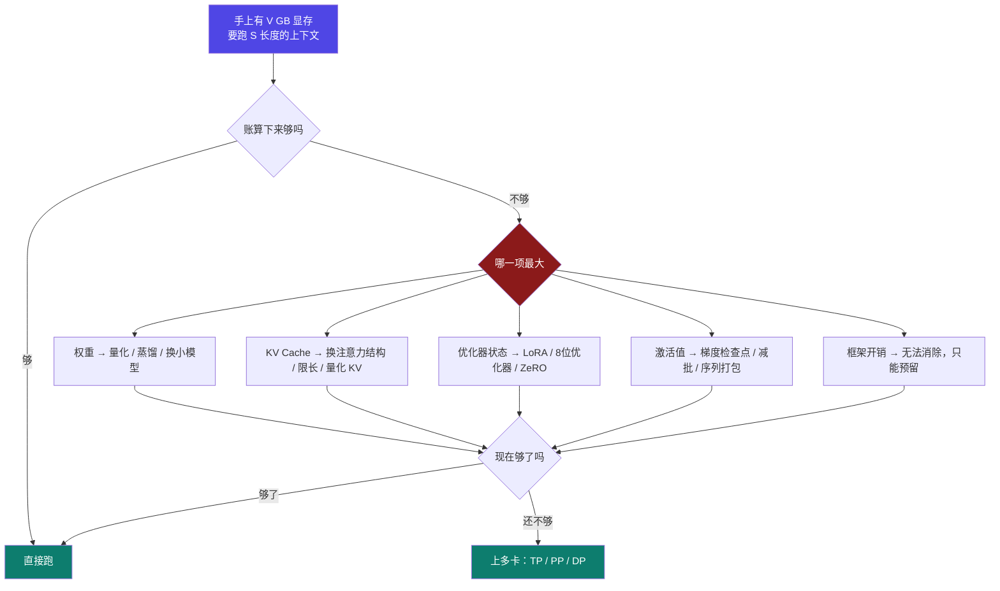
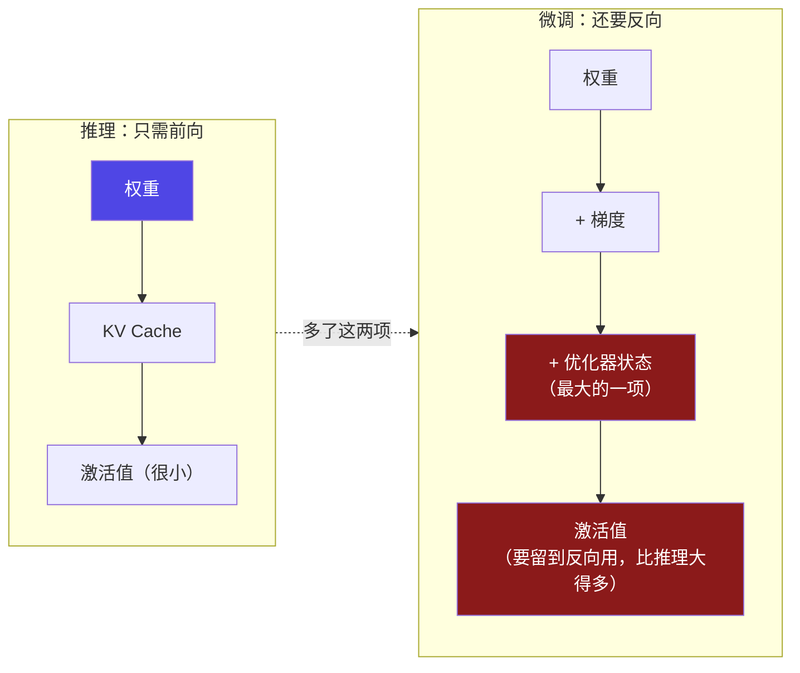

# 9-1 · 显存为什么是第一约束

::: info 难度分层 · 本页 = L1（问题层）
L1 能说清"为什么显存是所有方案的第一道闸门"，以及**推理**与**微调**两本账的差异在哪。本页不推公式。★
:::

## 定位

前 8 个部分讲的是"**怎么做**"——怎么选方法、造数据、配分布式、蒸馏、部署。
本部分（Part 9）讲的是"**做不做得成**"——**显存这块账，够不够、哪一项撑爆了、动哪个旋钮**。

这不是 [Part 6](/training/p6/01-challenges) 的重复：

| | Part 6 | Part 9（本部分） |
|---|---|---|
| 关心 | 怎么让推理**更快** | 显存这块账**怎么算**、哪一项撑爆了 |
| 手段 | 批处理、PagedAttention、量化、编译 | 数清账本 5 项 + 按优先级拧旋钮 |
| 性质 | 性能优化 | **容量规划** |

> 一句话：Part 6 让人"跑得快"，Part 9 让人"**跑得起来**"。

## (1) 为什么显存是第一约束

【业界口径】阿里云 PAI 文档把这条说得很直接：**部署和微调大模型所需的显存取决于模型参数量、精度、序列长度等因素**——也就是说，这三个量一旦定了，显存需求就基本定了，而你**改不动卡**。

所以工程上真实的决策链是这样的：

::: warning 关键：**"不够"不是一个数字，是一条判断链**
很多人只知道"显存不够就买卡"或"就上多卡"。真正的问题是——**先知道哪一项不够**。
权重不够和 KV 不够，解法完全不同（前者量化/换模型，后者换注意力结构/限长）。这正是本部分要先教"账本"的原因。
:::

## (2) 两本账：推理 vs 微调

同一个模型，同一个序列长度，**微调需要的显存可以是推理的 3–4 倍**。

| 台账 | 项数 | 组成 |
|---|---|---|
| **推理账本** | 5 | 模型权重 · KV Cache · 激活值 · 框架开销 · 多 GPU 开销 |
| **训练账本** | 5 | 模型权重 · **梯度** · **优化器状态** · 激活值 · 框架开销 |

【业界口径】CSDN-leo0308（2026-09）的原话：

> 如果模型想要训练，只看前 3 部分，需要的显存是**至少推理的 3–4 倍**。7B 的全精度模型加载需要 78G ~ 104G。

【业界口径】CSDN-weixin（2023-10）给出同一结论的另一路径：训练显存 = **模型权重 + 优化器 + 梯度 + 计算图内部变量 + 临时显存**，其中"计算图内部变量""正比于 `batch_size`"。

**多出来的两项从哪来？**

::: tip 为什么推理的激活值"很小"、微调的激活值"很大"
推理时每算完一层的激活，**用完就能扔**；微调时反向传播要用到前向的中间结果，**必须整批留着**。
这个差别就是 [9-7 激活值](/training/p9/07-activation) 那一页要展开的核心。
:::

## (3) 一个真实的反差：7B 到底要多少显存

同一句"7B 模型"，三篇参考给出的答案**完全不在一个量级上**：

| 场景 | 阿里云 PAI | CSDN-leo0308 | CSDN-weixin |
|---|---|---|---|
| 推理 FP16 | 14 GB | ~15 GB | 13.04 GB |
| 推理 INT4 | 3.5 GB | ~6 GB | 3.26 GB |
| LoRA 微调 | **18.1 GB** | ~24 GB | — |
| QLoRA 4-bit | **7.6 GB** | ~8 GB | — |
| 全参数微调 | **87.4 GB** | ~120 GB | 78 ~ 104 GB |

**看最后一行**：87.4 / 112 / 78–104——三个数字差出 **40 GB**。

::: danger 这不是谁算错了，是"口径不同"
差异来自**训练静态账到底算几字节/参数**：
- 阿里云：权重 2 + 梯度 2 + AdamW 优化器状态 8 = **12 B/参数**
- CSDN-leo0308：权重 2 + 梯度 2 + 优化器 12（含 fp32 主权重备份）= **16 B/参数**

**本部分采用哪一口径？** 以**阿里云 12 B/参数为主口径**（它是官方文档、且与本课程"混合精度 + AdamW"的描述一致），
同时把 CSDN 的 16 B/参数作为**更保守口径**在 [9-8](/training/p9/08-optimizer-states) 用脚注给出。
:::

## (4) 本部分的三个可验收目标

| # | 目标 | 学完能做到 |
|---|---|---|
| **G1** | **看懂** | 看到任意一个显存数字，能说出它由哪几项相加得到、每项由哪个公式决定 |
| **G2** | **会调** | 给定约束（"32GB 卡要跑 33K 上下文"），能按优先级说出该动哪几个旋钮、代价是什么 |
| **G3** | **对得上** | 能用本部分的公式手算出计算器里的数值（同量级），而不是只能"信界面" |

## 决策表：遇到"显存不够"先看哪一页

| 你的现象 | 先看 | 因为 |
|---|---|---|
| 不知道账由几项构成 | [9-2 账本总览](/training/p9/02-ledger-overview) | 先有账本再有账 |
| 模型加载就爆 | [9-3](/training/p9/03-weights-params) / [9-4](/training/p9/04-weights-formula) | 权重项 |
| 上下文一长就爆 | [9-5](/training/p9/05-kv-classic) / [9-6](/training/p9/06-kv-frontier) | KV Cache 项 |
| 训练时随 batch 线性涨 | [9-7 激活值](/training/p9/07-activation) | 激活项 |
| 训练起步就 100 GB+ | [9-8 优化器状态](/training/p9/08-optimizer-states) | AdamW 状态项 |
| 算出来够、一跑就 OOM | [9-9 算不到的那部分](/training/p9/09-unaccounted) | 框架开销 / 多 GPU 开销 |
| 单卡怎么都不够 | [9-10 并行切分](/training/p9/10-parallel-split) | TP / PP / DP / ZeRO |
| 卡选型 / 成本 | [9-11](/training/p9/11-hardware) / [9-11b](/training/p9/12-cost-green) | 硬件与钱 |

## 坑与自检

> ✕ 以为"显存不够"只有一个解法：上多卡。

> ✓ 先定位**哪一项**超了——权重 / KV / 激活 / 优化器状态，四项解法各不相同。

> ✕ 把 Part 6 的"推理优化"当成显存课。

> ✓ Part 6 讲**快**，Part 9 讲**装得下**。两者手段有交集（量化），但目标不同。

> ✕ 看到"7B 要 87.4 GB"和"7B 要 112 GB"就以为其中一个是错的。

> ✓ 两者都对，差在**训练静态账按几字节/参数算**。本部分主口径 = 阿里云 **12 B/参数**。

> ✕ 以为推理账本只有"权重 + KV"两项。

> ✓ 是 **5 项**，其中**框架开销**在真实工具里能占到 ~20%（见 [9-9](/training/p9/09-unaccounted)）。

**自检清单**：

- [ ] 我能说出推理账本 5 项与训练账本 5 项的名字
- [ ] 我能解释"为什么微调的激活值比推理大得多"
- [ ] 我知道 7B 全参微调在三种口径下是 87.4 / 112 / 78–104 GB，以及差异来源
- [ ] 我知道本部分采用 **12 B/参数** 作为训练静态账主口径
- [ ] 我能按"哪一项超了"选出去哪一页查

---

## 本部分页序（Part 9 · 19 页）

| # | 标题 | 档 |
|---|---|---|
| **9-1** | **显存为什么是第一约束**（本页） | ★精读 |
| [9-2](/training/p9/02-ledger-overview) | 显存账本总览：推理 5 项 · 训练 5 项 | ★精读 |
| [9-3](/training/p9/03-weights-params) | 模型权重（上）：参数量从哪来 | 标准 |
| [9-4](/training/p9/04-weights-formula) | 模型权重（下）：用公式反推 3B 模型 | ▶代码 |
| [9-5](/training/p9/05-kv-classic) | KV Cache（上）：公式与前 4 档注意力结构 | ★精读 |
| [9-6](/training/p9/06-kv-frontier) | KV Cache（下）：后 3 档前沿结构 + 真实代价 | ★精读 |
| [9-7](/training/p9/07-activation) | 激活值：训练显存的最大变量 | ★精读 |
| [9-8](/training/p9/08-optimizer-states) | 优化器状态：12 B/参数的账怎么压 | ★精读 |
| [9-9](/training/p9/09-unaccounted) | 算不到的那部分：框架开销、预分配、多GPU开销、分块预填充 | ★精读 |
| [9-10](/training/p9/10-parallel-split) | 并行切分：TP × PP × DP × ZeRO | ★精读 |
| [9-11](/training/p9/11-hardware) | 硬件选型：显存 / 带宽 / 算力 / 互连 / 质量系数 | 标准 |
| [9-11b](/training/p9/12-cost-green) | 成本与绿色 AI：$/hr · Spot vs On-Demand · 电价与碳强度 | 标准 |
| [9-12](/training/p9/13-inference-tuning) | 推理调参手册：6 个旋钮 + 4 组预设 | ★速查 |
| [9-13](/training/p9/14-training-tuning) | 训练调参手册：8 项优化技术的优先级 | ★速查 |
| [9-14](/training/p9/15-end-to-end) | 端到端实战：把计算器两组预设各算一遍 | ▶代码 |
| [9-15](/training/p9/16-calculator) | 交互式计算器 | ▶动手 |
| [9-A](/training/p9/A-param-dict) | **参数词典**（85 个字段） | ★速查 |
| [9-B](/training/p9/B-formula-card) | 公式速查卡（一页纸） | ★速查 |
| [9-C](/training/p9/C-model-matrix) | 主流模型配置对照表 | 标准 |

::: tip 三条读法
- **只想"看懂"** → 9-2 → 9-5 → 9-6 → 9-B
- **要"会调"** → 9-12 → 9-13 → 9-15（拧旋钮）
- **要"对得上"** → 9-4 → 9-14 → 9-15（跑数字）
:::

---

> 上一节：[Part 9 入口](/training/p9/01-first-constraint)（本页为首节） ｜ 下一节：[9-2 显存账本总览](/training/p9/02-ledger-overview)
