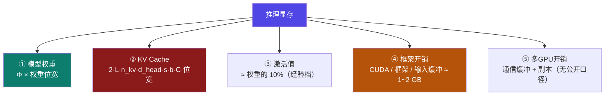
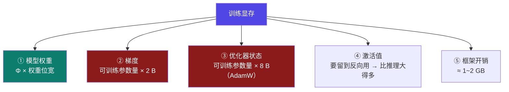

# 9-2 · 显存账本总览：推理 5 项 · 训练 5 项

::: info 难度分层 · 本页 = L2（心智模型层）
本页是**整个 Part 9 的地图**：一张图说清"显存这个数由哪几项相加"。后面的 9-3 ~ 9-11b 都是在逐项展开这 5 项。★★★
:::

## 定位

[9-1](/training/p9/01-first-constraint) 说了"先定位哪一项超了"，但**没有给账本**。
本页把账本列全——**记住这两行，本部分就掌握了一半**：

```
推理 = 权重 + KV Cache + 激活值 + 框架开销 + 多GPU开销
训练 = 权重 + 梯度   + 优化器状态 + 激活值 + 框架开销
```

## (1) 推理账本（5 项）



| # | 项 | 公式 | 由什么决定 | 详细页 |
|---|---|---|---|---|
| ① | **模型权重** | `参数量 × 权重位宽字节` | 参数量、量化档位 | [9-3](/training/p9/03-weights-params) / [9-4](/training/p9/04-weights-formula) |
| ② | **KV Cache** | `2 × L × n_kv × d_head × s × b × C × KV位宽` | 层数、**KV 头数**、序列长度、批、并发 | [9-5](/training/p9/05-kv-classic) / [9-6](/training/p9/06-kv-frontier) |
| ③ | **激活值** | `∝ b × s × h × L × 位宽`（简化 ≈ 权重的 10%） | 批、序列长度、架构 | [9-7](/training/p9/07-activation) |
| ④ | **框架开销** | 经验值 `1~2 GB` | CUDA 上下文 / 框架自身 / 输入缓冲 | [9-9](/training/p9/09-unaccounted) |
| ⑤ | **多 GPU 开销** | 通信缓冲 + 每卡副本 | 并行策略 | [9-9](/training/p9/09-unaccounted) / [9-10](/training/p9/10-parallel-split) |

【业界口径】阿里云 PAI 给出的推理四段（权重 / 激活值 / KV 缓存 / 其他）：

> 除了以上影响因素外，当前批次的输入数据、CUDA 核心、PyTorch/TensorFlow 深度学习框架本身等也会占用一些显存，**通常为 1～2GB**。

【业界口径】CSDN-leo0308 给的是两段（权重 + KV Cache），但补了 GQA 的关键作用：

> Llama-3、Qwen-2 等新模型采用了 **GQA（Grouped Query Attention）** 技术，能将 KV Cache 的显存占用降低 **4-8 倍**。

::: warning 三篇参考都"漏"了第 5 项
**多 GPU 开销**——三篇参考（阿里云 / CSDN-leo0308 / CSDN-weixin）**全都没有提到**。
本部分把它列进账本，但**必须标注为【推断】**：它的量级与具体并行策略、通信后端强相关，没有公开的统一公式。
:::

## (2) 训练账本（5 项）



| # | 项 | 公式 | 关键点 | 详细页 |
|---|---|---|---|---|
| ① | **模型权重** | `参数量 × 权重位宽字节` | QLoRA 下基座压到 4-bit → **0.5 B/参数** | [9-3](/training/p9/03-weights-params) |
| ② | **梯度** | `**可训练**参数量 × 2 B` | 全参 = 全量；LoRA/QLoRA **只为适配器算** | [9-13](/training/p9/14-training-tuning) |
| ③ | **优化器状态** | `**可训练**参数量 × 优化器字节数` | AdamW = 2 个 fp32 状态 = **8 B**；含主权重备份则 **12 B** | [9-8](/training/p9/08-optimizer-states) |
| ④ | **激活值** | `∝ b × s × h × L` | 训练版经验系数 **20–30%** | [9-7](/training/p9/07-activation) |
| ⑤ | **框架开销** | 经验值 `1~2 GB` | 同推理 | [9-9](/training/p9/09-unaccounted) |

::: tip 训练账本的"杠杆"全在**可训练参数量**上
注意②③两项的乘数不是"总参数量"，而是"**可训练参数量**"。
全参微调：可训练参数量 = 全部参数 → 7B × 16 B = 112 GB
LoRA/QLoRA：可训练参数量 ≈ 总参数的 **0.1% ~ 1%** → 这两项几乎归零

【业界口径】阿里云 PAI 的 7B 微调表（4 字节存储优化器状态）：

| 微调方式 | 模型本身 | 梯度 | Adam 优化器状态 | 激活值 | 其他 | 总计 |
|---|---|---|---|---|---|---|
| 全参数微调 | 14 GB | 14 GB | **56 GB** | 1.4 GB | 2 GB | **87.4 GB** |
| LoRA | 14 GB | 0.14 GB | 0.56 GB | 1.4 GB | 2 GB | **18.1 GB** |
| QLoRA（8-bit） | 7 GB | 0.14 GB | 0.56 GB | 1.4 GB | 2 GB | **11.1 GB** |
| QLoRA（4-bit） | 3.5 GB | 0.14 GB | 0.56 GB | 1.4 GB | 2 GB | **7.6 GB** |

**读这张表的方式**：从全参到 QLoRA-4bit，**权重省了 10.5 GB，优化器状态省了 55.4 GB**——后者才是大头。
:::

## (3) 两本账的一页对照

| 项 | 推理 | 训练 | 备注 |
|---|---|---|---|
| 模型权重 | ✅ | ✅ | 训练时可压到 4-bit（QLoRA） |
| KV Cache | ✅ | ❌（不缓存） | **只有推理有这一项** |
| 梯度 | ❌ | ✅ | 按**可训练**参数量算 |
| 优化器状态 | ❌ | ✅ | 训练最大的单项 |
| 激活值 | ✅（小） | ✅（**大**） | 差别在"是否要留到反向" |
| 框架开销 | ✅ | ✅ | 1~2 GB |
| 多 GPU 开销 | ✅ | ✅ | 无公开口径 |

## (4) 真实工具里账本长什么样

本部分的对照工具（**趋近智 · 大模型显存计算器**）右栏分两个区域，**别把二者混淆**：

| 区域 | 内容 | 性质 |
|---|---|---|
| **模型规格卡** | `权重` / `KV缓存: (FP16)` / `注意力结构: (MLA)` / `滑动窗口: (4096, 100.0%)` / `位置编码: (RoPE)` + 链接 `查看模型规格与架构详情` | **参数摘要**（不是账本分项） |
| **内存分配** | 模型权重 / KV 缓存 / 激活 / **框架开销** / **多GPU开销**（5 项条形账本） | **真正的账本** |

**推理侧示例读数**（计算器默认态）：

| 指标 | 读数 |
|---|---|
| 显存环 | **16.1%**（5.1 GB / 共 32 GB 显存） |
| 单流速度 / 延迟 | `~349 tok/sec` / `2.9 ms 每 token` |
| 首个令牌时间 TTFT | `~20 ms` |
| 估算 GPU 租赁 | `$1.10 / hour` |
| 模型规格 | `3B 总参数 · 0.1B 激活 · MoE · MLA 注意力` |

::: danger ⚠ 框架开销：占比最高的"隐形项"
在计算器示例里，**框架开销占到 1.01 GB ≈ 19.6%**——**比 KV Cache 还大 6 倍**。

而这一项：**课程讲义 0 命中、CSDN-leo0308 未给数值、CSDN-weixin 明确写"先不计算"**。
只有阿里云 PAI 给了"1～2 GB"这个区间。

**它是"算出来够、一跑就 OOM"的头号原因**，详见 [9-9](/training/p9/09-unaccounted)。
:::

## 决策表：先算哪一项

| 目标 | 建议顺序 | 理由 |
|---|---|---|
| 快速判断"跑不跑得起来" | 权重 → 优化器状态 → 其余打包预留 | 这两项占 90%+，先粗算 |
| 精算"能开多长上下文" | 权重 → **KV Cache** → 预留 2 GB | 长上下文时 KV 反超权重 |
| 精算"能吃多大 batch" | 激活值 → KV Cache | 两项都随 batch 线性涨 |
| 排查"算够了一跑就爆" | → 直接看[9-9](/training/p9/09-unaccounted) | 大概率是框架开销/预分配/碎片 |

## 坑与自检

> ✕ 把"模型规格卡"当成"内存分配账本"。

> ✓ 规格卡是**参数摘要**；账本分项在它下方的 `内存分配` 区。

> ✕ 训练账本照搬推理的项，只把权重乘个数。

> ✓ 训练**没有 KV Cache**，多了**梯度**与**优化器状态**，且激活值大得多。

> ✕ 以为推理账本 = 权重 + KV Cache 就完了。

> ✓ 至少还要加**框架开销（1~2 GB）**；多卡还要加**多 GPU 开销**。

> ✕ 把 7B 全参微调记成"112 GB"或"87.4 GB"其中一个就完事。

> ✓ 两个都要知道，并知道差在**优化器状态按 8 B 还是 12 B/参数**。

**自检清单**：

- [ ] 我能默写推理账本 5 项与训练账本 5 项
- [ ] 我知道**只有推理有 KV Cache**、**只有训练有梯度与优化器状态**
- [ ] 我知道②③两项训练账的乘数是"**可训练**参数量"而非总参数量
- [ ] 我能背出阿里云 7B 微调四档总计：87.4 / 18.1 / 11.1 / 7.6 GB
- [ ] 我知道框架开销经验值 **1~2 GB**，且在计算器示例里占 ~19.6%
- [ ] 我知道**多 GPU 开销三篇参考全无**，属【推断】

---

> 上一节：[9-1 显存为什么是第一约束](/training/p9/01-first-constraint) ｜ 下一节：[9-3 模型权重（上）：参数量从哪来](/training/p9/03-weights-params)
