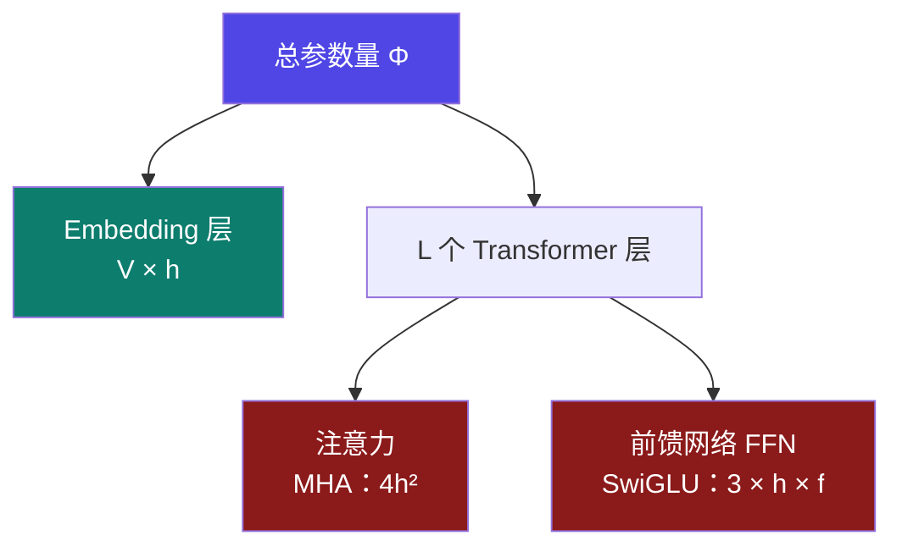
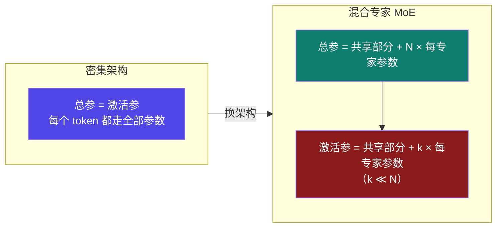

# 9-3 · 模型权重（上）：参数量从哪来

::: info 难度分层 · 本页 = L2（结构层）
L2 能把"参数量"拆成 embedding 与逐层两块，并说清 **MoE 为什么"总参 ≠ 激活参"**。本页不写代码。★
:::

## 定位

账本第 ① 项（[9-2](/training/p9/02-ledger-overview)）就是 `参数量 × 权重位宽字节`。
位宽那部分在 [1-9 量化与阶段](/training/p1/09-tuning-quant) 与 [3-6 量化技术专题](/training/p3/03-qlora) 已经讲过，还有一处全新的：**位宽档位里多了一个 FP8**（见本页 §4）。
本页要补的是另一半——**"参数量"这个数字到底从哪来**。

## (1) 参数量 = embedding + 逐层参数

| 块 | 公式 | 变量含义 |
|---|---|---|
| **Embedding** | `V × h` | `V` = 词表大小，`h` = 隐藏层维度 |
| **注意力（MHA）** | `4 × h²` | 每个 `h×h` 投影矩阵各一个：`W_q` `W_k` `W_v` `W_o` |
| **前馈（SwiGLU）** | `3 × h × f` | `gate_proj` + `up_proj` + `down_proj`，`f` = FFN 中间层维度 |
| **逐层小计** | `4h² + 3hf` | 归一化层 `2h` 量级可忽略 |
| **总计** | `V×h + L×(4h² + 3hf)` | 若输入/输出 embedding **共享权重**，则第一项不重复计 |

::: warning 两处最容易记错的地方
1. **FFN 是 3 个矩阵不是 2 个**。早期 Transformer 用 `h→f→h` 两个矩阵；现代大模型普遍用 **SwiGLU**，是 `gate/up/down` 三个。少算 1/3。
2. **embedding 可能占比很大**。词表 15 万、维度 3072 时，`V×h ≈ 4.67 亿`——对小模型来说这一项能占 15% 以上。
:::

## (2) 为什么 `h²` 在注意力和 FFN 之间"抢戏"

代入一组真实量级（`h = 3072`，`f = 18944`）：

| 块 | 计算 | 结果 | 占比 |
|---|---|---|---|
| 注意力 `4h²` | `4 × 3072²` | **37.75 M** | 17.8% |
| FFN `3hf` | `3 × 3072 × 18944` | **174.59 M** | **82.2%** |
| 逐层合计 | — | 212.34 M | 100% |

**结论**：现代大模型里 **FFN 参数量约为注意力的 4.6 倍**。

> 这也是为什么"**MoE 化**"主要动的是 **FFN**：把一个大 FFN 拆成 N 个专家，每 token 只激活其中几个——注意力部分基本不动。

## (3) MoE：为什么"总参 ≠ 激活参"

这是计算器「架构」字段选 `混合专家` 后会**多出一个「激活专家参数量」输入框**的原因。

| | 密集 | 混合专家 MoE |
|---|---|---|
| **权重显存** | `Φ × 位宽` | **`Φ总 × 位宽`**（全部专家都要加载！） |
| **激活值显存** | 按 `Φ` 算 | **按 `Φ激活` 算** |
| 计算量 | 按 `Φ` 算 | 按 `Φ激活` 算 |

【业界口径】阿里云 PAI 的原话：

> 对于 MoE 模型（混合专家模型），以 DeepSeek-R1-671B 为例，**671B 的模型本身参数都需要加载**，但在推理时**只激活 37B 的参数**，因此在计算激活值所占显存时，需要**按照 37B 的模型参数量计算**。

::: danger ⚠ 最容易搞反的一条
MoE **省的是算力与激活值，不省权重显存**。
671B 的 MoE 依然要在显存里放下 **671B 的权重**——这也是 DeepSeek 这么大模型必须多卡的原因。

计算器里对应的两个字段：`总参数量`（进权重项）与 `激活专家参数量`（进激活项）。
:::

## (4) 权重位宽档位表（含新增的 FP8）

| 档位 | 字节/参数 | 7B 权重 | 出处 |
|---|---|---|---|
| FP32 | 4 | 26.08 GiB | |
| FP16 | 2 | 13.04 GiB | |
| BF16 | 2 | 13.04 GiB | |
| **FP8** | **1** | **6.52 GiB** | 【业界口径】计算器档位 `完整(FP16) / FP8 / Q4(INT4)`；**三篇参考均未覆盖** |
| INT8 | 1 | 6.52 GiB | |
| INT4 | 0.5 | 3.26 GiB | |

::: warning ⚠ FP8 是课程与三篇参考的空白
计算器在**三个位置**都提供 FP8（推理量化 / KV 量化 / 配置弹窗的 `完整(FP16) / FP8 / Q4(INT4)`），
但：课程正文只在讲 SGLang 功能时把 "FP8" 当名词提过 1 次；阿里云参考只到 `32/16/8/4 bit`；两篇 CSDN 只到 `INT8/INT4`。

> **本页按"同字节数"处理**：FP8 每参数 **1 字节**（与 INT8 相同），故 7B → 6.52 GiB。
> 但要注意 FP8 ≠ INT8 的**数值语义**（FP8 是浮点，动态范围比 INT8 宽）。标为【业界口径】，不冒充讲义原文。
:::

## 决策表：模型加载就爆，动哪个旋钮

| 现象 | 优先 | 收益 | 代价 |
|---|---|---|---|
| 权重占了大头、质量要求可放宽 | **INT8 量化** | 权重直接**减半** | 精度略降 |
| 还差一半、能接受更多精度损失 | **INT4 量化** | 权重降到 **1/4** | 精度损失明显 |
| 要保住精度、还有算力余量 | **FP8** | 权重**减半**、数值范围好于 INT8 | 需要硬件支持（较新卡） |
| 又想省显存又要精调 | **QLoRA**（4-bit 基座 + LoRA） | 基座 0.5 B/参数 | 见 [3-3](/training/p3/03-qlora) |
| 架构选型阶段 | **换小模型 / 蒸馏** | 参数量直接下降 | 见 [Part 5](/training/p5/01-what) |
| 是 MoE、激活参很小但权重照样大 | ⚠ 量化只能治一半 | — | MoE 权重**必须全部加载** |

## 坑与自检

> ✕ 算 FFN 只乘 2 个矩阵（`h→f→h`）。

> ✓ 现代大模型用 **SwiGLU，3 个矩阵**（`gate/up/down`），漏算会少 1/3。

> ✕ 以为 MoE 能把权重显存也省下来。

> ✓ MoE **省算力与激活值**，权重**全部要加载**（671B 就得放下 671B）。

> ✕ 以为 embedding 可以忽略。

> ✓ 词表 15 万 × 维度 3072 ≈ **4.67 亿参数**，小模型上占比可达 15%+。

> ✕ 把 FP8 当成"课程里讲过的东西"。

> ✓ 课程正文只在 SGLang 功能列举里出现过这个词；**三篇参考也未覆盖**，本页标【业界口径】。

**自检清单**：

- [ ] 我能写出 `总参 = V×h + L×(4h² + 3hf)`
- [ ] 我知道 FFN 是 **3 个矩阵**（SwiGLU）
- [ ] 我能算出 `h=3072, f=18944` 时 FFN 参数约为注意力的 **4.6 倍**
- [ ] 我能解释 MoE 为什么"总参进权重项、激活参进激活项"
- [ ] 我知道 FP8 按 **1 字节/参数** 处理，且它**不在三篇参考覆盖范围内**

---

> 上一节：[9-2 显存账本总览](/training/p9/02-ledger-overview) ｜ 下一节：[9-4 模型权重（下）：用公式反推模型](/training/p9/04-weights-formula)
