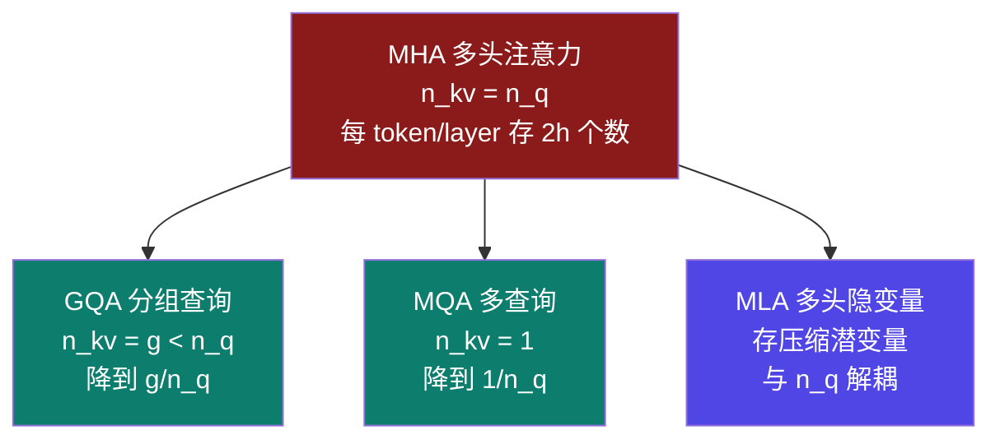

# 9-5 · KV Cache（上）：公式与前 4 档注意力结构

::: info 难度分层 · 本页 = L3（可算层）
L3 能用**通式**算出 MHA / GQA / MQA / MLA 四种结构的 KV 体积，并说清**两篇参考的公式为什么缺一个因子**。★★★
:::

## 定位

[6-2](/training/p6/02-kvcache) 讲了 KV Cache **是什么**（用显存换计算）与**四种内存优化**，
但没给"**到底多大**"的可算形式。本页补这一块——**KV Cache 是长上下文下最容易反超权重的一项**。

## (1) 通式：来自"多头"这个词本身

KV Cache 存的是每一层、每个 token 的 **K 和 V 两个矩阵**：

```
KV = 2 × L × n_kv × d_head × s × b × C × kv_bytes
     ↑   ↑    ↑       ↑      ↑ ↑ ↑    ↑
     K,V  层数  KV头数 每头维度 序列 批 并发  KV精度字节
```

| 变量 | 含义 | 计算器字段 |
|---|---|---|
| `2` | K 与 V 两个矩阵 | — |
| `L` | Transformer 层数 | `Transformer 层数` = 32 |
| `n_kv` | **KV 注意力头数** | `KV 注意力头数` = 48 |
| `d_head` | 每个头的维度 = `h / n_q` | 由 `隐藏层维度 ÷ Query 头数` 推出 = 3072 ÷ 48 = **64** |
| `s` | 序列长度（输入 + 输出 token） | `序列长度` = 4,096 |
| `b` | 批量大小（每步同时处理的输入数） | `批量大小` = 1 |
| `C` | 并发用户数 | `并发用户数` = 1 |
| `kv_bytes` | KV 精度字节（可独立量化） | `KV 缓存量化` = FP16 → 2 |

::: danger ⚠ 两篇参考的公式都缺「KV 头数」这个因子
| 来源 | 公式 |
|---|---|
| 阿里云 PAI | `2 × b × s × h × L × C × param_bytes` |
| CSDN-leo0308 | `2 × 层数 × 隐藏维度 × 序列长度 × Batch Size × 精度字节数` |

两篇都用 **`h`（隐藏维度）** 代替了 `n_kv × d_head`——这在 **`n_kv = n_q`（即 MHA）** 时恰好成立，
但**一旦换成 GQA / MQA，公式就与事实不符**。

**本部分采用通式** `2 × L × n_kv × d_head × s × b × C × kv_bytes`，
并把两篇参考的写法标注为 **「MHA 特例」**：

```
n_kv × d_head = n_q × (h / n_q) = h      ← 仅当 n_kv = n_q（MHA）
```

对照：计算器默认 `KV 头数 = 48 = Query 头数 48` → **正好是 MHA**。
所以拿默认参数套两篇参考的公式，会"算对"；**换成 GQA 就不对了**——这是选型误判的隐蔽来源。
:::

## (2) 四档结构：一张图看压缩比



| 档位 | KV 每 token 每层体积 | 相对 MHA |
|---|---|---|
| **MHA** | `2 × h × kv_bytes` | **1×**（基线） |
| **GQA** | `2 × n_kv × d_head × kv_bytes` | `n_kv / n_q` |
| **MQA** | `2 × d_head × kv_bytes` | `1 / n_q` |
| **MLA** | `(d_c + d_rope) × kv_bytes` | 与 `n_q` 无关，另算 |

::: tip 为什么 MLA 的公式长得不一样
MLA 不缓存 K、V 本身，而是缓存一个**低秩压缩后的潜变量** `c_KV`，再在读取时展开。
所以它的体积只由**潜变量维度**决定，**与有多少个 Query 头无关**。

`d_c + d_rope` 这个组合正是计算器里那个字段：**「KV 潜变量维度」（默认 576）**——
DeepSeek 的配置是 `d_c = 512`（压缩潜变量）+ `d_rope = 64`（解耦 RoPE）= **576**。

> 这也是一个交叉印证：**576 不是随手填的数**，它等于 512 + 64。
:::

## (3) 用计算器默认字段实算

字段：`L = 32`、`n_q = 48`、`n_kv = 48`、`h = 3072` → `d_head = 64`、`s = 4,096`、`b = 1`、`C = 1`、`kv_bytes = 2`（FP16）

| 结构 | 代入 | KV 体积 |
|---|---|---|
| **MHA** | `2 × 32 × 48 × 64 × 4096 × 1 × 1 × 2` | **1.500 GiB** |
| **GQA**（设 n_kv = 8） | `2 × 32 × 8 × 64 × 4096 × 2` | **0.250 GiB** |
| **MQA** | `2 × 32 × 1 × 64 × 4096 × 2` | **0.031 GiB** |
| **MLA**（d_c+d_rope = 576） | `32 × 576 × 4096 × 2` | **0.141 GiB** |

| 对比 | 相对 MHA |
|---|---|
| GQA(8) / MHA | `8/48` = **1/6** |
| MQA / MHA | `1/48` = **约 1/48** |
| MLA / MHA | **约 1/10.7** |

> 【业界口径】CSDN-leo0308 说 GQA"能将 KV Cache 的显存占用降低 **4-8 倍**"——
> 用本页公式验证：`n_q / n_kv = 48/8 = 6` 倍，**落在 4–8 区间内**。✅ 互相印证。

## (4) 决策表：KV 太大，动哪个旋钮

| 现象 | 首选 | 收益 | 代价 |
|---|---|---|---|
| 上下文长、KV 反超权重 | **换 MLA**（若可换模型） | KV 降约 **10×** | 换模型，非调参 |
| 已在用 MHA，想少改 | **GQA**（`n_kv` 降到 8） | KV 降 **6×** | 需重训，非推理期可改 |
| 只想压到极致、能接受质量损失 | **MQA**（`n_kv = 1`） | KV 降约 **48×** | 质量风险最大 |
| 不能换结构，只能调部署 | **KV 缓存量化**（INT8） | KV 直接**减半** | 精度略降 |
| 序列超长但只需近邻信息 | **SWA**（见 [9-6](/training/p9/06-kv-frontier)） | KV 从 `O(s)` 降到 `O(W)` | 丢远端信息 |
| 多轮对话、系统提示固定 | **前缀缓存**（见 [9-9](/training/p9/09-unaccounted)） | 复用同一段 KV | 需引擎支持 |

## 坑与自检

> ✕ 直接套"`2 × 层数 × 隐藏维度 × 序列长度 × Batch × 字节`"。

> ✓ 那是 **MHA 特例**（`n_kv = n_q`）。用通式 `2 × L × n_kv × d_head × …`。

> ✕ 把 `隐藏层维度` 当成 `d_head`。

> ✓ `d_head = h / n_q`（本例 3072 / 48 = 64）。

> ✕ 以为 KV Cache 只和序列长度有关。

> ✓ 它随 **`s × b × C`** 三者**同时线性**增长——并发是隐形乘数。

> ✕ 把 MLA 当成"另一种 GQA"。

> ✓ MLA 存的是**压缩潜变量**，体积**与 Query 头数无关**，公式形态完全不同。

**自检清单**：

- [ ] 我能默写通式 `2 × L × n_kv × d_head × s × b × C × kv_bytes`
- [ ] 我知道两篇参考的公式缺 `n_kv` 因子，只在 MHA 下成立
- [ ] 我能算出 `n_kv = 8 / n_q = 48` 时 GQA 降 **6 倍**（落在参考文"4-8 倍"区间）
- [ ] 我知道 `d_head = h / n_q`，本例 = 64
- [ ] 我知道 MLA 的 `576 = 512 + 64`，且它与 `n_q` 无关

---

> 上一节：[9-4 模型权重（下）：用公式反推模型](/training/p9/04-weights-formula) ｜ 下一节：[9-6 KV Cache（下）：后 3 档前沿结构与真实代价](/training/p9/06-kv-frontier)
