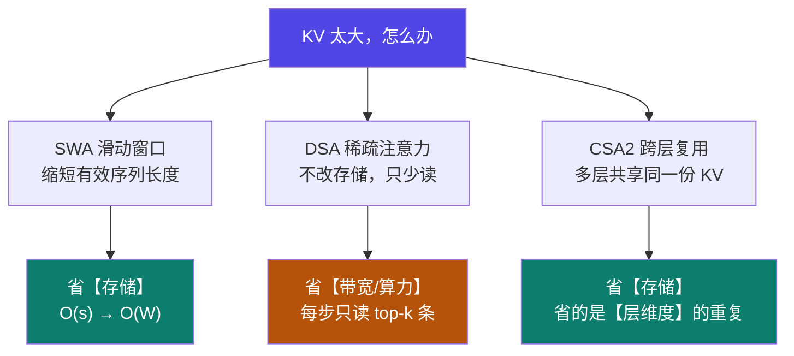

# 9-6 · KV Cache（下）：后 3 档前沿结构与真实代价

::: info 难度分层 · 本页 = L3→L4（可算 → 选型判断层）
L3 能算出 SWA / DSA / CSA2 各自的压缩量与代价；L4 能说清**"省显存"与"省带宽"是两件事**。★★★
:::

## 定位

[9-5](/training/p9/05-kv-classic) 讲了前 4 档（MHA / GQA / MQA / MLA），它们的共同点是——
**都是"每个 token 存多少"的问题**。
本页讲后 3 档（SWA / DSA / CSA2），它们的压缩发生在**另外的维度上**，而且**省的东西根本不一样**。

> 这是本部分**最有选型价值**的一页：把三种"省法"混为一谈，是显存容量规划最常见的误判来源。

## (1) 三种"省法"的机制差异



| 档位 | 压缩的维度 | **省存储？** | **省带宽？** | 一句话 |
|---|---|---|---|---|
| **SWA** | 序列长度 | ✅ | ✅ | 只留最近 `W` 个 token 的 KV |
| **DSA** | 被读取的条目数 | ❌ **不变** | ✅ | KV 还在显存里，但每步只读 top-k |
| **CSA2** | **层** | ✅ | ✅ | 多层共用一份 global KV |

::: danger ⚠ 最容易被误判的一条：DSA 不省显存
DSA（DeepSeek Sparse Attention）把核心注意力从 `O(L²)` 降到约 `O(Lk)`——
**但降的是"每次要读多少条缓存"，不是"要存多少条"**。缓存本身照旧存在显存里。

**所以**：
- 你的痛点是"**显存不够**" → 上 DSA **没用**，要上 SWA / CSA2 / GQA / KV 量化
- 你的痛点是"**长上下文太慢、带宽打满**" → DSA 正对口

把 DSA 当"省显存方案"去做容量规划，会算出"够"、然后照样 OOM。
:::

## (2) SWA：把 KV 从 O(s) 压到 O(W)

**机制**：每一层只保留最近 `W` 个 token 的 KV，更早的直接丢。

```
有效序列长度 = min(s, W)
```

计算器里对应两个地方：`注意力机制结构` 下拉里的 `滑动窗口注意力 (SWA)` 档，与独立的
`滑动窗口大小` 字段（说明原文："注意力机制的上下文窗口 Token 限制"，默认 **4096**）。

**用计算器默认态验证**：`s = 4096`、`W = 4096` → `min(4096, 4096) = 4096` → **100.0%**。
这与计算器模型规格卡上显示的 `滑动窗口: (4096, 100.0%)` **完全一致** ✅

| 场景 | `s` | `W` | 有效长度 | 相对无损 |
|---|---|---|---|---|
| 短上下文 | 4,096 | 4,096 | 4,096 | **100%** |
| 中上下文 | 32,768 | 4,096 | 4,096 | **12.5%** |
| 长上下文 | 131,072 | 4,096 | 4,096 | **3.1%** |

**代价**：窗口外的信息**彻底丢失**。SWA 不是"压缩"，是"**放弃**"。

## (3) DSA：省的是读取，不是存储

| 项 | 内容 |
|---|---|
| 出处 | **DeepSeek-V3.2-Exp（2025-09-29 发布）** |
| 机制 | 轻量 **lightning indexer** 给每个历史 token 打相关性分数 → **top-K 选择器**只保留分数最高的若干条 |
| 默认预算 | **2,048** 个 token（`k` 远小于长上下文下的 `L`） |
| 与 MLA 的关系 | **叠在 MLA 之上，不替换**：索引器对**MLA 压缩后的潜变量条目**打分，选中的仍走 MLA 读取路径 |
| 复杂度 | 核心注意力 `O(L²)` → 约 **`O(Lk)`** |
| 对账本的影响 | **存储不变**；每步读取的缓存条目数**大幅下降** → 省带宽、省算力 |

> **为什么它对显存"看起来"也有帮助**：因为"每条 KV 被读的次数变少了"，工程上对 **KV Cache 的带宽压力**小了，
> 于是可以更激进地做 KV 分页 / 更少预留通信缓冲。但这是**间接收益**，不是"KV 变小了"。

## (4) CSA2：跨层复用，真的省存储

| 项 | 内容 |
|---|---|
| 出处 | **DeepSeek-V4.1-Flash**，用**纯 CSA2**取代 V4 的 CSA + HCA 混合架构 |
| 核心思想 | Transformer 每一层都在生成自己的 global KV——**但相邻层的信息高度重复**。CSA2 让多层**共享同一份** global KV 与 Top-K 索引 |
| 三种模式 | `Full`（生成新的 global KV + 索引）· `Reindex`（复用 KV，但重新检索出新的 Top-K）· `Reuse`（KV 与索引都复用，最轻） |
| 与 SWA 的关系 | V4 系**每一层都用 SWA** 做局部处理，CSA2 负责**全局**部分 |
| 压缩效果 | global KV 存储降到约 **1/4**；再配合 **FP4** KV 缓存与 **SWA Bounded Replay**，**持久化 KV** 降到约 **1/8** |

```
CSA2 的三模式（一组 6 层为例）：
  Full → Reuse → Reuse → Reuse → Reuse → Reuse
    ↑
  只有这一层真正生成 global KV，其余 5 层复用
```

**为什么"复用"不显著掉质量**：共享的是**内存**，不是**计算**。
每一层仍然算自己的 Query——"同一批文档，不同的问题"。

## (5) 真实代价：`s × b × C × kv_bytes` 四个乘数

回到通式 `KV = 2 × L × n_kv × d_head × s × b × C × kv_bytes`，**四个乘数每个都会线性放大**：

| 旋钮 | 从 → 到 | KV 变化 | 代价 |
|---|---|---|---|
| 序列长度 `s` | 4K → 32K | **×8** | 无（无损） |
| 批量 `b` | 1 → 8 | **×8** | 无 |
| 并发 `C` | 1 → 32 | **×32** | 无 |
| KV 精度 | FP16 → INT8 | **×0.5** | 精度损失 |
| KV 精度 | FP16 → INT4 | **×0.25** | 精度损失更大 |
| KV 精度 | FP16 → **FP8** | **×0.5** | 数值范围优于 INT8 |

::: warning ⚠ 并发是"隐形乘数"
`C = 32` 时 KV 直接 **×32**。这就是为什么"单条请求测着好好的，一上线就 OOM"——
**你在本地测的是 `C = 1`，线上是 `C = 32`。**

计算器的 `并发用户数` 字段带着「对数刻度」开关，正是因为这个量级跨度太大（1 → 8 → 32 → …）不适合线性滑杆。
:::

**KV 量化档位的对账**：

| 档位 | 字节 | 计算器是否提供 | 三篇参考是否覆盖 |
|---|---|---|---|
| FP16 / BF16 | 2 | ✅（`KV缓存量化` 默认） | ✅ |
| **FP8** | 1 | ✅ | ❌ **三篇齐缺** |
| INT8 | 1 | ✅ | ✅ |
| INT4 | 0.5 | ✅ | ✅ |
| **FP4** | 0.5 | ❌（未在档位中出现） | ❌（仅在 V4.1-Flash 论文中出现） |

## (6) 线性注意力比例：混合架构的期望值

计算器「注意力参数」组里有一项 `线性注意力比例`——说明原文：
**"混合线性注意力层数占总层数的百分比（默认：关闭）"**。

**怎么理解**：不是所有层都需要昂贵的全量注意力。业界做法是把大部分层换成**线性注意力**（复杂度从平方降到线性），只在关键层保留全量注意力。

| 项 | 说明 |
|---|---|
| 输入 | 百分比 `p`（0 = 全部全量注意力，全关闭） |
| 效果 | 全量注意力的层数从 `L` 降到 `L × (1 − p)` → KV 项按此比例缩减 |
| 典型 | 业界混合架构出现过 **3:1** 这类比例（3 层线性 + 1 层全量） |
| 课程覆盖 | ❌ **0 命中**；三篇参考也**全无** → 本页标【推断】 |

## 决策表：按痛点选结构

| 你的痛点 | 选 | 不选 | 理由 |
|---|---|---|---|
| 显存不够、长上下文 | **SWA / CSA2 / GQA** | ❌ DSA | 只有前三个真的减存储 |
| 长上下文太慢、带宽打满 | **DSA** | — | 省读取条目数，正好对口 |
| 显存不够但能换模型 | **MLA + GQA** | — | 算法级压缩 |
| 显存不够但不能换模型 | **KV 量化（FP8/INT8 先试）** | — | 唯一推理期可动的旋钮 |
| 并发上量就爆 | **先降 `C` 或做 KV 分页** | — | 并发是 ×C 的乘数 |
| 只需近邻信息 | **SWA** | — | 最直接，但有信息损失 |

## 坑与自检

> ✕ 以为 DSA 能省显存。

> ✓ DSA **存储不变**，省的是每步读取的条目数与算力。容量规划别指望它。

> ✕ 把 CSA2 和 SWA 当成一回事。

> ✓ SWA 压**序列长度**；CSA2 压**层维度的重复**；两者在 V4 系里是**叠加使用**的。

> ✕ 忽略并发 `C`。

> ✓ KV 随 `C` 线性涨；本地 `C=1` 测通不等于线上 `C=32` 能跑。

> ✕ 以为 SWA 是"无损压缩"。

> ✓ SWA 是**丢弃**窗口外的 KV，信息真丢了。

**自检清单**：

- [ ] 我能说清 SWA / DSA / CSA2 分别省的是**存储**还是**带宽**
- [ ] 我知道 `s=32768, W=4096` 时有效长度只剩 **12.5%**
- [ ] 我知道 DSA 默认 top-K = **2,048**，且它**叠在 MLA 之上**
- [ ] 我知道 CSA2 把 global KV 压到约 **1/4**、持久化 KV 压到约 **1/8**
- [ ] 我知道 KV 随 `s × b × C` **三者同时线性**，并发是隐形乘数

---

> 上一节：[9-5 KV Cache（上）：公式与前 4 档注意力结构](/training/p9/05-kv-classic) ｜ 下一节：[9-7 激活值：训练显存的最大变量](/training/p9/07-activation)
