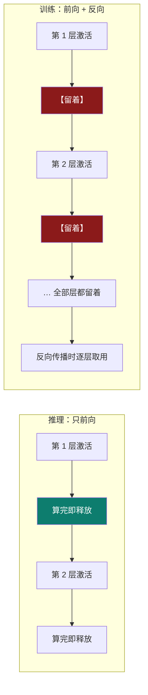
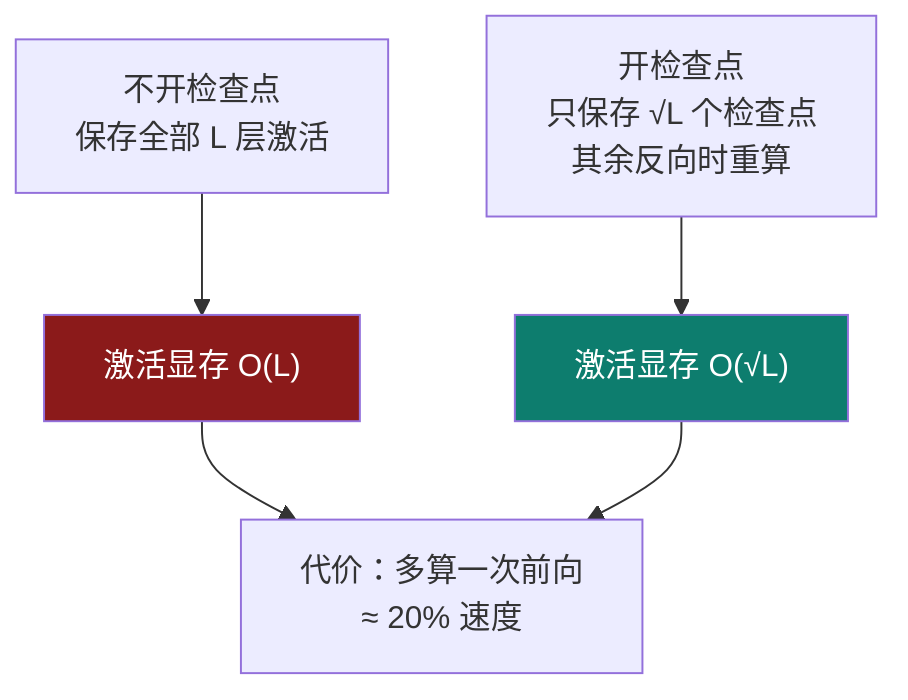

# 9-7 · 激活值：训练显存的最大变量

::: info 难度分层 · 本页 = L3（可算层）
L3 能说清"为什么训练的激活值比推理大得多"，并会用**双档经验系数**估算、用**梯度检查点**压缩它。★★★
:::

## 定位

激活值是账本里**唯一随 `batch × 序列长度` 双线性增长**的一项（推理账本第 ③ 项 / 训练账本第 ④ 项）。
权重与优化器状态在你按下"开始"那一刻就固定了，**激活值是"跑起来之后才决定你会不会 OOM"的那一项**。

## (1) 为什么推理"小"、训练"大"



**关键差别**：反向传播算梯度时需要用到**前向每层的中间结果**，所以不能像推理那样"用完就扔"。
【业界口径】CSDN-weixin 把这部分叫"**计算图内部变量（Forward Activations）**"，并指出：

> pytorch/tensorflow 等框架采用图结构来计算，图节点在 forward 和 backward 的时候需要存储，所以也需要占用显存……这一部分跟模型具体的实现有关系，而且**正比于 batch_size**。batch_size 越大，这一部分占用的越多。同样的结论也适用于 sequence length。

## (2) 公式与经验系数

```
激活值 ∝ b × s × h × L × param_bytes
```

【业界口径】阿里云 PAI 给的变量定义：

> `b`（batch size）：单次请求批量大小，在作为在线服务时通常为 1，作为批处理接口时不为 1。
> `s`（sequence length）：整个序列长度，包括输入输出（token 数量）。
> `h`（hidden size）：模型隐藏层维度。`L`（Layers）：模型 Transformer 层数。

**但精确公式依赖具体实现，所以业界用经验系数**。这里必须给出**双档**——因为两篇参考互相冲突：

| 档位 | 系数 | 出处与适用条件 | 7B 上的数值 |
|---|---|---|---|
| **低档** | **≈10%** | 阿里云 PAI：**推理与微调都用此档**，条件是 `b=1, s=2048, param_bytes=2` | 约 **1.4 GB** |
| **高档** | **20–30%** | CSDN-leo0308：训练时"需预留 20%-30% 显存给激活值（取决于 Context Length）" | 约 **2.8 ~ 4.2 GB** |

::: danger ⚠ 这不是"谁错了"，是两条口径
阿里云原文（2.2 与 3.4 两处都写）：

> 结合以上因素和实践经验，为简化显存估算，且留有一定余量，以一个 7B 模型为例，当 b 为 1，s 为 2048，param_bytes 为 2 字节时，激活值所占显存可以大致按照 **10%** 的模型所占显存进行估算。

CSDN-leo0308 原文：

> **动态部分**：需预留 **20%-30%** 显存给激活值（取决于 Context Length）。

**差异原因**：阿里云的 10% 是**在 `s = 2048` 的固定条件下**给的；CSDN 的 20–30% 是**面向长上下文的预留**。
`s` 一涨，激活值就跟着涨——**所以本部分给双档，并强制标注适用条件**：

| 你的条件 | 用哪档 |
|---|---|
| `s ≤ 2048`、`b = 1` | **10%** |
| `s ≥ 8192` 或 `b > 1` | **20–30%**（按 `s` 上浮） |
| 做容量规划、要保险 | 直接取 **30%** |
:::

## (3) 梯度检查点：训练显存的头号旋钮

【业界口径】CSDN-leo0308：

> **一定要开 Gradient Checkpointing**：训练时显存不够，第一时间开这个。它能用"**时间换空间**"，显存占用通常能**直接减半**（牺牲 **20%** 训练速度）。

**它为什么有效**（机制）：



| 项 | 不开 | 开 |
|---|---|---|
| 激活显存 | `O(L)` | **`O(√L)`** |
| 训练速度 | 基线 | **约 −20%** |
| 计算量 | 1 次前向 + 1 次反向 | 约 **1.33 次前向** + 1 次反向 |

**以 `L = 32` 为例**：`√32 ≈ 5.66` → 激活的**层数因子**从 32 降到约 5.66，**约 1/5.7**。
（注意：这是**层维度**的压缩比，不是总激活的压缩比——CSDN 说的"减半"是叠加了其它优化后的保守估计。）

计算器里对应 `8 项优化技术` 开关中的 **`梯度检查点`**（原文标签即此名）。

## (4) 另外两个直接压激活的开关

计算器的 `8 项优化技术` 里，有两项专门治激活值的浪费：

| 开关 | 治什么 | 效果 |
|---|---|---|
| **序列打包**（Sequence Packing） | 把多条短样本拼进一条长序列 | 同显存吃更多数据；**消除 padding 浪费** |
| **动态填充**（Dynamic Padding） | 按**批内最长**而非**全局最长**来 padding | 填充量从"全局最长"降到"批内最长" |
| **融合内核**（Fused Kernel） | 少启动内核、少中间张量 | 直接降低**峰值**激活 |

::: tip 三者的区别一句话记住
- **序列打包**：把多条拼成一条 → 减少**样本间**的填充
- **动态填充**：按批内最长对齐 → 减少**批内**的填充
- **融合内核**：把多个算子合成一个 → 减少**算子间**的临时张量

三者都不改精度，是"免费"的显存收益——优先开。
:::

## (5) 压缩激活的优先级（从免费到有代价）

| 优先级 | 手段 | 显存收益 | 代价 |
|---|---|---|---|
| ① | **动态填充** | 消除批内 padding 浪费 | 无 |
| ② | **序列打包** | 消除样本间 padding 浪费 | 需数据侧配合 |
| ③ | **融合内核** | 降低峰值临时张量 | 需框架支持 |
| ④ | **梯度检查点** | 层因子 `L → √L` | 训练速度 **−20%** |
| ⑤ | **减小 `b`** | 线性降低 | 需配合梯度累积补回等效批大小 |
| ⑥ | **减小 `s`** | 线性降低 | 上下文能力下降 |

> **和 [9-2](/training/p9/02-ledger-overview) 的权重/优化器状态对比**：那两项的杠杆是"量化"，激活值的杠杆是"**少存**"——
> 因为激活值不能量化（精度敏感），只能少留、晚算、重算。

## 决策表：训练时激活值爆了怎么办

| 现象 | 首选 | 理由 |
|---|---|---|
| 一开训练就 OOM，跟 batch 无关 | 先看 [9-8 优化器状态](/training/p9/08-optimizer-states) | 大概率不是激活 |
| 小 batch 能跑、一上量就爆 | **梯度检查点** + **动态填充** | 激活随 `b` 线性 |
| 长序列必爆 | **梯度检查点** + **序列打包** | 激活随 `s` 线性 |
| 就差一点点 | **把 `b` 设 1 + 梯度累积 16** | 【业界口径】CSDN-leo0308："效果是一样的，但显存占用极低" |
| 想同时压权重和激活 | 上 **QLoRA**（4-bit 基座 + LoRA） | 两项一起降 |

## 坑与自检

> ✕ 把推理的激活值经验系数（10%）直接用到长上下文训练上。

> ✓ 训练 + 长上下文要用 **20–30%** 档，容量规划直接取 30%。

> ✕ 以为梯度检查点能"免费"省显存。

> ✓ 代价是训练速度 **约 −20%**。

> ✕ 以为梯度检查点会让激活降到常数。

> ✓ 是 `O(L) → O(√L)`，**仍是随层数增长的**。

> ✕ 混淆"序列打包"和"动态填充"。

> ✓ 打包治**样本间**填充；动态填充治**批内**填充。

**自检清单**：

- [ ] 我能解释"为什么训练的激活值远大于推理"
- [ ] 我知道激活值**双档系数**：10%（`s≤2048, b=1`）/ 20–30%（长上下文训练）
- [ ] 我知道梯度检查点把层因子从 `L` 压到 `√L`，代价 **−20% 速度**
- [ ] 我能区分序列打包 / 动态填充 / 融合内核各治什么
- [ ] 我知道激活值**不能量化**，只能"少存、晚算、重算"

---

> 上一节：[9-6 KV Cache（下）：后 3 档前沿结构与真实代价](/training/p9/06-kv-frontier) ｜ 下一节：[9-8 优化器状态：12 B/参数的账怎么压](/training/p9/08-optimizer-states)
