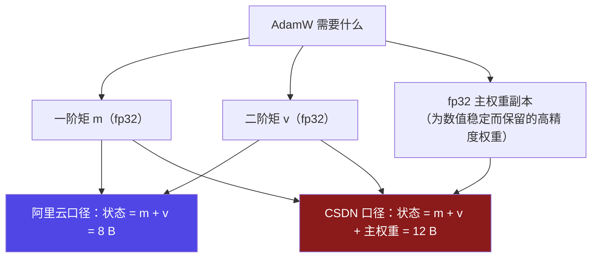

# 9-8 · 优化器状态：12 B/参数的账怎么压

::: info 难度分层 · 本页 = L3（可算层）
L3 能算清 AdamW 的优化器状态开销、能辨析 **8 B vs 12 B** 两套口径，并能说出三种压缩手段各自的收益与代价。★★★
:::

## 定位

训练账本第 ③ 项，也是**训练显存里最大的一项**：7B 全参微调时它占 **56 GB**，比权重（14 GB）大 4 倍。
本页讲三件事：**它由什么决定**、**两套口径差在哪**、**怎么压**。

## (1) 优化器状态由"优化器类型"决定

【业界口径】阿里云 PAI 的优化器表：

| 优化器 | 参数更新机制 | 额外存储（每个**待训练**参数） | 适用场景 | 7B 全参 | 7B LoRA(1%) | 7B QLoRA(1%) |
|---|---|---|---|---|---|---|
| **SGD** | 只用当前梯度 | **0**（无额外状态） | 小模型或实验 | 0 | 0 | 0 |
| **SGD + Momentum** | 带动量项 | **1 个浮点数**（动量） | 稳定性更好 | 28 GB | 0.28 GB | 0.28 GB |
| **RMSProp** | 自适应学习率 | **1 个浮点数**（二阶矩） | 非凸优化 | 28 GB | 0.28 GB | 0.28 GB |
| **Adam / AdamW** | 动量 + 自适应学习率 | **2 个浮点数**（一阶 + 二阶矩） | **大模型常用** | **56 GB** | 0.56 GB | 0.56 GB |

> 表中"浮点数"按 **4 字节（fp32）** 存储。`28 GB = 7B × 4 B`，`56 GB = 7B × 8 B`（十进制 GB）。

::: tip 三个立刻能用的结论
1. **优化器不是随便选的**——SGD 的状态开销是 0，AdamW 是 8 B/参数。7B 上差 **56 GB**。
2. **LoRA / QLoRA 的优化器开销几乎为零**（0.56 GB），因为它只为 **1% 的可训练参数**建状态。
3. 大模型默认用 AdamW（"大模型常用"），所以**算训练显存时必须按 8 B/参数预留**。
:::

## (2) ⚠ 8 B vs 12 B：两套口径必须辨析

同一句"AdamW 的优化器状态开销"，两篇参考给的是**不同的数**：

| 口径 | 构成 | 每参数 | 7B 全参 | 出处 |
|---|---|---|---|---|
| **阿里云口径** | 2 个 fp32 状态（一阶矩 + 二阶矩） | **8 B** | **56 GB** | 【业界口径】阿里云 PAI：`0.56GB = 7B × 1% × 8B` |
| **CSDN 口径** | 2 个 fp32 状态 **+ fp32 主权重备份** | **12 B** | **84 GB** | 【业界口径】CSDN-leo0308："占用：约 **12 Bytes / 参数**（包含 FP32 的主权重备份）" |

差别的来源是**"主权重备份算不算优化器状态"**：



**由此推出的"训练静态账"也分成两套**：

| 口径 | 权重 | 梯度 | 优化器状态 | 静态合计 | 7B 全参 |
|---|---|---|---|---|---|
| 阿里云 | 2 B | 2 B | **8 B** | **12 B/参数** | **87.4 GB** |
| CSDN | 2 B | 2 B | **12 B** | **16 B/参数** | **112 GB** |

::: danger ⚠ 本部分的口径裁决（D6 已裁决）
**主口径采用阿里云 12 B/参数**（官方文档、且与本课程"混合精度 + AdamW"的描述一致）。

**为什么必须显式裁决而不是"取中间值"**：87.4 GB 与 112 GB 差 **24.6 GB**——
在 80 GB 卡上，**前者能跑、后者不能跑**。这不是精度问题，是"能不能上线"的问题。

CSDN 的 16 B/参数作为**更保守口径**在需要留余量时使用。
:::

::: warning ⚠ 单位口径：GB 还是 GiB？
阿里云参考里的数字是**十进制 GB**（`7B × 2 B = 14 GB`），
而本站既有页面与 [gate_01](/training/gate/README) 用的是 **GiB**（`7B × 2 B = 13.04 GiB`）。

```
1 GB（十进）= 10⁹ B ；1 GiB = 2³⁰ B ≈ 1.074 × 10⁹ B
→ 1 GB ≈ 0.9313 GiB
```

**两者不是同一个单位，差 7%**。本部分凡引用阿里云数字都标 `GB`，凡本站计算都标 `GiB`，**不混用**。
:::

## (3) 三种压缩手段

### 3.1 8 位优化器（bitsandbytes）

【业界口径】CSDN-weixin 原文：

> 如果你采用 AdamW，每个参数需要占用 8 个字节，因为需要维护两个状态……**如果采用 bitsandbytes 优化的 AdamW，每个参数需要占用 2 个字节**，也就是全精度（float32）模型权重的一半。

| | 状态字节/参数 | 7B 全参状态显存 |
|---|---|---|
| 常规 AdamW | 8 B | 56 GB |
| **bitsandbytes 8 位 AdamW** | **2 B** | **14 GB** |

**收益**：状态开销从 8 B → 2 B，**降 75%**。7B 全参省 **42 GB**。
**代价**：优化器状态被量化，收敛性与稳定性需实测验证。

计算器里对应 `8 位优化器` 开关。

### 3.2 分页优化器（Paged Optimizer）

**解决的不是"占得多"，是"占得**碎**"**。

| 项 | 说明 |
|---|---|
| 问题 | 显存**碎片化**→ 明明总量够，却分配不出连续块 → 偶发 OOM |
| 做法 | 优化器状态像虚拟内存一样**分页**，需要时换入、不用时换出到 CPU |
| 收益 | 消除碎片导致的**偶发** OOM（不是降低总量） |
| 代价 | 换入换出带来时延抖动 |
| 计算器开关 | `分页优化器` |

> 注意区分：**8 位优化器降"总量"，分页优化器治"碎片"**。二者不互斥，常一起开。

### 3.3 纯 16 位训练（Pure 16-bit Training）

| 项 | 说明 |
|---|---|
| 做法 | **去掉 fp32 主权重备份**，并用 16 位存优化器状态 |
| 收益 | 省下主权重 **4 B/参数**；若状态也从 fp32 降到 16 位，再省 **4 B/参数** → 合计约 **8 B/参数** |
| 代价 | **数值稳定性风险**——fp16 动态范围窄，容易梯度下溢/溢出 |
| 出处 | 计算器 `8 项优化技术` 中的 `纯16位训练` 开关；三篇参考**均未讨论** |
| 定量 | 以 7B 全参为例：`7B × 8 B = 56 GB` 的节省（按 CSDN 12 B 口径计） |

> 【推断】具体省多少取决于实现（是否连状态也降位）。本部分给的是**上界估算**，实际值须实测。

## (4) 四种手段的收益/代价对照

| 手段 | 治什么 | 显存收益 | 代价 | 优先级 |
|---|---|---|---|---|
| **选 SGD** | 状态本身 | 0 → 省 100% | 收敛慢、效果可能差 | 低（大模型不推荐） |
| **LoRA / QLoRA** | **可训练参数量** | 状态降 **99%+** | 适配能力有限 | **最高** |
| **8 位优化器** | 状态位宽 | 8 B → 2 B（**−75%**） | 稳定性需实测 | 高 |
| **纯 16 位训练** | 主权重 + 状态位宽 | 约 −8 B/参数 | 数值稳定性风险 | 中 |
| **分页优化器** | **碎片**（非总量） | 治偶发 OOM | 时延抖动 | 中 |
| **ZeRO-1/2** | **跨卡切分**状态 | 见 [9-10](/training/p9/10-parallel-split) | 通信开销 | 多卡时高 |

::: tip 一句话优先级
**先降"可训练参数量"（LoRA/QLoRA）→ 再降"状态位宽"（8 位优化器）→ 最后才动"训练方式"（纯 16 位）。**
顺序反了会把风险引进来却没省多少。
:::

## 决策表

| 现象 | 首选 | 收益 |
|---|---|---|
| 全参微调起步就要 87 GB | **换 LoRA** | 状态从 56 GB → 0.56 GB |
| 必须全参、卡又不够 | **8 位优化器** | 56 GB → 14 GB |
| 训练过程中随机 OOM | **分页优化器** | 治碎片 |
| 单卡差最后 10 GB | **纯 16 位训练** | 约 −56 GB（7B），但有稳定性风险 |
| 多卡、想按卡摊 | **ZeRO-1/2** | 见 [9-10](/training/p9/10-parallel-split) |

## 坑与自检

> ✕ 把 AdamW 的优化器状态记成 8 B/参数，然后和 CSDN 的 16 B/参数总账对不上就以为谁错了。

> ✓ 两个口径的差别是**主权重备份算不算进去**；本部分主口径 **12 B/参数**（阿里云）。

> ✕ 把 GB 和 GiB 混着加。

> ✓ 阿里云数字是**十进制 GB**，本站既有页是 **GiB**，差 **7%**。

> ✕ 以为分页优化器能降低优化器状态总量。

> ✓ 它治的是**碎片**（偶发 OOM），不降总量。

> ✕ 一上手就开纯 16 位训练。

> ✓ 先降可训练参数量（LoRA），再降位宽（8 位优化器），最后才考虑纯 16 位。

**自检清单**：

- [ ] 我能背优化器状态表：SGD 0 / SGD+M 4 B / RMSProp 4 B / AdamW 8 B
- [ ] 我能算出 7B 全参 AdamW 状态 = **56 GB**（十进制）
- [ ] 我能辨析 **8 B（阿里云）vs 12 B（CSDN）** 的差别来源 = 主权重备份
- [ ] 我知道本部分主口径 **12 B/参数**，7B 全参静态账 = **87.4 GB**
- [ ] 我知道 8 位优化器把 8 B → **2 B**（−75%），而分页优化器**不降总量**

---

> 上一节：[9-7 激活值：训练显存的最大变量](/training/p9/07-activation) ｜ 下一节：[9-9 算不到的那部分](/training/p9/09-unaccounted)
