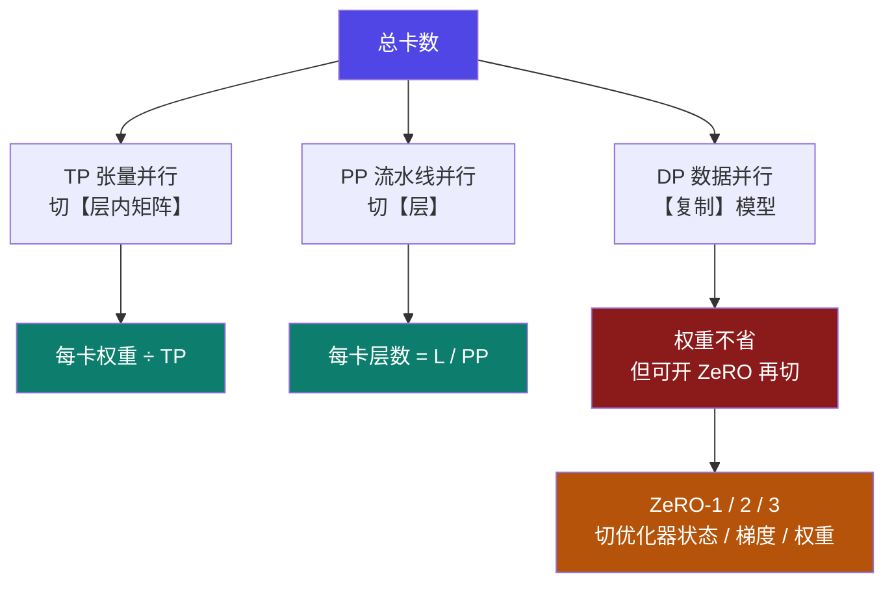

# 9-10 · 并行切分：TP × PP × DP × ZeRO

::: info 难度分层 · 本页 = L3→L4（可算 → 组合判断层）
L3 能算出每个维度把每卡显存摊到多少；L4 能说清"为什么 DP 单独用不省显存"。★★★
:::

## 定位

前三部分已经分别讲过 [4-10 DP/DDP](/training/p4/10-ddp)、[4-11 模型并行与流水线并行](/training/p4/11-model-pipeline-parallel)、
[4-12 DeepSpeed 与 ZeRO](/training/p4/12-deepspeed-zero)。
本页补的是**它们缺的那一块**：**怎么组合、组合后每卡显存是多少**——即"**3D 网格**"的统一视图。

## (1) 计算器的集群拓扑字段

| 字段 | 界面说明（原文） | 默认 |
|---|---|---|
| **物理节点数 (Nodes)** | 集群中物理服务器的数量 | 1 |
| **单节点 GPU 数** | 每个物理节点上安装的 GPU 数量 | 1 |
| **流水线并行 (PP) 维度** | 模型层顺序拆分的流水线并行阶段数 | 1 |
| **张量并行 (TP) 维度** | 单个模型层进行张量分片计算的 GPU 数量 | 1 |
| **总计 / 3D 网格** | 只读派生 | `总计: 1 GPU · 3D 网格: 1TP × 1PP × 1DP` |

```
总卡数 = 物理节点数 × 单节点 GPU 数
3D 网格 = TP × PP × DP        （DP 由工具反推：DP = 总卡数 / (TP × PP)）
```

::: tip 一个立刻能用的自检
`TP × PP` 必须整除总卡数，否则配不出合法网格。
计算器把 `总计` 与 `3D 网格` 做成只读派生，就是防止你配出矛盾的值。
:::

## (2) 四个维度各自"切"什么



| 维度 | 切什么 | 每卡**权重** | 每卡**优化器状态** | 通信特征 |
|---|---|---|---|---|
| **TP** | 层内矩阵（列/行切分） | **÷ TP** | **÷ TP** | 每层要 AllReduce，**最频繁** |
| **PP** | 按层切分 | **÷ PP** | **÷ PP** | 阶段间 P2P，较少 |
| **DP** | 不切，**复制** | **不省**（×1） | **不省**（×1） | 每步梯度 AllReduce |
| **ZeRO-1** | DP 组内切**优化器状态** | 不变 | **÷ DP** | 状态相关 AllGather / ReduceScatter |
| **ZeRO-2** | ZeRO-1 + 切**梯度** | 不变 | **÷ DP** | 再叠加梯度通信 |
| **ZeRO-3** | ZeRO-2 + 切**权重** | **÷ DP** | **÷ DP** | 前向/反向中 AllGather 权重，**最多** |

::: danger ⚠ 最容易误解的一条：DP 本身不省显存
**DP 是"复制"，不是"切分"。** 8 张卡做纯 DP，每张卡上依然是**完整的一份模型 + 完整的一份优化器状态**。

所以"单卡跑不动就上 8 张卡做 DP"——**显存一点没省**，省的是**时间**。
真想省显存，DP 必须配 **ZeRO**。

| 配置 | 每卡权重 | 每卡优化器状态 |
|---|---|---|
| 1 卡 | `Φ` | `Φ × 8 B` |
| 8 卡纯 DP | `Φ` | `Φ × 8 B`（**没省**） |
| 8 卡 DP + ZeRO-1 | `Φ` | `Φ × 8 B / 8` |
| 8 卡 DP + ZeRO-3 | `Φ / 8` | `Φ × 8 B / 8` |
:::

## (3) 每卡显存摊分公式

```
每卡权重     = Φ × 权重字节 / (TP × PP × [1 或 DP])      ← ZeRO-3 时乘 DP
每卡梯度     = 可训练参数 × 2 B / (TP × PP × [1 或 DP])   ← ZeRO-2/3 时乘 DP
每卡优化器   = 可训练参数 × opt_B / (TP × PP × DP)        ← ZeRO-1 起乘 DP
每卡激活     = 激活总量 / TP                              ← PP 下还要按微批再分
每卡 KV      = KV / TP                                    ← 与 TP 相关
```

**以 [9-8](/training/p9/08-optimizer-states) 的 7B 全参为例**（A 组：权重 14 GB、梯度 14 GB、AdamW 状态 56 GB）：

| 配置 | 权重 | 梯度 | 优化器状态 | 静态合计/卡 |
|---|---|---|---|---|
| 1 × A100-80G | 14 | 14 | 56 | **84 GB → ❌ 爆** |
| 8 卡 DP + ZeRO-1 | 14 | 14 | 7 | **35 GB → ✅** |
| 8 卡 DP + ZeRO-3 | 1.75 | 1.75 | 7 | **10.5 GB → ✅** |
| 8 卡 DP + ZeRO-2 | 14 | 1.75 | 7 | **22.75 GB → ✅** |

> **读法**：ZeRO-1 只切优化器状态，就足以把 84 GB 压到 35 GB——因为**优化器状态本来就是最大的一项**（56 GB）。
> 这与 [9-2](/training/p9/02-ledger-overview) 的结论完全一致：**训练显存的杠杆在优化器状态上**。

## (4) 组合原则：为什么现实里是"TP × PP × DP"而不是选一个

| 维度 | 优势 | 代价 | 适用位置 |
|---|---|---|---|
| **TP** | 单层就能切，延迟低 | 通信**最频繁** → 必须**高带宽**（NVLink），**限制在单机内** | 机内 |
| **PP** | 通信少 | 有**流水线气泡**，需要足够多微批 | 机间 |
| **DP** | 实现简单、扩展性好 | **不省显存**（须配 ZeRO） | 机间 |

**现实组合**（业界常见形态）：
```
机内：TP = 8（吃满 NVLink）
机间：PP × DP（走 RDMA / InfiniBand）
再叠加：ZeRO-1 或 ZeRO-2 切状态
```

这解释了为什么 [4-2 网络环境](/training/p4/02-network) 与 [4-3 RDMA](/training/p4/03-rdma) 重要——
**TP 能开多大，直接由互连带宽决定**（见 [9-11](/training/p9/11-hardware)）。

## (5) 通信量随维度增长

[4-8 Ring AllReduce](/training/p4/08-allreduce) 给出的经典结论：

| 算法 | 每卡通信量 |
|---|---|
| Naive AllReduce | `2Ψ` |
| **Ring AllReduce** | `2(N−1)/N · Ψ` → `N` 大时趋近 `2Ψ` |

| 维度 | 通信频次 | 量级 |
|---|---|---|
| TP | **每层 2 次** | 最频繁（∝ 层数） |
| PP | 每微批边界 | 与微批数相关 |
| DP | 每步 1 次（梯度） | `2(N−1)/N · Ψ` |
| ZeRO-3 | 前向 + 反向 **每层** AllGather 权重 | **最多** |

::: warning ⚠ 显存 ↔ 通信的兑换率
**切得越细 → 每卡显存越小 → 通信越多**。这是一条没有例外的兑换率：

| 想省显存 | 代价 |
|---|---|
| 开 TP | 每层两次 AllReduce，**必须高带宽** |
| 开 PP | 流水线气泡，利用率下降 |
| 开 ZeRO-1/2 | 状态通信 |
| 开 ZeRO-3 | **权重**每层 AllGather，通信量最大 |

**所以不是"ZeRO 阶段越高越好"**——[4-12](/training/p4/12-deepspeed-zero) 也强调过：更高阶段减少每卡内存但**增加通信开销**。
:::

## 决策表：怎么配这个网格

| 你的约束 | 首选配置 | 理由 |
|---|---|---|
| 单卡爆、只有一张卡 | **降方法：LoRA / QLoRA / 量化** | 上并行需要多卡 |
| 单机 8 卡、NVLink | **TP = 8 + ZeRO-1** | 吃满机内带宽 |
| 多机、RDMA 好 | **TP = 8（机内）× PP × DP + ZeRO-1/2** | 通信分层 |
| 只差优化器状态那部分 | **DP + ZeRO-1** | 切最大那一项，通信最少 |
| 连权重都放不下 | **ZeRO-3** | 但接受最大通信量 |
| 推理（不是训练） | **TP 为主**（+ PP） | 推理没有优化器状态，切权重与 KV |

## 坑与自检

> ✕ 以为"单卡跑不动 → 上 8 卡 DP 就能跑"。

> ✓ **DP 不省显存**，8 卡纯 DP 每卡还是完整一份。必须配 **ZeRO**。

> ✕ 以为开了 TP 就不用管网络。

> ✓ TP **每层两次 AllReduce**，没有 NVLink 级别的带宽会被通信彻底拖死。

> ✕ 以为 ZeRO 阶段越高越好。

> ✓ ZeRO-3 通信量最大；**ZeRO-1 往往性价比最高**（切的是最大的那一项，通信最少）。

> ✕ 配 `TP × PP` 不整除总卡数。

> ✓ 网格必须能整除，否则配不出合法拓扑。

**自检清单**：

- [ ] 我能写出 `3D 网格 = TP × PP × DP`，且 `DP = 总卡数 / (TP × PP)`
- [ ] 我能说清 **DP 是复制不是切分**（单独用不省显存）
- [ ] 我能算出 7B 全参在 `8 卡 DP + ZeRO-1` 下每卡静态合计 **35 GB**
- [ ] 我知道 **ZeRO-1 往往性价比最高**（切最大项、通信最少）
- [ ] 我知道 **TP 受互连带宽限制**，一般限制在单机内

---

> 上一节：[9-9 算不到的那部分](/training/p9/09-unaccounted) ｜ 下一节：[9-11 硬件选型：显存 / 带宽 / 算力 / 互连](/training/p9/11-hardware)
