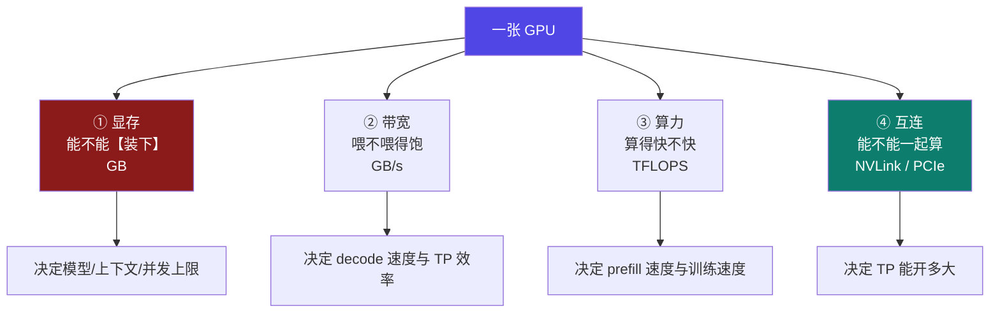

# 9-11 · 硬件选型：显存 / 带宽 / 算力 / 互连

::: info 难度分层 · 本页 = L2（结构层）
L2 能说清选卡要看**四个维度**、能读懂计算器 `设备/GPU` 那一行规格、并知道**互连决定 TP 上限**。★
:::

## 定位

[1-4 显卡选型](/training/p1/04-gpu) 讲了"要多少显存"，本页补**另一半**：
**除了显存，还要看什么**——以及计算器 `设备/GPU` 那一行规格里的三个数字分别意味着什么。

## (1) 计算器的硬件字段

| 字段 | 界面说明（原文） | 默认 / 示例 |
|---|---|---|
| **单机 Rig / 集群** | 二选一 | 单机 Rig |
| **设备 / GPU** | 选择 GPU 或自定义显存 | `RTX 5090 (32GB)` |
| 规格副信息 | — | **`1792 GB/s · 419.2 TFLOPS`** + `Hardware Guide` 链接 |
| **硬件类型** | 选择硬件类型（配置查找弹窗内） | `Nvidia` |
| 配置态 | — | `推荐` / `调优`（`针对当前配置优化模型` 按钮） |
| **保存配置** | 按钮 | — |

## (2) 选卡的四个维度

| 维度 | 单位 | 决定什么 | 不够时怎么办 |
|---|---|---|---|
| **① 显存** | GB | **装不装得下**（本部分前 10 页都在算这个） | 量化 / 换结构 / 并行 |
| **② 带宽** | GB/s | **decode 速度**、TP 效率 | 减 KV 读取量（[DSA](/training/p9/06-kv-frontier)）/ 换卡 |
| **③ 算力** | TFLOPS | **prefill 速度**、训练速度 | 换卡 / 减算 |
| **④ 互连** | GB/s | **TP 规模上限** | 降 TP、提 PP |

::: tip 为什么"带宽"单列一项
大模型推理的 **decode 阶段是"访存密集"而非"算力密集"**——每生成一个 token 都要把权重和 KV Cache
从显存搬一遍。所以 **decode 速度 ≈ 带宽 ÷ 每 token 要读的字节数**，跟 TFLOPS 关系不大。

**这就是为什么**计算器的规格副信息把 **`1792 GB/s` 放在 TFLOPS 前面**。
:::

## (3) 互连：TP 能开多大的硬约束

[4-2 网络环境](/training/p4/02-network)、[4-3 RDMA](/training/p4/03-rdma) 已讲清机内与机间的差别。落到选卡上：

| 互连类型 | 典型带宽 | 能支撑的 TP |
|---|---|---|
| **NVLink** | 数百 GB/s 级 | 机内 **TP = 8** 这类大开法 |
| **PCIe 4.0 x16** | 约 **64 GB/s** | TP 开大了会被通信拖死 |

计算器首轮截图里就有 `GPU 互连类型` 这个字段（示例值 `PCIe 4.0 x16 (64 GB/s)`，另有 NVLink 档）。

::: warning ⚠ 已覆盖现状（讲义缺口）
全站有 **4 页提"互连"**（[4-2](/training/p4/02-network)、[4-9](/training/p4/09-backends)、[4-14](/training/p4/14-optim-practice)、[A3](/training/p8/a3-cheatsheet)），
但**没有一页把"互连带宽 ↔ TP 规模上限"挂上钩**。本页补这一条对应关系。
:::

## (4) GPU 质量（性能系数）

计算器首轮截图里有一个 `GPU 质量` 滑块——**它不是选卡，而是"算力折扣系数"**。

| 项 | 说明 |
|---|---|
| 作用 | 把标称 TFLOPS/带宽打个折，反映实际可达性能 |
| 为什么要打折 | 标称值是**理论峰值**；真实 kernel 达不到（访存受限、启动开销、并行度不足） |
| 影响 | 换算出来的 `tokens/sec`、`TTFT`、`$/百万 token` 都随之变化 |
| 课程覆盖 | ❌ **0 命中** → 标【推断】 |

> **实务做法**：跟计算器对照时，如果实测吞吐只有预测值的 60~70%，优先怀疑这个系数——而不是怀疑自己的模型算错了。

## (5) 计算器给出的两组真实硬件数据

| 配置 | 显存 | 每小时成本 | 吞吐 | TTFT | 显存分配 |
|---|---|---|---|---|---|
| **1x T4 (16GB)** | 16 GB | **$0.12/hr** | `382.5–467.5 t/s`（总吞吐 `425 t/s`） | `95 ms` | `4.1 GB / 16.0 GB` |
| **RTX 5090 (32GB)** | 32 GB | `$1.10/hr` | `~349 t/s` | `~20 ms` | `5.1 GB / 32.0 GB` |

**一个反直觉的读数**：T4 的**总吞吐（425 t/s）比 5090（349 t/s）高**，但 TTFT 差 4.75 倍（95 ms vs 20 ms）。

**怎么读**：
- **总吞吐**是批量并发下的聚合值 → T4 靠大 batch 堆出来
- **TTFT** 是单请求首字延迟 → 5090 的算力优势体现在这里
- **结论**：**吞吐看成本，延迟看体验**，两者不能用一个数比较（见 [9-12](/training/p9/13-inference-tuning)）

## 决策表：按约束选卡

| 你的约束 | 优先看 | 建议 |
|---|---|---|
| 只求"跑得起来" | **显存** | 能装下最大，其余不管 |
| 在线服务、要低延迟 | **算力 + 带宽** | TFLOPS 与 GB/s 都要高 |
| 离线批处理、只求便宜 | **带宽 / 每小时成本** | 大 batch 堆吞吐，选便宜的 |
| 要开 TP = 8 | **互连** | 必须有 NVLink 级互连 |
| 多机扩展 | **机间网络** | 见 [4-3 RDMA](/training/p4/03-rdma) / [4-6 IB 与 RoCE](/training/p4/06-ib-roce) |
| 显存刚好卡线 | **回 [9-9](/training/p9/09-unaccounted) 留 15%** | 别用"刚好够"下单 |

## 坑与自检

> ✕ 选卡只看显存 GB 数。

> ✓ 还要看 **带宽**（决定 decode）、**算力**（决定 prefill/训练）、**互连**（决定 TP 上限）。

> ✕ 用"总吞吐更高"判定某张卡更好。

> ✓ T4 的总吞吐高于 5090，但 **TTFT 差 4.75 倍**——吞吐看成本，延迟看体验。

> ✕ 以为标称 TFLOPS/带宽能拿到手。

> ✓ 真实可达要打折扣（`GPU 质量` 系数），实测 60~70% 属正常。

> ✕ 在 PCIe 卡上开 TP = 8。

> ✓ PCIe 4.0 x16 约 **64 GB/s**，撑不住 TP 的每层两次 AllReduce。

**自检清单**：

- [ ] 我能说出选卡的四个维度及各自决定什么
- [ ] 我知道 **decode 是访存密集**，速度主要受带宽约束
- [ ] 我知道 **互连带宽决定 TP 规模上限**（NVLink vs PCIe 64 GB/s）
- [ ] 我知道 `GPU 质量` 是**算力折扣系数**，不是选卡项
- [ ] 我能解释为什么 T4 总吞吐高于 5090 却不是"更好的卡"

---

> 上一节：[9-10 并行切分：TP × PP × DP × ZeRO](/training/p9/10-parallel-split) ｜ 下一节：[9-11b 成本与绿色 AI](/training/p9/12-cost-green)
