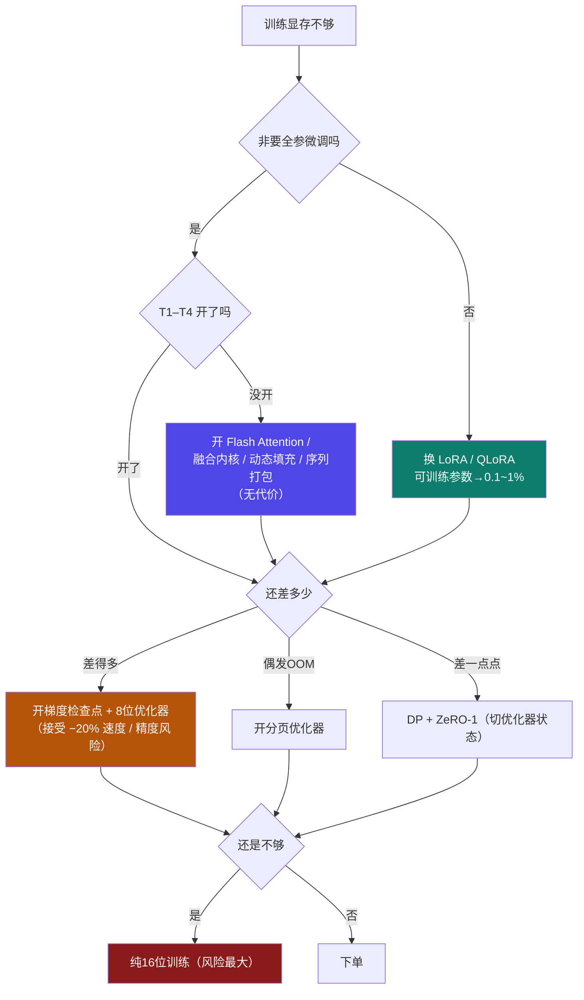

# 9-13 · 训练调参手册：8 项优化技术的优先级

::: info 难度分层 · 本页 = L3（可算层 → 决策层）★速查
L3 能在**全参 / LoRA / QLoRA** 三档下，说出该开哪几项、按什么顺序开、每项省在哪、代价是什么。★
:::

::: tip 本页用「调参手册模板」（同 [9-12](/training/p9/13-inference-tuning)）
```
目标 → 候选旋钮（按性价比排序）→ 每个旋钮的显存收益 / 时延代价 / 质量风险 → 组合建议 → 反例
```
:::

## (0) 先记住训练账本的两个"杠杆"

[9-2](/training/p9/02-ledger-overview) 已经指出：训练账本 5 项里，**② 梯度**与 **③ 优化器状态**的乘数是"**可训练参数量**"，不是总参数量。由此得到两条铁律：

| 杠杆 | 说明 | 效果 |
|---|---|---|
| **杠杆一：换方法** | 全参 → LoRA → QLoRA，**可训练参数量从 100% 掉到 0.1~1%** | 梯度与优化器状态**几乎归零** |
| **杠杆二：开技术** | 本页的 8 项开关，逐项压**激活值 / 优化器状态 / 权重** | 在选定方法内继续压 |

::: danger ⚠ 顺序不能反
**先选方法，再开技术。**

因为杠杆一的量级远大于杠杆二：7B 从全参到 QLoRA-4bit，**优化器状态从 56 GB 掉到 0.56 GB**——
任何一项开关技术都做不到这个降幅。

**所以"训练显存不够"的第一个问题永远是：非要全参微调吗？**
:::

## (1) 8 项技术按性价比排序

计算器的 `8 项优化技术` 开关全清单，本页把它们按"**省得多 ÷ 代价小**"重排：

| 序 | 技术 | 主要省哪一项 | 收益 | 代价 | 默认建议 |
|---|---|---|---|---|---|
| **T1** | **Flash Attention** | ③ 激活值 | 把注意力矩阵从 **O(s²)** 降到 **O(s)** | **无**（通常还更快） | ✅ **无脑开** |
| **T2** | **融合内核**（Fused Kernel） | ③ 激活值峰值 | 少内核启动 + 少中间张量 | **无** | ✅ **无脑开** |
| **T3** | **动态填充**（Dynamic Padding） | ③ 激活值 | 消除 padding 浪费 | 实现复杂度 | ✅ **无脑开** |
| **T4** | **序列打包**（Sequence Packing） | 不省显存 | 同等显存**吃更多数据** | 需处理样本边界 | ✅ **无脑开** |
| **T5** | **梯度检查点** | ③ 激活值 | 峰值激活 **O(L) → O(√L)** | **速度约 −20%** | ⚠ 装不下就开 |
| **T6** | **8 位优化器** | ④ 优化器状态 | **8 B → 2 B/参数（−75%）** | 收敛/稳定性风险 | ⚠ 全参必开 |
| **T7** | **分页优化器** | 治**碎片** | 消除**偶发** OOM | 换入换出时延抖动 | ⚠ 偶发 OOM 时开 |
| **T8** | **纯 16 位训练** | ④ 优化器状态 + 权重 | 省主权重 **4 B/参数**（状态再降则共 ~8 B） | **数值稳定性风险大** | ❌ **最后选择** |

::: warning 为什么 T1–T4 是"无脑开"
因为它们**不是"用代价换显存"的技术**，而是"现代框架本来就该这么做"：

- **Flash Attention / 融合内核**：省显存的同时**减少内核启动与显存搬运**，通常**更快**
- **动态填充**：padding 是纯浪费——同一批里一条 512 token 的样本被迫补到 4,096，激活按 4,096 算
- **序列打包**：把多条短样本拼成一条长样本，**同等显存下 batch 有效大小提升**

**T1–T4 不开，等于白扔显存。**
:::

## (2) 逐个技术：省在哪、代价是什么

### T1 Flash Attention

| 项 | 不分块注意力 | Flash Attention |
|---|---|---|
| 注意力矩阵存储 | **O(s²)**（s=4,096 → 16.8M/头） | **O(s)**（不物化完整矩阵） |
| 长序列时 | 激活被注意力矩阵主导 | 激活回到 O(s) 的线性项 |

**这是长序列训练显存的第一号开关**——序列越长，收益越大。
【业界口径】CSDN-leo0308 也把它列为长上下文省显存手段之一。

### T2 融合内核 / T3 动态填充

| 技术 | 机制的显存效果 |
|---|---|
| 融合内核 | 多个算子合成一个内核 → **不落地中间张量** → 激活峰值下降 |
| 动态填充 | 批内按**实际最长**补齐（而非固定最大长度）→ 激活按真实长度算 |

### T4 序列打包（Sequence Packing）

**注意：它不省显存，它省"浪费"。**

```
不打包：batch = [512, 4096, 512] → 全部补到 4096 → 有效利用率 = (512+4096+512)/(3×4096) = 41.7%
打包后：三条拼成一条 5,120 token 的样本 → 利用率 ≈ 100%
```

**同样的显存，能吃下 2.4 倍的数据**——这是"等效显存"的提升，账本上不体现，但训练效率上体现。

### T5 梯度检查点（Gradient Checkpointing）

| 项 | 不开 | 开 |
|---|---|---|
| 峰值激活 | **O(L)**（每层中间结果都留到反向） | **O(√L)**（只留 √L 个检查点，其余重算） |
| 速度 | 基准 | **约 −20%**（【业界口径】CSDN-leo0308） |

**推导**（[9-7](/training/p9/07-activation) 已展开）：把 L 层分成 √L 段，每段存 1 个检查点，
反向时重算段内中间结果。存储从 `L` 个中间结果降到 `√L` 个 + 段内临时量。

```
L = 32  →  √L ≈ 5.66  →  检查点数量约为原来的 1/5.66 ≈ 17.7%
```

**代价的本质**：用**一次额外前向**换掉大部分激活存储。所以是"时间换空间"的教科书案例。

### T6 8 位优化器

| | 状态字节/参数 | 7B 全参状态显存 |
|---|---|---|
| 常规 AdamW | 8 B | **56 GB** |
| **8 位优化器** | 2 B | **14 GB**（**省 42 GB**） |

**这是全参微调唯一的救命稻草**——7B 全参 87.4 GB 里，优化器状态占 56 GB（64%）。
砍掉它，就能落进 80 GB 卡。

### T7 分页优化器

**它治的是"碎片"，不是"总量"。** 见 [9-8](/training/p9/08-optimizer-states) §3.2：

| 症状 | 该不该开 |
|---|---|
| 显存算出来够，但**时好时坏**地 OOM | ✅ 开（典型碎片症状） |
| 显存算出来就**稳定不够** | ❌ 开它没用（不降总量） |

> 注意：**T6 降总量、T7 治碎片**，二者不互斥，常一起开。

### T8 纯 16 位训练

| 项 | 说明 |
|---|---|
| 做法 | 去掉 **fp32 主权重备份**，并用 16 位存优化器状态 |
| 收益 | 省主权重 **4 B/参数**；状态也从 fp32 降到 16 位则再省 **4 B/参数** → 合计约 **8 B/参数** |
| 7B 全参 | 按 CSDN 12 B 口径，可省 `7B × 8 B = 56 GB` |
| 代价 | **fp16 动态范围窄 → 梯度下溢/溢出风险**，收敛可能失败 |
| 该不该开 | **只有前 7 项都开完还不够时才考虑**，且必须严密监控 loss |

## (3) 三档方法 × 推荐组合

以**阿里云 7B 微调四档账本**（[9-2](/training/p9/02-ledger-overview)）为基准，叠加技术后的结果：

| 方法 | 基准账本 | 必开技术（T1–T4） | 建议再开 | 叠加后量级 |
|---|---|---|---|---|
| **全参微调** | **87.4 GB** | T1 T2 T3 T4 | **T5 + T6**（激活 ↓、优化器 56→14 GB） | **≈ 44 GB**（接近减半） |
| **LoRA** | **18.1 GB** | T1 T2 T3 T4 | 一般不需要；装不下再加 **T5** | **≈ 18 GB**（激活已不是瓶颈） |
| **QLoRA（8-bit）** | **11.1 GB** | T1 T2 T3 T4 | 一般不需要 | **≈ 11 GB** |
| **QLoRA（4-bit）** | **7.6 GB** | T1 T2 T3 T4 | 不需要 | **≈ 7.6 GB** |

全参叠加账（7B）：

```
权重 14 + 梯度 14 + 优化器(8位) 14 + 激活(检查点后) ~0.5 + 其他 2  ≈ 44.5 GB
                                                        ↑ 从 87.4 GB 降 49%
```

::: tip 再叠加 ZeRO 会怎样（呼 [9-10](/training/p9/10-parallel-split)）
44.5 GB 在 80 GB 卡上已经能跑。若还要更省，用 **DP + ZeRO-1**（只切最大项）：

| 配置 | 权重 | 梯度 | 优化器 | 静态合计/卡 |
|---|---|---|---|---|
| 1 卡 + T1–T6 | 14 | 14 | 14 | **≈ 44 GB** |
| **8 卡 DP + ZeRO-1 + T1–T6** | 14 | 14 | **1.75** | **≈ 32 GB** |
| 8 卡 DP + ZeRO-3 + T1–T6 | 1.75 | 1.75 | 1.75 | **≈ 7.75 GB** |

**注意顺序**：先开技术（T1–T6），再上并行。**先上并行再开技术，等于用通信换本该免费省下的显存。**
:::

## (4) 决策流：四步走



## (5) 反例（四个最常见的错误配方）

> ✕ **在 LoRA 上纠结要不要开 8 位优化器。**
> ✓ LoRA 的优化器状态只有 **0.56 GB**（1% × 7B × 8 B），开 8 位只省 0.42 GB——**不值得引入精度风险**。

> ✕ **全参微调不开梯度检查点，却先上 8 卡 ZeRO。**
> ✓ 梯度检查点是**零成本**（除速度）的激活压缩，应该**先开它**，再考虑用通信换显存。

> ✕ **把序列打包当"省显存"技术。**
> ✓ 它提升的是**数据吞吐/有效利用率**，账本上的显存**不变**。

> ✕ **分页优化器用来解决"显存稳定不够"。**
> ✓ 它只治**碎片导致的偶发 OOM**；稳定不够要靠 T5/T6/ZeRO。

## 坑与自检

- [ ] 我能说出训练账本的两个杠杆，且知道**杠杆一（换方法）量级远大于杠杆二（开技术）**
- [ ] 我能背出 **T1–T4 是无代价的（无脑开）**：Flash Attention / 融合内核 / 动态填充 / 序列打包
- [ ] 我知道 **梯度检查点把激活从 O(L) 压到 O(√L)**，代价是速度约 −20%
- [ ] 我知道 **8 位优化器把状态从 8 B 压到 2 B/参数（−75%）**，7B 全参省 42 GB
- [ ] 我能区分 **T6 降总量 vs T7 治碎片**
- [ ] 我知道 **纯 16 位训练代价最大，是最后手段**
- [ ] 我能说出 7B 全参叠加 T1–T6 后约 **44.5 GB**（从 87.4 GB 降 49%）

---

> 上一节：[9-12 推理调参手册](/training/p9/13-inference-tuning) ｜ 下一节：[9-14 端到端实战](/training/p9/15-end-to-end)
